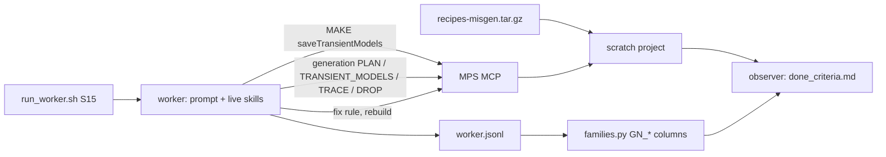

# Requirements

### Overview & Goals

The MPS-40316 work (`plugins/mcp-tools/docs/generation-debugging-plan.md`: `mps_mcp_alter_nodes MAKE saveTransientModels`, the new `mps_mcp_generation` tool with `PLAN` / `TRANSIENT_MODELS` / `TRACE` / `DROP_TRANSIENT_MODELS`, transient-aware read/write tools, and the skill recipe `mps-aspect-generator/references/debugging-misgeneration.md`, including the uncommitted compiled-vs-interpreted granularity note) has integration tests and ad-hoc live checks, but **no study cell** in `plugins/mcp-tools/study/scenarios/`. `scenarios.md` lists `mps-aspect-generation-plan` under *No scenario*, and no cell forces `mps_mcp_generation` or the `saveTransientModels` flag. The goal is a new, repeatable eval cell **S15 — debug a misgeneration with the generation trace**, so that every later change to these tools or skills can be validated live against MPS MCP by the existing harness (`run_worker.sh` → worker transcript → `families.py` → observer `done_criteria.md`).

S13 and S14 are reserved (dataflow debugging, another agent). This plan creates **S15 only**.

### Scope

**In scope**
- `study/scenarios/S15/worker_prompt.md` (frozen after one rehearsal), `done_criteria.md`, `DEFECT.md` (+ `DEFECT.log` of the exact injection calls, S5 style).
- New fixture `recipes-misgen` (a `recipes-full` project with a deterministic generator plus one injected generator defect), documented in `study/fixtures/README.md`; tarball built live and stored under `~/MPSProjects/mcp-study/fixtures*/` (not in git).
- Generation-specific process-signal columns in `study/scripts/families.py` with unit tests in `study/scripts/tests/test_families.py`.
- Catalog registration: `study/scenarios.md` (brief list, *By scenario*, *By skill*, *No scenario*), `run_worker.sh` usage comment, `.agents/skills/skill-optimization-study/references/scenarios.md` and its identical `.claude/skills/...` copy.
- One rehearsal run per selected model, evaluation against the criteria, prompt freeze.

**Out of scope**
- Changes to the `mps_mcp_*` tools or to the `mps-*` skill blueprints (the cell measures them; defects found go to `study/docs-defects.md`).
- Compiled-generator (`generateTemplates=true`) tracing: covered by `JetBrainsMPSGenerationTraceIntegrationTest`; the fixture generator stays interpreted.
- A FORK / explicit `@genplan` plan in the cell (only `gpfork@genplan` exists in the checkout and it is applied programmatically); the plan read in S15 is the samples model's DEFAULT plan and the structure model's devkit plan with a `DescriptorClasses` checkpoint. Fork coverage stays with `JetBrainsMPSGenerationTransientModelsIntegrationTest`.
- `test_scenarios/` verification documents and the full-suite part (dropped per your answer).

### User Stories
- As the mcp-tools maintainer, I want a frozen cell that a worker cannot pass without `MAKE saveTransientModels:true`, `TRANSIENT_MODELS`, reading a transient model and `TRACE BACKWARD`, so a regression in those tools or in `debugging-misgeneration.md` shows up as a FAIL or as a bad process signal.
- As the study observer, I want read-only done criteria with pinned expected values (plan step, transient model name, rule name, Java values) so evaluation is mechanical.
- As the analyst, I want `families.py` columns that tell "traced before editing" from "read the generator instead of tracing", like `T_type_queries` / `T_rule_prints` do for S11/S12.

### Functional Requirements
1. The S15 prompt is developer-voice, numbered, with an explicit "Done when", the standard closing lines, and **no reporting requirements beyond `EVIDENCE.md`** (same pattern as S12).
2. The task cannot be completed honestly without: one make of `mcp.study.kitchen.samples` keeping transient models; listing them; reading the step model where the wrong node first appears; a backward trace naming the rule (`role: RULE`) and its `templateRoot`; a generator fix; a language rebuild and a re-make; freeing the transient models.
3. `done_criteria.md` is observer-checkable with read-only `mps_mcp_*` calls plus `grep` on `source_gen`; it pins the fixture values (recipe names, `servings`, step counts, the rule name, plan step index/prefix, transient model stereotype) and says which equivalent modelling passes.
4. The injected defect compiles and yields visibly wrong Java for at least one recipe while another recipe stays right by coincidence (so the symptom is recipe-dependent and not guessable from the template name alone).
5. `families.py` gains the columns listed in Technical Design; the TSV header grows accordingly; every column is defined in the module docstring; `python3 -m unittest` in `study/scripts/tests` passes.
6. `scenarios.md` lets "run evals for my change to `mps-aspect-generator` debugging / `mps_mcp_generation` / MAKE `saveTransientModels`" resolve to S15 via the *By skill* table.

### Non-Functional Requirements
- Fixture excludes the doc surface (`.agents`, `.claude`, `AGENTS.md`, `CLAUDE.md`, `.git`, `*/.mps/workspace.xml`) and includes `classes_gen` + `source_gen` so no rebuild is needed before the worker starts.
- Isolation: S15 shares the `mcp.study.recipes` module id with S3–S7/S9 → MPS restart before it when one of those ran in the same process (D80 hazard); the worker's language rebuild means a restart after it too.
- Transient models cost memory; the prompt asks to free them, and the criteria check it, so a left-behind MPS is not bloated for the next cell.

# Scenario Content

### Fixture `recipes-misgen`

Base: `recipes-full.tar.gz` (passing S1 project, 3 Ingredients / 3 Recipes / 1 Cookbook, language `mcp.study.recipes`, solution `mcp.study.kitchen`, model `mcp.study.kitchen.samples`). Built by the observer through MPS MCP in a scratch copy (`~/MPSProjects/mcp-study/proj/fixture-recipes-misgen/`), never by editing `.mps` as text:

1. **Deterministic generator** (the S6 task, authored by the observer so the shape is known, not taken from a worker run): generator module for `mcp.study.recipes` (default `generateTemplates=false` → interpreted; verify `generator/source_gen/.../Generator.java extends TemplateModuleInterpreted2`), one `MappingConfiguration` `main` with a `Root_MappingRule` **`RecipeToClass`** (Recipe → `ClassConcept` in package `mcp.study.generated`, `$` property macro on the class name), a `public static final int PORTIONS = 0` with a property macro `node.servings`, and `public static String[] steps()` returning `new String[]{ "<step>" }` with a `$LOOP$` over `node.steps` and a property macro `node.text`. Make language + solution; verify one Java file per recipe with the right values.
2. **Injected defect D1** (`DEFECT.md`, with the exact `mps_mcp_update_node` / `mps_mcp_parse_java_and_insert` calls in `DEFECT.log`): the `PORTIONS` property macro query becomes `node.steps.size`. Compiles; wrong for every recipe whose step count ≠ `servings`. Pick (or adjust one sample so) at least one recipe is wrong and one is right by coincidence; record the per-recipe `servings` / step counts in `DEFECT.md`.
3. Optional D2, decided only at the rehearsal if D1 is fixed without any trace: `$LOOP$` iterates `node.steps.skip(1)` (first step missing) — attributable to a `LOOP` trace entry.
4. Make the language and the samples once more so `source_gen` shows the wrong Java and `classes_gen` is current; drop transient models; close the project; tar with the standard excludes.
5. **Pin values** live for `done_criteria.md`: `PLAN` of `mcp.study.kitchen.samples` (expected DEFAULT, the step index and `transientStereotypePrefix` of the step holding `mcp.study.recipes.generator.template.main.*`, coverage `IN_PLAN`), `TRANSIENT_MODELS` after a `saveTransientModels:true` make (the `<prefix><minor>` model where the classes first appear, the highest-minor main-branch model = final output), `TRACE BACKWARD` from the `PORTIONS` initializer in the final model (expected one change with `RecipeToClass` as `RULE`, a `TEMPLATE` entry = the template `ClassConcept`, `templateRoot` = `main`), node ids of the three Recipe roots, the fixture's `check_root_node_problems` verdict on the samples and generator models.

### `worker_prompt.md` (draft; frozen after the rehearsal, sha recorded in run meta)

```
You are working in the current folder, which contains a JetBrains MPS project with the language
`mcp.study.recipes` (concepts Recipe, Step, Ingredient, Cookbook) whose generator emits one Java
class per Recipe into package `mcp.study.generated`, and the solution `mcp.study.kitchen` with the
model `mcp.study.kitchen.samples` holding three recipes. MPS is running with the MCP server enabled
and this project open. Follow CLAUDE.md and the MPS skills.

Task: the generated Java is wrong; find the generator rule that produces it from the generation
trace, and fix it.

1. Make the samples model and read the generated classes under
   `solutions/mcp.study.kitchen/source_gen/mcp/study/generated`. Each class's `PORTIONS` must equal
   the recipe's `servings`; today `<Recipe>.PORTIONS` is `<wrong>` although the recipe serves `<n>`.
2. Find out from the generation plan and the generation trace — not by reading the generator
   first — in which generation step the class is created, the transient model in which the wrong
   `PORTIONS` value first appears, and the rule and template that produced it.
3. Fix the generator so `PORTIONS` is the recipe's `servings`, rebuild the language, make the
   samples model again and confirm the Java for all three recipes.
4. Write `EVIDENCE.md` in the current folder: the plan step (index and transient-model prefix) in
   which the recipes generator runs, the transient model where the wrong node first appeared, the
   rule and template root the trace named, what you changed, and the corrected `PORTIONS` lines.
   Free the transient models when you are done.

Done when: the language builds, every generated class has the right `PORTIONS`, `EVIDENCE.md`
holds the evidence, and the samples model is unchanged.

Do not roll back changes. Do not edit .mps/.mpl files as text. Stop and explain if blocked.
```

### `done_criteria.md` (observer, read-only; the worker's build is what is measured)

1. **Generator fixed.** `mps_mcp_print_node` (deep JSON) of the `RecipeToClass` rule / template root: the `PORTIONS` property macro reads `node.servings` (equivalent: `servings` via a behavior method, or an `$IF$`-free restructuring) and `steps()` still loops over all steps. `mps_mcp_check_root_node_problems` on the generator model: 0 errors.
2. **Generated Java right.** `grep` in `solutions/mcp.study.kitchen/source_gen/mcp/study/generated/*.java`: one file per Recipe root, `PORTIONS = <pinned servings>` for each, `steps()` with the pinned step count in order.
3. **`EVIDENCE.md`** names, in any form: the plan step index and prefix (pinned, e.g. `2` / `2_`), a transient model `mcp.study.kitchen.samples@<prefix><minor>` (pinned prefix; any minor of that step), the rule `RecipeToClass` with `role: RULE` (naming only the template `ClassConcept` or a macro fails; naming a baseLanguage generator rule as the producer fails), and the fix. A "before" claim with no `TRACE` call before the first generator edit in the transcript fails this criterion (P2).
4. **Samples unchanged.** `mps_mcp_get_project_structure(startingPoint=<samples model ref>, includeRootNodes=true)` lists exactly the fixture roots (pinned ids); `check_root_node_problems` on the model as in the fixture. `.mps` files differing from the fixture: `generator/template/main@generator.mps` only (descriptors, `.mps/` project files, `source_gen*`, `classes_gen` do not count).
5. **Transients freed.** `mps_mcp_generation TRANSIENT_MODELS {}` on the left-behind MPS lists no `originals` for `mcp.study.kitchen.samples` (a `DROP_TRANSIENT_MODELS`, or a final make without the flag, both pass); `checkpoints` entries from the language rebuild (`mcp.study.recipes.structure@descriptorclasses`) are fine.

Pass = 1–5. Caveats to state: a make of the language also drops transients (`droppedPrevious: true`), so a worker that traces *after* rebuilding sees `NOT_FOUND` — that is the lifecycle rule, not a tool defect; `compactTemplates` defaults to the IDE setting and can hide the rule, so a trace that shows only `TEMPLATE` entries is a docs signal (`debugging-misgeneration.md` says to pass `compactTemplates:false`), not a FAIL if `EVIDENCE.md` still names the rule.

### Process signals (transcript + `families.py` row; reported separately from the pass)
- **P1 kept transients**: `M_makes_save_transient` ≥ 1.
- **P2 traced before editing**: `GN_trace_before_fix` ≥ 1 with at least one `direction: BACKWARD` (`GN_trace_backward`).
- **P3 trace, not template study**: `GN_template_prints_before_trace` ≤ 1 (one orientation print allowed; more means the worker read the generator to guess the producer).
- **P4 plan asked**: `GN_plan` ≥ 1.
- **P5 step models read**: `GN_transient_models` ≥ 1 and `GN_transient_reads` ≥ 1 (a `print_node` / `get_project_structure` / `query_nodes` on an `i:` reference).
- **P6 freed**: `GN_drop` ≥ 1 (or criterion 5 via a flag-less make).
- **P7 build count**: `M_makes` expected 3 (samples with flag, language rebuild, samples again); `M_reload_all` 0.

# Technical Design

### Current Implementation
- Cells live in `plugins/mcp-tools/study/scenarios/<S>/{worker_prompt.md,done_criteria.md}` plus optional injection docs (`S5/PROBLEMS.md`, `PROBLEMS.log`). `run_worker.sh` takes any scenario directory name (only its usage comment enumerates `S1..S12`), installs the live skill catalog into the run project and records `promptSha256`.
- `study/scenarios.md` is the lookup (brief list → *By scenario* → *By skill* → *No scenario*); `study/fixtures/README.md` says how each fixture is regenerated (tarballs live in `~/MPSProjects/mcp-study/fixtures*/`, e.g. `fixtures-r12/recipes-full.tar.gz`).
- `study/scripts/families.py` counts per-run process signals (`KEYS`, `fam()`), with `READ_ONLY` tools that do not reset the check-verdict state; `T_rule_prints` / `T_type_queries_before_make` / `M_makes` are the S11/S12 analogues of what S15 needs. Tests: `study/scripts/tests/test_families.py` (stream-json fixtures built with `tool()` / `result()` helpers).
- `.agents/skills/skill-optimization-study/references/scenarios.md` holds the scenario table and "Adding a scenario"; `.claude/skills/skill-optimization-study/` is a byte-identical copy.
- Tools under test (live-verified in this session): `mps_mcp_generation PLAN` on `Kaja.sandbox.sandbox` → DEFAULT, 6 TRANSFORM steps, `usedLanguages[].coverage` `IN_PLAN` / `NO_GENERATORS`; on `jetbrains.mps.lang.text.structure` → EXPLICIT / DEVKIT with a persisted `DescriptorClasses` checkpoint (`checkpointModelName` `…@descriptorclasses`). The recipes language's structure model has the same devkit plan, so a language rebuild in S15 publishes a checkpoint model.

### Key Decisions
- **One cell, S15, the smallest task that forces the changed path** ("Adding a scenario": reuse a fixture, write criteria first). The debugging loop of `debugging-misgeneration.md` is the path; PLAN is forced through the "which step" question, DROP through "free the transient models".
- **Fixture authored by the observer, not taken from a worker's S6 pass**: the only left-behind S6 project (`proj/S6-junie-lite-1`) has no generated Java, and a worker-shaped generator would make the pinned rule name and trace shape unpredictable. The authoring recipe lives in `DEFECT.md` so the fixture is rebuildable.
- **Defect in a property macro, found via the rule's `templateRoot`**: property macros are not traced (plan doc risk 4), so the trace yields rule + template fragment, and the worker must open the template — exactly what the skill recipe teaches. D2 (`$LOOP$`) is held back for the rehearsal.
- **Interpreted generator only** (S6 default). Compiled-trace coarseness stays with the integration test; the criteria note the mode so a future `generateTemplates` flip is noticed.
- **New `families.py` columns under a `GN_` prefix** (`G_` is taken by `G_errors`), parameters parsed from either the string or object form of `parameters`, as the server accepts both.

### Proposed Changes
1. **Scenario files** — `scenarios/S15/worker_prompt.md`, `done_criteria.md`, `DEFECT.md`, `DEFECT.log` with the content in the Scenario Content tab (pins filled in stage 4).
2. **`families.py`** — new counters and tests; `mps_mcp_generation` added to `READ_ONLY`; docstring rows for each column; `KEYS` extended at the end so existing TSV consumers keep their column positions.
3. **Catalog** — `scenarios.md`: brief-list row `S15`; *By scenario* block (fixture, mutates the generator only, forces list, run-to-verify list, hypotheses H2 make/reload, H5 validation, H7 skills; isolation: recipes module id + restart after its language rebuild); *By skill*: `mps-aspect-generator` Run = S6, S15 (S15 = the debugging recipe); new rows `mps_mcp_generation` / MAKE `saveTransientModels` / `debugging-misgeneration.md` Run = S15; `mps-aspect-generation-plan` moves from *No scenario* to *Also seen: S15 (reads a DEFAULT plan and a devkit checkpoint; no plan authoring)* with a note that authoring still has no cell. `fixtures/README.md`: `recipes-misgen` row. `run_worker.sh` comment `S1..S15`. Skill `references/scenarios.md` table row S15 in both catalog copies.
4. **Fixture build + pins** — live observer work in a scratch copy; outputs the tarball and the pinned values written into `done_criteria.md` / `DEFECT.md`.
5. **Rehearsal** — `run_worker.sh S15 <model> 1 <proj>`, evaluate, adjust criteria wording, freeze the prompt, add the run note to `scenarios.md` (S12 precedent) and the round's `HOTSPOT_REPORT_round*.md` if one is open.

### Data Models / Contracts

New `families.py` columns (all integers per run):

| column | counts |
|---|---|
| `M_makes_save_transient` | `alter_nodes MAKE` calls whose parameters have `saveTransientModels: true` |
| `GN_plan` / `GN_transient_models` / `GN_trace` / `GN_drop` | `mps_mcp_generation` calls by `operation` (trimmed, upper-cased) |
| `GN_trace_backward` | of `GN_trace`, `direction` BACKWARD |
| `GN_trace_before_fix` | of `GN_trace`, before the first write call (`insert_root_node_from_json` / `update_node` / `update_root_node_from_json` / `parse_java_and_insert` / `alter_nodes` other than MAKE) whose node/model reference is in a `…@generator)` model |
| `GN_transient_reads` | `print_node` / `get_project_structure` / `query_nodes` / `check_root_node_problems` whose `nodeReference` / `startingPoint` / `parameters.nodeReference` matches a transient reference (`i:<hex>(`) |
| `GN_template_prints` | `print_node` calls on a reference in a `…@generator)` model |
| `GN_template_prints_before_trace` | of them, before the first `GN_trace` |

Helper: `params(inp) -> dict` returning `inp["parameters"]` parsed from a JSON string or taken as an object, `{}` on failure. Regexes: `GENERATOR_MODEL = re.compile(r"@generator\)")`, `TRANSIENT_REF = re.compile(r"(^|/)i:[0-9a-fA-F]+\(")`.

### File Structure
```
plugins/mcp-tools/study/
  scenarios.md                              (modified: S15 rows, By skill, No scenario)
  fixtures/README.md                        (modified: recipes-misgen row)
  scenarios/S15/worker_prompt.md            (new)
  scenarios/S15/done_criteria.md            (new)
  scenarios/S15/DEFECT.md                   (new: generator recipe, D1 (D2 optional), pinned ids)
  scenarios/S15/DEFECT.log                  (new: exact injection calls)
  scripts/run_worker.sh                     (modified: usage comment)
  scripts/families.py                       (modified: columns, READ_ONLY, docstring)
  scripts/tests/test_families.py            (modified: new tests)
.agents/skills/skill-optimization-study/references/scenarios.md   (modified: S15 row)
.claude/skills/skill-optimization-study/references/scenarios.md   (modified: identical copy)
~/MPSProjects/mcp-study/fixtures-r<N>/recipes-misgen.tar.gz        (built, not in git)
```

### Architecture Diagram


### Risks
- **Worker fixes without tracing** (the generator has one rule): mitigated by the prompt's evidence requirement and P2/P3 signals; D2 (`$LOOP$`) is the escalation if the rehearsal shows it.
- **Lifecycle trap**: the language rebuild drops the transient models; a worker that rebuilds first then traces gets `NOT_FOUND`. The criteria call this out as expected behaviour; it is also a useful docs signal for `debugging-misgeneration.md`.
- **`compactTemplates` IDE default** may hide the rule; criteria accept the rule from `EVIDENCE.md` however obtained and flag the signal.
- **`originalInputNode` is not always present** (plan doc phase 4 note): criteria must not require it.
- **Pinned minors**: `TRANSIENT_MODELS` minors depend on pre/post scripts; pin the prefix, accept any minor.
- **Shared `checkpoints` module** across open projects: criterion 5 ignores `checkpoints` entries.
- **Fixture drift**: the pins are tied to this fixture tarball; `DEFECT.md` records the node ids, and the README row says to re-pin when rebuilt.

# Testing

### Validation Approach
- Harness code: `cd plugins/mcp-tools/study/scripts && python3 -m unittest discover -s tests` must pass, including the new `families.py` cases.
- Fixture: `tar -tzf recipes-misgen.tar.gz | grep -E '(^|/)(\.claude|\.agents|AGENTS\.md|CLAUDE\.md)'` prints nothing; the generator is interpreted (`Generator.java extends TemplateModuleInterpreted2`); the wrong Java is in `source_gen`.
- Live tool walk during the fixture build (observer, MPS MCP against the scratch project): MAKE with `saveTransientModels:true` → `transientModels.saved:true`, `traceAvailableFor` contains the samples model; `TRANSIENT_MODELS {model}` lists `@0` and `<prefix><minor>` models, `loaded`/`roots` present; `get_project_structure startingPoint=<i: ref>` and `print_node` on a transient root work; `TRACE BACKWARD` from the `PORTIONS` initializer names `RecipeToClass` as `RULE`; `update_node` on a transient node → `NOT_EDITABLE`; `DROP_TRANSIENT_MODELS {}` → `TRANSIENT_MODELS` empty; `mps_mcp_read_ide_log sinceMinutes minLevel=WARN` shows nothing from the tools.
- Rehearsal: one `run_worker.sh S15 <model> 1 <proj>` run; evaluate criteria 1–5 and signals P1–P7; freeze the prompt only after a pass with the intended path, or after adjusting the criteria/defect.

### Key Scenarios
- Worker follows `debugging-misgeneration.md`: make-with-flag → TRANSIENT_MODELS → print step model → TRACE BACKWARD (`compactTemplates:false`) → open `templateRoot` → fix macro → rebuild → re-make → DROP. Expected: PASS, `GN_trace_before_fix ≥ 1`, `GN_template_prints_before_trace ≤ 1`, `M_makes` 3.
- Worker rebuilds the language before tracing → `TRACE` `NOT_FOUND` with the recovery line → re-make with flag → trace. Expected: PASS; record the extra make as a docs signal.

### Edge Cases
- `families.py`: `parameters` given as a JSON object vs. a string; operation in lower case / with spaces; a MAKE rejected by the envelope still counts in `M_makes` but a `saveTransientModels:"true"` string value does not count as true unless the server accepts it (test documents the choice); `GN_trace_before_fix` window closes on the first generator-model write, not on a samples-model write; `GN_transient_reads` does not match plain `r:` references.
- Criterion 4: a worker that edits a sample recipe to "make the numbers match" fails (roots pinned by id, properties compared on the three Recipe roots).
- Criterion 5: checkpoint models from the language rebuild are not `originals`.

### Test Changes
- Add to `test_families.py`: `test_gn_generation_operations_counted`, `test_m_makes_save_transient_string_and_object_parameters`, `test_gn_trace_before_fix_window_closes_on_generator_write`, `test_gn_template_prints_before_trace`, `test_gn_transient_reads_matches_i_refs_only`, `test_generation_is_read_only_for_check_verdict`.
- No JVM test changes; `SkillCatalogReplicationTest` is unaffected (no `mps-*` skill is edited; `skill-optimization-study` is a repository-local skill whose two copies are kept identical by hand).

# Delivery Steps

###   Step 1: Write the S15 scenario files (prompt, done criteria, defect recipe)
`plugins/mcp-tools/study/scenarios/S15/` holds a complete, pin-ready cell definition.

- Create `worker_prompt.md` with the draft text from the Scenario Content tab (developer voice, 4 numbered steps, `EVIDENCE.md`, "Done when", standard closing lines; `<Recipe>/<wrong>/<n>` placeholders to be pinned in stage 4).
- Create `done_criteria.md`: header (fixture, what the cell measures, references section with pin placeholders), criteria 1–5 with the exact read-only tool per check and the equivalent-modelling and lifecycle caveats, then the Process-signals section P1–P7 citing the new `families.py` columns.
- Create `DEFECT.md`: the deterministic generator recipe (`RecipeToClass` root mapping rule, `PORTIONS` property macro, `$LOOP$` steps), defect D1 (`node.steps.size`), optional D2 (`node.steps.skip(1)`) marked "rehearsal-only", the interpreted-generator check, a table for per-recipe `servings` / step counts and node ids, and the rule "record every injection call in `DEFECT.log`".
- Create an empty-template `DEFECT.log` (filled in stage 4).

###   Step 2: Add generation process-signal columns to families.py with tests
`families.py` reports `M_makes_save_transient` and the `GN_*` columns, and the unit tests pass.

- In `plugins/mcp-tools/study/scripts/families.py`: add a `params(inp)` helper (string or object `parameters`), regexes `GENERATOR_MODEL` and `TRANSIENT_REF`, append the new keys to `KEYS`, add `mps_mcp_generation` to `READ_ONLY`, and extend `fam()` with the counters and the two ordering windows (`GN_trace_before_fix`, `GN_template_prints_before_trace`).
- Document every new column in the module docstring (semantics, the S15 signal it serves, the window rules), mirroring the `T_*` paragraphs.
- Add the six tests listed in the Testing tab to `plugins/mcp-tools/study/scripts/tests/test_families.py`, using the existing `tool()` / `result()` helpers; run `python3 -m unittest discover -s tests` from `study/scripts`.
- Update the usage comment in `run_worker.sh` to `S1..S15`.

###   Step 3: Register S15 in the study catalog and fixture docs
A reader asking "which cell verifies the generation-debugging tools or skill?" finds S15 everywhere the harness looks.

- `plugins/mcp-tools/study/scenarios.md`: add the brief-list row; the *By scenario* block for S15 (fixture `recipes-misgen`, mutates the generator only, forces list, run-to-verify list, hypotheses, isolation: recipes module id, restart after its rebuild, S13/S14 untouched); *By skill*: `mps-aspect-generator` Run `S6, S15`, new rows for `mps_mcp_generation` / MAKE `saveTransientModels` / `debugging-misgeneration.md`; move `mps-aspect-generation-plan` to *Also seen: S15* with a note that plan authoring still has no cell; note the stage-5 rehearsal result once known.
- `plugins/mcp-tools/study/fixtures/README.md`: `recipes-misgen` row (base `recipes-full`, observer-authored generator per `scenarios/S15/DEFECT.md`, injected D1, `classes_gen` + `source_gen` included, standard excludes, re-pin rule).
- `.agents/skills/skill-optimization-study/references/scenarios.md`: S15 table row and the fixture list sentence; copy the file byte-identically to `.claude/skills/skill-optimization-study/references/scenarios.md` (`diff -rq` of the two skill folders stays empty).

###   Step 4: Build the recipes-misgen fixture live and pin the expected values
`recipes-misgen.tar.gz` exists and `done_criteria.md` / `DEFECT.md` / `worker_prompt.md` carry real values.

- Announce paths, extract `fixtures-r12/recipes-full.tar.gz` to `~/MPSProjects/mcp-study/proj/fixture-recipes-misgen/`, open it via the CLI protocol, and author the generator per `DEFECT.md` with MPS MCP tools (`mps_mcp_create_module` type generator if absent, `insert_root_node_from_json` / `parse_java_and_insert` for the template, `check_root_node_problems` on the generator model); MAKE language and solution; verify the correct Java by `grep`.
- Inject D1 with `mps_mcp_update_node` on the property macro query, log the exact calls in `DEFECT.log`, re-make, verify the wrong Java and that at least one recipe is wrong and one right.
- Walk the tool path once and record pins: `PLAN` (step index, `transientStereotypePrefix`, coverage), MAKE with `saveTransientModels:true` (`transientModels` block), `TRANSIENT_MODELS` (model names, `loaded`), `TRACE BACKWARD` from the `PORTIONS` initializer (`RecipeToClass` as `RULE`, `templateRoot`), `update_node` on a transient node → `NOT_EDITABLE`, `DROP_TRANSIENT_MODELS`, `read_ide_log` WARN check; write the pins and the three Recipe root ids into `done_criteria.md`, `DEFECT.md` and the prompt placeholders.
- Drop transients, close the project with `mps_mcp_close_project`, tar with the standard excludes into the current `fixtures-r<N>/`, run the doc-surface `tar -tzf` check.

###   Step 5: Rehearse S15 once, adjust, and freeze the prompt
S15 has one evaluated run and a frozen prompt, and the catalog records it.

- Run `run_worker.sh S15 <model> 1 <proj>` on a fresh fixture copy (restart MPS first if a recipes cell ran in the process), then evaluate criteria 1–5 read-only and compute `families.py` for P1–P7.
- If the worker fixed the macro without tracing or the criteria wording misfired, adjust `done_criteria.md` (or enable D2 in the fixture and re-pin) and re-run once; otherwise freeze the prompt and note its `promptSha256` in `done_criteria.md`'s header, S12 style.
- Add the rehearsal note (model, pass/fail, turns, calls, signals) to `scenarios.md`'s S15 block and to the open `HOTSPOT_REPORT_round*.md` if a round is in progress; record any tool/docs defect found in `study/docs-defects.md`.