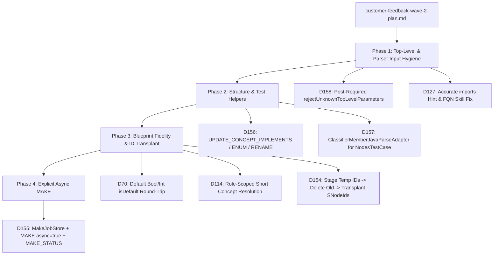

# Customer Feedback Wave 2 — Phased Execution Roadmap

**Status (2026-11-26):** Phase 1 re-evaluated against the live `plugins/mcp-tools` codebase and rewritten; **no Wave 2 code changes implemented yet**.
- Wave 1 (`93bc835ddce8`) remediated all confirmed live `mcp-tools` bugs (`CF-001`–`CF-005`, `CF-012`, `CF-013` / `D138`, `D141`, `D149`–`D153`) and documented core-MPS/MCP workarounds across all three skill trees (`CF-018`, `CF-021`–`CF-034` / `D140`, `D159`–`D163`).
- Wave 2 addresses the remaining server-side feature candidates and open server defects from [`customer-feedback-triage.md`](customer-feedback-triage.md) and [`../study/instructions/defects.md`](../study/instructions/defects.md) across **4 risk-graduated phases** executed in independent sessions.
- **Checkbox rule:** Tick a box (`[x]`) only when the item is implemented **and** verified as stated; record commit hashes in the Phase Matrix below as each phase lands.

**Out of scope for Wave 2:** Wave 1 items already fixed and archived (`D138`, `D140`, `D141`, `D149`–`D153`, `D159`–`D163`), pre-existing fixed items (`CF-035`–`CF-052`), dropped customer-domain / third-party items (`CF-053`–`CF-057`), upstream JBR / MPS Core / IDEA MCP escalations (`CF-058`–`CF-062`), and the two former Phase 1 items dropped during the 2026-11-26 relevance audit (`D80` and `D113` — see §1.2).

---

## 0. Multi-Run Execution Ground Rules

Every session executing a phase or item from this roadmap must follow [`.agents/quality-gates.md`](../../../.agents/quality-gates.md), [`.agents/conventions.md`](../../../.agents/conventions.md), [`.agents/git.md`](../../../.agents/git.md), and [`AGENTS.md`](../../../AGENTS.md):

1. **JDK 25 & Single-JVM Test Execution**:
   - Builds and tests run on **JDK 25**.
   - Never run multiple JUnit suites concurrently (they contend on MPS environments and locks). Before launching any suite, verify no test JVM is running: `ps aux | grep JUnitStarter`.
   - Never launch `*McpToolset*IntegrationTest` classes or `Mcp*TestSuite` sub-suites from the editor gutter. Always run through `execute_run_configuration(configurationName="McpToolsIntegrationTestSuite", envs={"MCP_TESTS": "..."})`.
   - When a suite exceeds ~60 s, launch with `waitForExit=false`, monitor `ps aux | grep McpToolsIntegrationTestSuite`, and inspect `fullOutputPath` for `testFailed` entries after exit.
2. **Required Suite Gates by Change Scope**:
   - **One toolset class**: run its test class (`MCP_TESTS=<TestClass>`), then its owning `Mcp*TestSuite` sub-suite.
   - **`common/`, `McpIntegrationTestBase`, or the umbrella**: run focused tests first, then run the **full unfiltered `McpToolsIntegrationTestSuite`** (no `MCP_TESTS`).
   - **Tool name, parameter, or `@McpDescription`**: run the toolset's sub-suite + `McpContractAndSkillsTestSuite` (and update any affected skill scripts/examples so `SkillScriptsDriftTest` stays green).
   - **New test classes**: register in **exactly one** `Mcp*TestSuite` sub-suite, never directly in `McpToolsIntegrationTestSuite` (`SuiteRegistrationGuardTest` enforces this).
3. **3-Tree Skill Blueprint Sync**:
   - Source of truth is `plugins/mcp-tools/resources/jetbrains/mps/agents/mcp/skills/`. Never edit `.agents/skills/` or `.claude/skills/` directly, and never run `mps_mcp_initialize_project_for_agents` in this checkout.
   - Copy every modified `<skill-name>/` directory verbatim over both `.agents/skills/<skill-name>/` and `.claude/skills/<skill-name>/`.
   - Keep `references/*.md` files within `SkillReferenceLayoutTest` size caps (12,288 B default unless allow-listed) and run:
     ```sh
     python3 plugins/mcp-tools/scripts/validate_skill_catalog.py --self-test plugins/mcp-tools/resources/jetbrains/mps/agents/mcp/skills
     ```
4. **Live MPS & IDE Log Gate**:
   - After exercising a change against a live MPS over MCP, inspect the IDE log (`mps_mcp_read_ide_log` covering the run window with `minLevel="WARN"`) to confirm no hidden `WARN`/`ERROR`/`SEVERE` stack traces were logged. If no live MPS instance is available, state explicitly what was skipped and why.
5. **Tracker Archival & Commit Hygiene**:
   - When an item's server and skill work are verified, move closed `D*` rows from `plugins/mcp-tools/study/instructions/defects.md` to `plugins/mcp-tools/study/instructions/defects-archive.md` and update `plugins/mcp-tools/docs/customer-feedback-triage.md`.
   - Commit one logical phase/item at a time using `mcp-tools - <summary>` and `Co-Authored-By: <agent>` per `.agents/git.md` (when committing is requested).

---

## 1. Phase Overview & Relevance Audit Record

### 1.1 Active Wave 2 Phase & Item Matrix

| Phase | Items | Summary | Primary Files | Required Test Gate | Effort | Status / Commit |
|---|---|---|---|---|---|---|
| **Phase 1** | `D158` (`CF-010`), `D127` (`CF-017`), *(opt.)* `CF-015` note | Universal `rejectUnknownTopLevelParameters` guard (post-missing-check) + accurate `"imports"` hint & `parameters-rules.md` FQN fix | `common/AbstractOps.kt`, `common/McpToolInputSchemas.kt`, all 17 `*McpToolset.kt`, `mps-baselanguage/.../parameters-rules.md` | `McpContractAndSkillsTestSuite` + full `McpToolsIntegrationTestSuite` (`common/` touched) | ~0.5–1 d | Pending |
| **Phase 2** | `D156` (`CF-008`), `D157` (`CF-009`) | `alter_structure` incremental ops (`UPDATE_CONCEPT_IMPLEMENTS`, `UPDATE_ENUM_MEMBER`, `RENAME_CONCEPT`) + `NodesTestCase` (`IClassifier`) in `parse_java_and_insert` | `MPSLanguageStructureMcpToolset.kt`, `MPSJavaMcpToolset.kt`, `java/ClassifierMemberJavaParseAdapter.kt` *(new)*, `common/McpToolInputSchemas.kt` | `McpLanguageToolsTestSuite`, `McpJavaToolsTestSuite`, `McpContractAndSkillsTestSuite` + full umbrella (`common/` touched) | ~2–3 d | Pending |
| **Phase 3** | `D70` (`CF-014`), `D114` (`CF-011`), `D154` (`CF-006`) | Default boolean/int `"isDefault": true` emission, role-scoped short concept disambiguation, and stage-then-transplant `SNodeId` preservation | `common/AbstractOps.kt`, `common/AbstractNodeOps.kt`, `MPSRootNodeMcpToolset.kt` | `McpNodeToolsTestSuite`, `McpContractAndSkillsTestSuite` + full `McpToolsIntegrationTestSuite` | ~4.5–6.5 d | Pending |
| **Phase 4** | `D155` (`CF-007`) | Opt-in `async: true` `MAKE` + `MAKE_STATUS` polling via project-scoped `MakeJobStore` | `common/AbstractOps.kt`, `common/MakeJobStore.kt` *(new)*, `MPSNodeMcpToolset.kt`, `common/McpToolInputSchemas.kt` | `AbstractOpsMakeTest`, `McpNodeToolsTestSuite`, `McpContractAndSkillsTestSuite` + full `McpToolsIntegrationTestSuite` | ~2–3 d | Pending |



### 1.2 Items Dropped / Deferred from Phase 1 (2026-11-26 Relevance Audit)

Before coding Phase 1, all four originally proposed Phase 1 items were audited against the live `plugins/mcp-tools`, `plugins/mps-console`, `plugins/mps-java`, `languages/baseLanguage`, and `core/` sources. Two items were removed from the implementation plan:

1. **`D80` (`CF-015`) — Runtime-vs-Declaration Feature Diff in `LanguageReadiness` & Flipping `Stale` in `get_concept_details` -> DROPPED**
   - **Already solved by `D112`:** `LanguageReadiness.kt`, `ConceptDeclarationView.kt`, `AbstractNodeOps.ConceptGate`, and `AbstractOps.ensureLanguageRuntime` (`d112-language-readiness-overview.md`) already cover all three unbuilt/stale states end-to-end:
     - `NoRuntime` and `ConceptNotInRuntime` serve synthesized declaration records via `ConceptDeclarationView` with `"source": "declaration"`, `"descriptorStatus": "hollow"`, `warnings`, and `details.languageBuild`, and gate node writers / `query_types` with `LANGUAGE_NOT_BUILT`.
     - `NotBuilt.Stale` (`ModelGenerationStatusManager.generationRequired(structureModel)`) already catches unbuilt `UPDATE_CONCEPT_*` edits (`CF-015`): writes to newly added/renamed features fail cleanly in `ConceptGate.staleFeature` (`AbstractNodeOps.kt:201-227`) with `LANGUAGE_NOT_BUILT` (`status: "stale"`), while `get_concept_details` (`MPSLanguageMcpToolset.kt:213-227`) reports `details.languageBuild` (`status: "stale"`).
   - **Why the proposed diff was harmful:**
     - `D80` (`defects.md:17, 36`) was a single pre-`D112` Round-17 cross-cell incident marked **`repro first`** and absent across Rounds 18–52 (moreover, `ModelGenerationStatusManager` compares `currentHash` against `GenerationDependenciesCache`, which already flags unbuilt copies lacking matching `generated` hashes). Running `ConceptDeclarationView` (`BHReflection` superconcept walks) on every `Ready` concept during `search_concepts` / `get_concept_details` adds unmeasured read overhead for an unconfirmed hypothesis.
     - `generationRequired(structureModel)` is **model-wide**: routing `Stale` through `addReadinessMarkers` in `get_concept_details` would stamp `"descriptorStatus": "hollow"` onto every unchanged concept in the structure model, breaking `D57` semantics.
   - **Disposition:** Leave `D80` on the recurrence watch (`repro first` in `defects.md:36`). Only the optional narrow `CF-015` UX reminder on `UPDATE_CONCEPT_*` / `RENAME_CONCEPT_*` responses is retained in §2.3 below.

2. **`D113` (`CF-016`) — Console In-Flight Execution Guard -> DROPPED / DEFERRED**
   - **Unsafe callback contract in `mps-console`:** Neither `BaseConsoleTab` nor `DialogConsoleTab` tracks in-flight execution state, and `GeneratedCommand__BehaviorDescriptor.java:43-63` (`BLCommand` / `BLExpression`) runs `ConsoleUtil.make` on a pooled thread and **returns early without invoking `beforeCallback` or `afterCallback`** whenever `ConsoleUtil.make` fails (syntax/type/compile error or cancelled make) or `ClassLoaderManager` fails to load `Main`. Setting a per-project in-flight flag in `MPSConsoleMcpToolset` that clears on callback/history completion would **permanently wedge the console in `McpErrorCode.CONFLICT`** after a single failing command, blocking the caller from calling `mps_mcp_insert_console_command_from_json` (or `mps_mcp_parse_java_and_insert` with `insert.mode = "console"`) to fix the broken command.
   - **Low ROI & headless test gap:** `D113` occurred once (`round 43: S9-opus-1:6-7`, absent in Rounds 44–52), both `defects.md:45` and `customer-feedback-triage.md:56` mark the server half optional, Wave 1 already added the sequencing rule in `mps-console/SKILL.md:49`, and `MPSConsoleMcpToolsetIntegrationTest` has no live Console tool window in the headless test fixture.
   - **Disposition:** Leave mitigated by `mps-console/SKILL.md:49`; do not add custom in-flight state in `MPSConsoleMcpToolset`.

---

## 2. Phase 1 — Top-Level Argument Hygiene & Java Parser Import Hint (`D158`, `D127`)

### 2.1 `D158` (`CF-010`) — Universal `rejectUnknownTopLevelParameters` Guard

**Problem:** `AbstractOps.rejectUnknownTopLevelParameters(tool, allowed)` (`AbstractOps.kt:447-480`) inspects `McpCallAdditionalDataElement` `rawArguments`, tolerates `TOLERATED_PARAMETER_KEYS` (`projectPath`) and `JsonNull`, and suggests near-misses via `RequiredParameterNearMisses` + `suggestParameterName`. In Wave 1 (`D138`) it was wired only into `mps_mcp_run_migrations` (`MPSMigrationMcpToolset.kt:59-62`). On the remaining `@McpTool` endpoints across the 17 toolsets registered in `plugins/mcp-tools/META-INF/plugin.xml`, `D43`'s `rejectMissingParameters` catches wrong parameter names **only** when a required parameter was left blank as a result. Whenever all required parameters are supplied and the caller passes a hallucinated **optional** parameter (`index = 0` instead of `position = 0` on `mps_mcp_update_node`, `depth = 2` or `outputFile` on `mps_mcp_print_node`, `name` instead of `configurationName` on `mps_mcp_create_run_configuration`), `CallableBridge` silently drops the unknown key and the tool succeeds with unintended default behavior.

**Ordering Invariant (Critical — Preserve `D27`/`D43`/`D56`/`D63`):**
- `rejectUnknownTopLevelParameters` **must run AFTER `rejectMissingParameters` and any upfront required-selector checks** (such as `mps_mcp_get_concept_details` checking that `conceptRefs` and `languageRefs` are not both empty, `mps_mcp_search_concepts` checking `searchTexts`, `mps_mcp_create_run_configuration` checking `nodeReference`/`modelReference`, and operation-scoped `rejectMissingParameters` in `mps_mcp_update_node`, `mps_mcp_update_module`, `mps_mcp_update_model`, `mps_mcp_create_module`).
- **Why:** When a caller sends `{"blueprint": "..."}` instead of `{"json": "..."}` to `mps_mcp_insert_console_command_from_json` (or `{"node": "..."}` to `mps_mcp_print_node`), `json`/`nodeReference` arrives blank while `rawArguments` holds `"blueprint"`/`"node"`. Existing `D43` contracts and bridge tests (`MPSConsoleMcpToolsetIntegrationTest.kt:119-150`, etc.) assert `details.missingParameters` and the copy-pasteable retry message (`"json is required. Retry with ... a value sent as 'blueprint' never reaches it."`). Running `rejectMissingParameters` **first** preserves every missing-parameter response verbatim, while running `rejectUnknownTopLevelParameters` **immediately after** required parameters are confirmed present catches every dropped optional/extra argument.

**Implementation Design:**
- Derive or cache the allowed parameter-name `Set<String>` per `@McpTool` method (e.g. a shared helper on `AbstractOps` reflecting/caching `@McpTool` `valueParameters` on `this::class`, or verified per-tool constants) so parameter additions cannot silently drift from the allow-list.
- Wire `rejectUnknownTopLevelParameters` into **every** `@McpTool` entry point across all 17 toolsets in `plugin.xml`:
  - `MPSProjectMcpToolset` (`mps_mcp_list_open_projects`, `mps_mcp_close_project`, `mps_mcp_read_ide_log`, `mps_mcp_reload_all`, `mps_mcp_get_project_structure`, `mps_mcp_get_compact_project_structure`) — note several of these do not go through `withMpsProject` or have no required parameters, so place the guard directly in the `@McpTool` method body (after any required-parameter check).
  - `MPSConsoleMcpToolset` (`mps_mcp_get_console_history`, `mps_mcp_insert_console_command_from_json`, `mps_mcp_recall_console_command`, `mps_mcp_run_console_command`, `mps_mcp_clear_console`).
  - `MPSLanguageMcpToolset` (`mps_mcp_get_concept_details` — after the empty `conceptRefs`+`languageRefs` check; `mps_mcp_search_concepts` — after the blank `searchTexts` check).
  - `MPSModuleMcpToolset`, `MPSModelMcpToolset`, `MPSRootNodeMcpToolset`, `MPSNodeMcpToolset` (for `mps_mcp_update_node`, run after `operation`/`kind` and the operation-specific `rejectMissingParameters` checks so `parentRef` on an incomplete `ADD CHILD` still triggers the `D43` missing-`nodeReference` message, while `index` on a complete `ADD CHILD` triggers `unknownParameters`), `MPSTypesMcpToolset`, `MPSDataflowMcpToolset`, `MPSIntentionsMcpToolset`, `MPSEditorMcpToolset`, `MPSLanguageStructureMcpToolset`, `MPSJavaMcpToolset`, `MPSRunConfigurationMcpToolset`, `MPSMigrationMcpToolset` (already wired), `MPSGenerationMcpToolset`, and `MPSInitMcpToolset`.
- Optionally add `"index"` -> `"position"` (or verify `suggestParameterName` / `RequiredParameterNearMisses` hints) so `mps_mcp_update_node(..., index = 0)` and `mps_mcp_create_run_configuration(..., name = "...")` surface helpful `"did you mean '...'"` suggestions when helpful, without violating `McpToolParameterOptionalityTest`'s rule that no near-miss alias of parameter P may be a real parameter of the same tool.

**Checklist:**
- [ ] Implement universal post-required `rejectUnknownTopLevelParameters` across all `@McpTool` methods in all 17 `*McpToolset` classes (`common/AbstractOps.kt` + `MPS*McpToolset.kt`), preserving `D43`/`D56`/`D63` missing-parameter precedence.
- [ ] Extend `unit/McpToolParameterOptionalityTest.kt` (`McpContractAndSkillsTestSuite`) to assert every `@McpTool` registered in `plugins/mcp-tools/META-INF/plugin.xml` has a matching parameter allow-list / guard coverage.
- [ ] Add wire-level `callThroughBridge` tests verifying:
  - Unknown optional/extra keys are rejected with `McpErrorCode.INVALID_REQUEST` and `details.unknownParameters` (covering `index` on `mps_mcp_update_node`, `depth`/`outputFile` on `mps_mcp_print_node`, and `name` on `mps_mcp_create_run_configuration`).
  - Missing required parameter + near-miss key (e.g. `blueprint` instead of `json`) still returns `details.missingParameters` and the `D43` retry sentence rather than `details.unknownParameters`.
  - `projectPath` (`TOLERATED_PARAMETER_KEYS`) and `JsonNull` values remain tolerated.

### 2.2 `D127` (`CF-017`) — Accurate `"imports"` Unknown-Key Hint in `parse_java_and_insert` & Skill Alignment

**Problem & Factual Correction:**
- In `parseJavaParseInsertRequest` (`common/McpToolInputSchemas.kt:545`), `obj.rejectUnknownParameterKeys("mps_mcp_parse_java_and_insert", JAVA_INSERT_PARAMETER_KEYS)` rejects an invented `"imports"` key with only the generic accepted-keys message (`round 45: S1-opus-1:48`).
- Meanwhile, Wave 1's `mps-baselanguage/references/parse-java-tips/parameters-rules.md:17` currently states *"Java classes resolve only through the target model's imports: add `@java_stub` or target models (`java.util@java_stub`, `jetbrains.mps.scope@java_stub`, etc.) via `mps_mcp_model_dependency` before calling `mps_mcp_parse_java_and_insert`"*. **That claim is false for fully qualified names** and contradicts `D117` (`JavaSyntaxProblems.headerHint` at `java/JavaSyntaxProblems.kt:135-138`):
  - `JavaParseResolver.addJDKDependency` automatically stages `JDK` on the module, `ClassifierResolveUtils.resolveNonSpecialSyntax` resolves **fully qualified** names (`java.util.List`, `jetbrains.mps.scope.ListScope` when visible via module/devkit dependencies) across `module.getScope().getModels()` even before the model imports `@java_stub`, and `JavaParseResolver.updateModelDependencies` then **auto-imports** the referenced models onto the target model.
  - Furthermore, `featureKind: "CLASS"` *does* accept leading `import ...;` lines (`MPSJavaMcpToolsetIntegrationTest.kt:170-203`).
  - Explicit `mps_mcp_model_dependency` `ADD` before `mps_mcp_parse_java_and_insert` is needed only when writing **unqualified** short names, when the target module does not yet depend on the owning module at all, or when targeting the MPS Console (`modelReference: "console"`).

**Implementation Design:**
- In `parseJavaParseInsertRequest` (`common/McpToolInputSchemas.kt:545` or `rejectUnknownParameterKeys`), when `"imports"` (or `"import"`) is among the rejected unknown keys on `mps_mcp_parse_java_and_insert`, append a one-line hint aligned with `JavaSyntaxProblems.headerHint`:
  > *"There is no 'imports' parameter (and only featureKind 'CLASS' accepts leading `import` statements): write external classes fully qualified (`java.util.List`) so they resolve against module dependencies and auto-import into the target model, or add model imports first with `mps_mcp_model_dependency` when using short names, adding a new module dependency, or targeting `modelReference: \"console\"`."*
- Update `plugins/mcp-tools/resources/jetbrains/mps/agents/mcp/skills/mps-baselanguage/references/parse-java-tips/parameters-rules.md:17` to state the exact same rule (FQNs resolve across imports + visible module dependencies and auto-import outside the Console; `mps_mcp_model_dependency` `ADD` first is required for unqualified names, missing module dependencies, or `"console"`), keeping the valid second sentence about inserting callee/helper methods before callers. Propagate `mps-baselanguage` to `.agents/skills/mps-baselanguage/` and `.claude/skills/mps-baselanguage/`.

**Checklist:**
- [ ] Add the `"imports"` / `"import"` unknown-key hint in `parseJavaParseInsertRequest` (`common/McpToolInputSchemas.kt`) with wording aligned to `JavaSyntaxProblems.headerHint`.
- [ ] Add unit test(s) in `unit/McpToolInputSchemasTest.kt` (`McpContractAndSkillsTestSuite`) verifying the `"imports"` rejection message on `parseJavaParseInsertRequest` while keeping `"dryRun"` and general unknown-key rejections intact.
- [ ] Fix `plugins/mcp-tools/resources/jetbrains/mps/agents/mcp/skills/mps-baselanguage/references/parse-java-tips/parameters-rules.md:17`, propagate `mps-baselanguage` across `.agents/skills/` and `.claude/skills/`, and run `validate_skill_catalog.py`.

### 2.3 Optional Narrow `CF-015` Polish — Post-Mutation `MAKE` Note on `alter_structure` Feature Edits

- [ ] *(Optional — include only if envelope-compatible with existing tests)* `MPSLanguageStructureMcpToolset` `UPDATE_CONCEPT_{PROPERTY,CHILD,REFERENCE}` and `RENAME_CONCEPT_{PROPERTY,CHILD,REFERENCE}` (`MPSLanguageStructureMcpToolset.kt:1274, 1338, 1365, 1396`) currently return bare `okJson("true")` without reminding callers that the compiled concept descriptor (`get_concept_details` runtime record and node writers) stays stale until `mps_mcp_alter_nodes` `MAKE` rebuilds the language. If desired, attach `details.languageBuild` (`status: "stale"`) or a `warnings` reminder on those responses (verifying `MPSLanguageStructureMcpToolsetIntegrationTest` first), **without** modifying `LanguageReadiness.classify` or stamping `"descriptorStatus": "hollow"` on `Stale` concepts in `get_concept_details`.

### 2.4 Phase 1 Verification, Records & Commit Gate

- [ ] Run IDEA `get_file_problems` on all modified Kotlin files.
- [ ] Run focused tests: `MCP_TESTS=McpToolParameterOptionalityTest,McpToolInputSchemasTest`, then `MCP_TESTS=McpContractAndSkillsTestSuite`.
- [ ] Run the full unfiltered `McpToolsIntegrationTestSuite` (mandatory because `common/AbstractOps.kt` and `common/McpToolInputSchemas.kt` are modified) and confirm 0 failures on JDK 25.
- [ ] Run `python3 plugins/mcp-tools/scripts/validate_skill_catalog.py --self-test plugins/mcp-tools/resources/jetbrains/mps/agents/mcp/skills`.
- [ ] Exercise unknown top-level parameter rejection and `parse_java_and_insert` `"imports"` rejection against a live MPS if running, and inspect `mps_mcp_read_ide_log(minLevel="WARN")` (or record explicitly if skipped because no MPS instance is open).
- [ ] Archive `D158` and `D127` from `study/instructions/defects.md` into `study/instructions/defects-archive.md` and update `CF-010` / `CF-017` in `docs/customer-feedback-triage.md`.
- [ ] Commit Phase 1 per `.agents/git.md` and record the commit hash in §1.1.

---

## 3. Phase 2 — Structure & Test Authoring Helpers (`D156`, `D157`)

### 3.1 `D156` (`CF-008`) — `alter_structure` Incremental Operations

**Problem:** `MPSStructureAlterOperation` (`MPSLanguageStructureMcpToolset.kt:49-58`) supports `CREATE_CONCEPTS`, `CREATE_ENUM`, `UPDATE_CONCEPT_{PROPERTY,CHILD,REFERENCE}`, and `RENAME_CONCEPT_{PROPERTY,CHILD,REFERENCE}`, but lacks incremental helpers for `ConceptDeclaration.implements`, `EnumerationDeclaration.members`, and renaming a concept declaration itself.

**Contract & Implementation:**
- Extend `MPSStructureAlterOperation` and `alterStructureParameterKeys` (`MPSLanguageStructureMcpToolset.kt`, `common/McpToolInputSchemas.kt`) with:
  1. `UPDATE_CONCEPT_IMPLEMENTS`: parameters `conceptRef`, `interfaceRef` (or `interfaceRefs`), `action` (`"ADD"` | `"REMOVE"`). Adds or removes `InterfaceConceptReference` entries on `ConceptDeclaration.implements` (and `InterfaceConceptDeclaration.extends`), resolving every target `InterfaceConceptDeclaration` **before** mutating (`D153` atomicity rule) and deduplicating on `ADD`.
  2. `UPDATE_ENUM_MEMBER`: parameters `enumerationRef`, `memberName`, `action` (`"ADD"` | `"UPDATE"` | `"REMOVE"`), optional `newName`, `presentation`, `isDefault: Boolean`. Mutates `EnumerationDeclaration.members` (`EnumerationMemberDeclaration`) in place, preserving `memberId` on `UPDATE`.
  3. `RENAME_CONCEPT`: parameters `conceptRef`, `newName`. Validates Java/MPS identifier syntax and same-model name uniqueness, updates `INamedConcept.name` on the `ConceptDeclaration` / `InterfaceConceptDeclaration` / `EnumerationDeclaration` (preserving numeric `conceptId`), calls `saveModelAndModule` (`FORCE_SAVE_WITH_RESOLVE_INFO`), and reports `makeStatus: "runtime_stale"` plus any non-auto-named aspect roots (`InferenceRule` `typeof_*`, etc.) in `details`.

**Checklist:**
- [ ] Implement `UPDATE_CONCEPT_IMPLEMENTS`, `UPDATE_ENUM_MEMBER`, and `RENAME_CONCEPT` in `MPSLanguageStructureMcpToolset.kt` + `common/McpToolInputSchemas.kt`.
- [ ] Add unit schema tests in `unit/McpToolInputSchemasTest.kt` and integration tests (including `D153` pre-mutation failure atomicity, `memberId`/`conceptId` preservation, and duplicate handling) in `integration/MPSLanguageStructureMcpToolsetIntegrationTest.kt` (`McpLanguageToolsTestSuite`).
- [ ] Update `mps-aspect-structure-concepts` (`references/structure-operation-api/tool-conventions.md`) and any `@McpDescription` / `mcp-tools-index.md` references across all 3 skill trees.

### 3.2 `D157` (`CF-009`) — `parse_java_and_insert` Support for `NodesTestCase` (`IClassifier`)

**Problem:** `MPSJavaMcpToolset.prepareJavaParseResult` (`MPSJavaMcpToolset.kt:117-169`) and `ConceptBehaviorJavaParseAdapter.kt` accept `Classifier` and `ConceptBehavior` contexts, rejecting `NodesTestCase` (`IClassifier`, whose helper methods are `DefaultClassifierMethodDeclaration` in role `methods`).

**Contract & Implementation:**
- Add `java/ClassifierMemberJavaParseAdapter.kt` alongside `ConceptBehaviorJavaParseAdapter.kt` converting parsed `InstanceMethodDeclaration` nodes into `jetbrains.mps.baseLanguage.classifiers.structure.DefaultClassifierMethodDeclaration` (copying `name`, `visibility`, `parameter`, `returnType`, `body`, `throwsItem`, `typeVariableDeclaration`, `smodelAttribute`/javadoc; rejecting `StaticMethodDeclaration`, fields, or constructors with a clear `INVALID_REQUEST` message since `NodesTestCase.methods` holds instance `DefaultClassifierMethodDeclaration`s; and rewriting resolvable `this.<helper>(...)` `InstanceMethodCallOperation`s into `DefaultClassifierMethodCallOperation`s).
- Wire `IClassifier` (`NodesTestCase`) into `MPSJavaMcpToolset.prepareJavaParseResult` (`inferredContextNodeRef` in `child` mode at lines 124–135 and `parseContext` at lines 145–169) and update the error hint in `common/McpToolInputSchemas.kt:602`.

**Checklist:**
- [ ] Implement `java/ClassifierMemberJavaParseAdapter.kt` and wire `IClassifier` / `NodesTestCase` support into `MPSJavaMcpToolset.kt` and `common/McpToolInputSchemas.kt`.
- [ ] Add integration tests in `integration/MPSJavaMcpToolsetIntegrationTest.kt` (`McpJavaToolsTestSuite`) covering `METHOD` and `CLASS_CONTENT` insertion into `NodesTestCase.methods` (including `contextNodeRef` inference in `child` mode, intra-root helper calls, and rejection of `static` methods/fields).
- [ ] Update `mps-tests/references/common-failures.md` and `mps-baselanguage` (`parameters-rules.md` / `@McpDescription`) across all 3 skill trees.

### 3.3 Phase 2 Verification, Records & Commit Gate

- [ ] Run focused suites (`McpLanguageToolsTestSuite`, `McpJavaToolsTestSuite`, `McpContractAndSkillsTestSuite`) and full unfiltered `McpToolsIntegrationTestSuite` (if `common/McpToolInputSchemas.kt` changed).
- [ ] Run `validate_skill_catalog.py` and verify 3-tree skill parity (`SkillCatalogReplicationTest`, `SkillReferenceLayoutTest`, `SkillScriptsDriftTest`).
- [ ] Perform live MPS verification + `mps_mcp_read_ide_log(minLevel="WARN")` check (or document skip if MPS is not running).
- [ ] Archive `D156` and `D157` into `study/instructions/defects-archive.md`, update `CF-008` / `CF-009` in `docs/customer-feedback-triage.md`, commit Phase 2, and record the commit hash in §1.1.

---

## 4. Phase 3 — Blueprint Round-Trip Fidelity & ID-Preserving Rewrites (`D70`, `D114`, `D154`)

### 4.1 `D70` (`CF-014`) — Default Boolean & Integer Emission in `print_node` JSON

**Problem:** In MPS, `SPrimitiveTypes.BOOLEAN.toString(false)` and `SPrimitiveTypes.INTEGER.toString(0)` return `null`, so `AbstractOps.addNodeFeatures` (`AbstractOps.kt:1898-1910`) omits unset `false`/`0` properties (`defaultEnumLiteralName` handles enums only), and `AbstractNodeOps.isUnsetDefaultProperty` (`AbstractNodeOps.kt:624-630`) checks enum defaults only. Consequently, `BooleanConstant(false)` prints `"properties": []`, and replaying a printed blueprint for a concept whose factory initializes a boolean to `true` (e.g. `PunctuationLeftStyleClassItem.flag = false`) flips the property back to `true`.

**Contract & Implementation:**
- In `AbstractOps.addNodeFeatures` (`common/AbstractOps.kt`), generalize `defaultEnumLiteralName(prop)` to `defaultPropertyDisplayValue(prop)` returning `"false"` for `SPrimitiveTypes.BOOLEAN`, `"0"` for `SPrimitiveTypes.INTEGER`, and `defaultEnumLiteralName(prop)` for `SEnumeration` when `!stored` (`!SNodeAccessUtil.hasProperty(node, prop)`), emitting `"isDefault": true`.
- In `AbstractNodeOps.isUnsetDefaultProperty` (`common/AbstractNodeOps.kt`), match `"false"` on `BOOLEAN` and `"0"` on `INTEGER` alongside enum defaults: in `createNode`, `newNode.setProperty(sProperty, null)` clears any factory-set `"true"` (preserving `PunctuationLeftStyleClassItem.flag = false` on clone/replay), while an edited `"isDefault": true, "value": "true"` has `propValue != default` and applies `"true"`.

**Checklist:**
- [ ] Implement `defaultPropertyDisplayValue` in `common/AbstractOps.kt` and boolean/integer handling in `AbstractNodeOps.isUnsetDefaultProperty` (`common/AbstractNodeOps.kt`).
- [ ] Add round-trip tests (including `BooleanConstant(false)`, `IntegerConstant(0)`, factory-initialized `true` cleared by `"isDefault": true, "value": "false"`, and edited `"isDefault": true, "value": "true"`) in `McpNodeToolsTestSuite`, and audit existing tests + `SkillBlueprintShapesTest` for snapshot assertions expecting `"properties": []` on boolean/integer nodes.
- [ ] Update `mps-dsl-memory/SKILL.md`, `mps-language-analysis/SKILL.md`, and `mps-mcp-workflow/references/analysis-tools/print-node-output.md` across all 3 skill trees.

### 4.2 `D114` (`CF-011`) — Role-Scoped Short Concept Name Disambiguation

**Problem:** `AbstractNodeOps.createNode` (`AbstractNodeOps.kt:434-481`) resolves unqualified `concept` names globally via `resolveConceptPreferringProject` and calls `model.addLanguage(language)`, silently picking an arbitrary language on short-name collisions (`"NodeParameter"` resolving to `lang.textGen` in a `dataFlow` builder, `"IsNotEmptyOperation"`, `"AssertStatement"`) and importing that wrong language.

**Contract & Implementation:**
- In `AbstractNodeOps.createNode` (`common/AbstractNodeOps.kt`) and `typeOperandNode`: detect unqualified `concept` names (`!conceptName.contains('.')` and `conceptRef.isNullOrEmpty()`).
- Restrict candidate lookup for unqualified names to concrete concepts in the target `model`'s **already-used languages and used devkits**, further filtered to subconcepts of `link.targetConcept` when `link != null` (or rootable concepts when `enclosingNode == null` on root insertion).
- **Exact 1 match:** resolve without calling `model.addLanguage` and append a `warnings` entry naming the resolved FQN.
- **0 matches or 2+ matches (including unimported-only matches):** reject with `McpInvalidRequestException` / `McpNotFoundException` listing ranked FQN candidates from `ConceptSuggestions`, **never** auto-importing an unused language from a bare name.

**Checklist:**
- [ ] Implement role- and used-language-scoped short concept disambiguation in `common/AbstractNodeOps.kt`.
- [ ] Audit existing tests and skill examples for bare concept names in models lacking the corresponding used language; add integration tests in `MPSNodeMcpToolsetIntegrationTest` / `MPSRootNodeMcpToolsetIntegrationTest` (`McpNodeToolsTestSuite`) covering unique role-narrowed hit + warning, 2+ in-scope collision rejection (`NodeParameter` when both `dataFlow` and `textGen` are used), and 0 in-scope / unimported rejection.
- [ ] Update `mps-aspect-dataflow` (`SKILL.md`, `references/json-patterns.md`) and `mps-node-editing` (`references/json-format.md`) across all 3 skill trees.

### 4.3 `D154` (`CF-006`) — Stage-Then-Transplant `SNodeId` Preservation in `update_root_node_from_json`

**Problem:** `AbstractNodeOps.updateNodeFromBlueprint` (`AbstractNodeOps.kt:1251-1375`) stages new children attached alongside `originalChildren` so `NodeFactoryManager.setupNode` sees live ancestors (`MPS-40226`), then deletes `originalChildren`. Because two attached nodes in one `SModel` cannot share an `SNodeId` simultaneously, every child gets a fresh `SNodeId`, breaking nameless intra-root references (`ApplicableNodeReference`, `StaticMethodCall`) and incoming cross-root child pointers (`has error` `TestNodeAnnotation`, behavior method callers).

**Contract & Invariants (Risk Mitigation):**
- Keep `MPS-40226` attached staging with temporary `SNodeId`s so node factories and rollback-on-throw stay intact.
- Before staging in `updateNodeFromBlueprint`, index existing descendants of `node` (excluding `node` itself) as `Map<SNodeId, SConcept>`.
- During `createNode` / `fillChildren` under `updateNodeFromBlueprint`, parse optional `"reference"` on each child blueprint: if its `SNodeId` exists in `existingDescendants` with the **exact same `SConcept`** and has not already been claimed by an earlier blueprint node, record `stagedNode -> targetSNodeId` (on duplicate claim, keep the first and emit a warning; on concept mismatch or foreign root ID, mint a fresh ID as today).
- **Detached transplant & `StaticReference` maturation:** `jetbrains.mps.smodel.SNode.setId` asserts `myModel == null`, and `StaticReference.create` to an in-memory node creates an immature direct object pointer. In the apply phase, **after** `originalChildren` are deleted from `node` (freeing those IDs in `SModel`), detach each staged top-level child subtree, call `(stagedDescendant as jetbrains.mps.smodel.SNode).setId(preservedId)` while detached, re-attach to `node` in role order, and convert/re-resolve intra-root `StaticReference`s by `(model.reference, targetNodeId)` so no immature direct `SNode` reference dangles onto a deleted original node. Report `preservedNodeIds: Int` in `details`.

**Checklist:**
- [ ] Implement stage-then-transplant descendant `SNodeId` preservation and `StaticReference` maturation in `common/AbstractNodeOps.kt` (`MPSRootNodeMcpToolset.kt` description updated).
- [ ] Add integration tests in `integration/MPSRootNodeMcpToolsetIntegrationTest.kt` (`McpNodeToolsTestSuite`) covering intra-root (`ApplicableNodeReference`, `VariableReference`, `StaticMethodCall`) and cross-root (`TestNodeAnnotation` / behavior caller) ID preservation, duplicate-ID claim warning, concept-mismatch fresh ID fallback, and clean rollback on invalid blueprint without corrupting original IDs.
- [ ] Update `mps-node-editing` (`references/json-format.md`) across all 3 skill trees to replace the Wave 1 child-ID-turnover workaround note with the `"reference"` preservation contract.

### 4.4 Phase 3 Verification, Records & Commit Gate

- [ ] Run `McpNodeToolsTestSuite`, `McpContractAndSkillsTestSuite`, and the full unfiltered `McpToolsIntegrationTestSuite` (mandatory for `common/AbstractOps.kt` and `common/AbstractNodeOps.kt`).
- [ ] Run `validate_skill_catalog.py` and verify 3-tree skill parity.
- [ ] Perform live MPS verification + `mps_mcp_read_ide_log(minLevel="WARN")` check (or document skip if MPS is not running).
- [ ] Archive `D70`, `D114`, and `D154` into `study/instructions/defects-archive.md`, update `CF-014`, `CF-011`, and `CF-006` in `docs/customer-feedback-triage.md`, commit Phase 3, and record the commit hash in §1.1.

---

## 5. Phase 4 — Explicit Async `MAKE` & Status Polling (`D155`)

### 5.1 `D155` (`CF-007`) — Opt-In `async: true` `MAKE` + `MAKE_STATUS`

**Problem:** `AbstractOps.performMake` (`AbstractOps.kt:4832-4845`) blocks on `future.get()` inside `runInterruptible`. When a large language build exceeds the MCP client transport timeout (`CancellationException`), `performMake` cancels `makeMonitor` and `future.cancel(true)` mid-build after `TextGen` already wrote `source_gen/`, leaving `classes_gen/` uncompiled and skipping subsequent modules in `modules: [...]`.

**Contract & Lifecycle Invariants:**
- Add `"async"` (`Boolean`, default `false`) to `MAKE` parameter keys (`common/McpToolInputSchemas.kt`) and add `MAKE_STATUS` (`jobId` optional `String`, `waitMs` optional `Int` bounded `0..25_000`) to `MPSNodeAlterOperation` (`MPSNodeMcpToolset.kt`).
- Introduce a project-scoped `common/MakeJobStore.kt` **disposed with IntelliJ `Project`** (so background coroutines cancel cleanly on project close and `MigrationAssistantGuard` + `sessionClosedLatch` cleanup always run in `finally`), holding at most one active async job and a bounded ring buffer of recent completed jobs:
  - Tracks lifecycle phases: `PREPARING` -> `GENERATING` -> `COMPILING` -> `RELOADING` -> `COMPLETED` / `FAILED` / `CANCELLED` (via custom `ProgressMonitorBase` / `IMakeNotificationListener` task names and message accumulator), start/end timestamps, target modules/models, and final `MakeResult`.
  - When `async = true`, `performMake` validates inputs and session availability synchronously, launches the build on `MakeJobStore`'s project coroutine scope (so MCP request return/cancellation does **not** cancel `makeMonitor`), and immediately returns `{jobId, status: "RUNNING", phase, pollWith: {tool: "mps_mcp_alter_nodes", operation: "MAKE_STATUS", parameters: {jobId}}}`.
  - Synchronous `MAKE` (`async = false`, default) keeps its deterministic `runInterruptible` cancellation behavior unchanged; if an async `MAKE` is already active, it reports `"Another make session is already active"` with `details.activeMakeJobId` so the caller can poll `MAKE_STATUS`.

**Checklist:**
- [ ] Implement `common/MakeJobStore.kt`, wire `async: true` into `AbstractOps.performMake` (`common/AbstractOps.kt`), and add `MAKE_STATUS` to `MPSNodeMcpToolset.kt` + `common/McpToolInputSchemas.kt`.
- [ ] Add tests in `integration/AbstractOpsMakeTest.kt` (`McpContractAndSkillsTestSuite`) and `unit/McpToolInputSchemasTest.kt` covering async launch, `MAKE_STATUS` polling (`waitMs` and immediate), phase transitions, completion classloader reload, concurrent `MAKE` `activeMakeJobId` hint, and project-disposal cancellation cleanup.
- [ ] Update `mps-mcp-workflow` (`references/node-editing-rules.md`, `references/mcp-tools-index.md` — respect the tight size cap in `SkillReferenceLayoutTest`) and `@McpDescription` on `mps_mcp_alter_nodes` across all 3 skill trees (checking `SkillScriptsDriftTest` for `MPSNodeAlterOperation` literals).

### 5.2 Phase 4 Verification, Records & Commit Gate

- [ ] Run `MCP_TESTS=AbstractOpsMakeTest,McpToolInputSchemasTest`, `McpContractAndSkillsTestSuite`, `McpNodeToolsTestSuite`, and the full unfiltered `McpToolsIntegrationTestSuite` (`common/` touched).
- [ ] Run `validate_skill_catalog.py` and verify 3-tree skill parity + `SkillReferenceLayoutTest` + `SkillScriptsDriftTest`.
- [ ] Perform live MPS verification + `mps_mcp_read_ide_log(minLevel="WARN")` check (or document skip if MPS is not running).
- [ ] Archive `D155` into `study/instructions/defects-archive.md`, update `CF-007` in `docs/customer-feedback-triage.md`, commit Phase 4, and record the commit hash in §1.1.