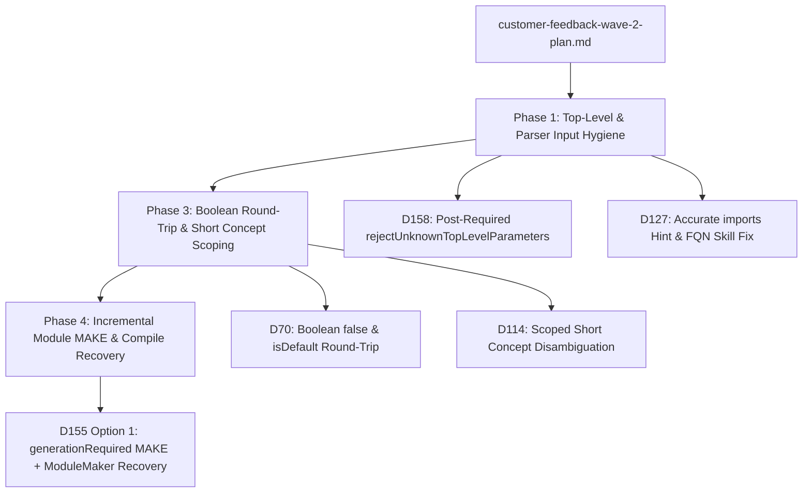

# Customer Feedback Wave 2 — Phased Execution Roadmap

**Status (2026-11-27):** Phases 1, 2, 3, and 4 re-evaluated against the live `plugins/mcp-tools` and MPS codebase; Phase 1 rewritten (§1.2, §2) and in progress (`D127` in `36f2311debcd`, `CF-015` note in `5926dd7cab6b` / `40960a87321d`; `D158` pending), Phase 2 dropped/deferred in full (§1.3), **Phase 3 narrowed, hardened, and completed** (§1.4, §3: `D70` in `8414491a7f2d`, `D114` completed 2026-11-27), and Phase 4 refocused onto Option 1 — incremental module/project `MAKE` + interrupted-compile recovery — with async/status polling (`Option 2`) and full deferral (`Option 3`) marked out of scope (§1.5, §4; implementation pending).
- Wave 1 (`93bc835ddce8`) remediated all confirmed live `mcp-tools` bugs (`CF-001`–`CF-005`, `CF-012`, `CF-013` / `D138`, `D141`, `D149`–`D153`) and documented core-MPS/MCP workarounds across all three skill trees (`CF-018`, `CF-021`–`CF-034` / `D140`, `D159`–`D163`).
- Wave 2 addresses the remaining server-side feature candidates and open server defects from [`customer-feedback-triage.md`](customer-feedback-triage.md) and [`../study/instructions/defects.md`](../study/instructions/defects.md) across **3 active risk-graduated phases** (Phases 1, 3, and 4; Phase 2 deferred after the 2026-11-26 audit) executed in independent sessions.
- **Checkbox rule:** Tick a box (`[x]`) only when the item is implemented **and** verified as stated; record commit hashes in the Phase Matrix below as each phase lands.

**Out of scope for Wave 2:** Wave 1 items already fixed and archived (`D138`, `D140`, `D141`, `D149`–`D153`, `D159`–`D163`), pre-existing fixed items (`CF-035`–`CF-052`), dropped customer-domain / third-party items (`CF-053`–`CF-057`), upstream JBR / MPS Core / IDEA MCP escalations (`CF-058`–`CF-062`), the former Phase 1 items dropped/deferred during the 2026-11-26 relevance audit (`D80` and `D113` — see §1.2), the former Phase 2 items dropped/deferred during the 2026-11-26 relevance audit (`D156` / `CF-008` including `RENAME_CONCEPT`, and `D157` / `CF-009` — see §1.3), the former Phase 3 items dropped/deferred during the 2026-11-26 relevance audit (`SPrimitiveTypes.INTEGER` from `D70`, and `D154` / `CF-006` — see §1.4), and the Phase 4 alternatives marked out of scope during the 2026-11-26 relevance audit (`Option 2` — opt-in `async: true` `MAKE` + `MAKE_STATUS` polling via `MakeJobStore`, and `Option 3` — leaving module/project `MAKE` non-incremental; see §1.5).

---

## 0. Multi-Run Execution Ground Rules

Every session executing a phase or item from this roadmap must follow [`.agents/quality-gates.md`](../../../.agents/quality-gates.md), [`.agents/conventions.md`](../../../.agents/conventions.md), [`.agents/git.md`](../../../.agents/git.md), and [`AGENTS.md`](../../../AGENTS.md):

1. **JDK 25 & Single-JVM Test Execution**:
   - Builds and tests run on **JDK 25**.
   - Never run multiple JUnit suites concurrently (they contend on MPS environments and locks). Before launching any suite, verify no test JVM is running: `ps aux | grep JUnitStarter`.
   - Never launch `*McpToolset*IntegrationTest` classes or `Mcp*TestSuite` sub-suites from the editor gutter. Always run through `execute_run_configuration(configurationName="McpToolsIntegrationTestSuite", envs={"MCP_TESTS": "..."})`.
   - When a suite exceeds ~60 s, launch with `waitForExit=false`, monitor `ps aux | grep McpToolsIntegrationTestSuite`, and inspect `fullOutputPath` for `testFailed` entries after exit.
2. **Required Suite Gates by Change Scope**:
   - **One toolset class**: run its test class (`MCP_TESTS=<TestClass>`), then its owning `Mcp*TestSuite` sub-suite.
   - **`common/`, `McpIntegrationTestBase`, or the umbrella**: run focused tests first, then run the **full unfiltered `McpToolsIntegrationTestSuite`** (no `MCP_TESTS`).
   - **Tool name, parameter, or `@McpDescription`**: run the toolset's sub-suite + `McpContractAndSkillsTestSuite` (and update any affected skill scripts/examples so `SkillScriptsDriftTest` stays green).
   - **New test classes**: register in **exactly one** `Mcp*TestSuite` sub-suite, never directly in `McpToolsIntegrationTestSuite` (`SuiteRegistrationGuardTest` enforces this).
3. **3-Tree Skill Blueprint Sync**:
   - Source of truth is `plugins/mcp-tools/resources/jetbrains/mps/agents/mcp/skills/`. Never edit `.agents/skills/` or `.claude/skills/` directly, and never run `mps_mcp_initialize_project_for_agents` in this checkout.
   - Copy every modified `<skill-name>/` directory verbatim over both `.agents/skills/<skill-name>/` and `.claude/skills/<skill-name>/`.
   - Keep `references/*.md` files within `SkillReferenceLayoutTest` size caps (12,288 B default unless allow-listed) and run:
     ```sh
     python3 plugins/mcp-tools/scripts/validate_skill_catalog.py --self-test plugins/mcp-tools/resources/jetbrains/mps/agents/mcp/skills
     ```
4. **Live MPS & IDE Log Gate**:
   - After exercising a change against a live MPS over MCP, inspect the IDE log (`mps_mcp_read_ide_log` covering the run window with `minLevel="WARN"`) to confirm no hidden `WARN`/`ERROR`/`SEVERE` stack traces were logged. If no live MPS instance is available, state explicitly what was skipped and why.
5. **Tracker Archival & Commit Hygiene**:
   - When an item's server and skill work are verified, move closed `D*` rows from `plugins/mcp-tools/study/instructions/defects.md` to `plugins/mcp-tools/study/instructions/defects-archive.md` and update `plugins/mcp-tools/docs/customer-feedback-triage.md`.
   - Commit one logical phase/item at a time using `mcp-tools - <summary>` and `Co-Authored-By: <agent>` per `.agents/git.md` (when committing is requested).

---

## 1. Phase Overview & Relevance Audit Record

### 1.1 Active Wave 2 Phase & Item Matrix

| Phase | Items | Summary | Primary Files | Required Test Gate | Effort | Status / Commit |
|---|---|---|---|---|---|---|
| **Phase 1** | `D158` (`CF-010`), `D127` (`CF-017`), *(opt.)* `CF-015` note | Universal `rejectUnknownTopLevelParameters` guard (post-missing-check) + accurate `"imports"` hint & `parameters-rules.md` FQN fix | `common/AbstractOps.kt`, `common/McpToolInputSchemas.kt`, all 17 `*McpToolset.kt`, `mps-baselanguage/.../parameters-rules.md` | `McpContractAndSkillsTestSuite` + full `McpToolsIntegrationTestSuite` (`common/` touched) | ~0.5–1 d | In progress (`D127`: `36f2311debcd`; `CF-015` note: `5926dd7cab6b`, `40960a87321d`; `D158` pending) |
| ~~**Phase 2**~~ | ~~`D156` (`CF-008`), `D157` (`CF-009`)~~ | *Dropped / deferred in 2026-11-26 Phase 2 relevance audit — see §1.3 (`RENAME_CONCEPT` dropped; `UPDATE_CONCEPT_IMPLEMENTS`, `UPDATE_ENUM_MEMBER`, and `D157` deferred to existing tool & Wave 1 skill coverage).* | — | — | 0 d | Deferred (§1.3) |
| **Phase 3** | `D70` (`CF-014`, `BOOLEAN` only), `D114` (`CF-011`) | Boolean `"false"` display & unset `"isDefault": true` round-trip + scoped short concept disambiguation & `mps-aspect-dataflow` blueprint fixes | `common/AbstractOps.kt`, `common/AbstractNodeOps.kt`, `MPSRootNodeMcpToolset.kt`, `MPSConsoleMcpToolset.kt`, `MPSTypesMcpToolset.kt`, `mps-aspect-dataflow/.../pattern-*.md`, `mps-node-editing/...`, `mps-aspect-accessories/...`, `integration/SkillBlueprintShapesTest.kt` | `McpNodeToolsTestSuite`, `McpContractAndSkillsTestSuite` + full `McpToolsIntegrationTestSuite` (`common/` touched) | ~1.5–2 d | Complete (`D70`: `8414491a7f2d`; `D114` done 2026-11-27) |
| **Phase 4** | `D155` (`CF-007`, Option 1) | Incremental module/project `MAKE` (`generationRequired`) + `ModuleMaker` dirty-source compile recovery & reload (`async: true` / `MAKE_STATUS` out of scope — §1.5) | `common/AbstractOps.kt`, `MPSNodeMcpToolset.kt`, `integration/AbstractOpsMakeTest.kt`, `mps-mcp-workflow/.../node-editing-rules.md` | `AbstractOpsMakeTest`, `McpNodeToolsTestSuite`, `McpContractAndSkillsTestSuite` + full `McpToolsIntegrationTestSuite` (`common/` touched) | ~0.5–1 d | Pending |



### 1.2 Items Dropped / Deferred from Phase 1 (2026-11-26 Relevance Audit)

Before coding Phase 1, all four originally proposed Phase 1 items were audited against the live `plugins/mcp-tools`, `plugins/mps-console`, `plugins/mps-java`, `languages/baseLanguage`, and `core/` sources. Two items were removed from the implementation plan:

1. **`D80` (`CF-015`) — Runtime-vs-Declaration Feature Diff in `LanguageReadiness` & Flipping `Stale` in `get_concept_details` -> DROPPED**
   - **Already solved by `D112`:** `LanguageReadiness.kt`, `ConceptDeclarationView.kt`, `AbstractNodeOps.ConceptGate`, and `AbstractOps.ensureLanguageRuntime` (`d112-language-readiness-overview.md`) already cover all three unbuilt/stale states end-to-end:
     - `NoRuntime` and `ConceptNotInRuntime` serve synthesized declaration records via `ConceptDeclarationView` with `"source": "declaration"`, `"descriptorStatus": "hollow"`, `warnings`, and `details.languageBuild`, and gate node writers / `query_types` with `LANGUAGE_NOT_BUILT`.
     - `NotBuilt.Stale` (`ModelGenerationStatusManager.generationRequired(structureModel)`) already catches unbuilt `UPDATE_CONCEPT_*` edits (`CF-015`): writes to newly added/renamed features fail cleanly in `ConceptGate.staleFeature` (`AbstractNodeOps.kt:201-227`) with `LANGUAGE_NOT_BUILT` (`status: "stale"`), while `get_concept_details` (`MPSLanguageMcpToolset.kt:213-227`) reports `details.languageBuild` (`status: "stale"`).
   - **Why the proposed diff was harmful:**
     - `D80` (`defects.md:17, 36`) was a single pre-`D112` Round-17 cross-cell incident marked **`repro first`** and absent across Rounds 18–52 (moreover, `ModelGenerationStatusManager` compares `currentHash` against `GenerationDependenciesCache`, which already flags unbuilt copies lacking matching `generated` hashes). Running `ConceptDeclarationView` (`BHReflection` superconcept walks) on every `Ready` concept during `search_concepts` / `get_concept_details` adds unmeasured read overhead for an unconfirmed hypothesis.
     - `generationRequired(structureModel)` is **model-wide**: routing `Stale` through `addReadinessMarkers` in `get_concept_details` would stamp `"descriptorStatus": "hollow"` onto every unchanged concept in the structure model, breaking `D57` semantics.
   - **Disposition:** Leave `D80` on the recurrence watch (`repro first` in `defects.md:36`). Only the optional narrow `CF-015` UX reminder on `UPDATE_CONCEPT_*` / `RENAME_CONCEPT_*` responses is retained in §2.3 below.

2. **`D113` (`CF-016`) — Console In-Flight Execution Guard -> DROPPED / DEFERRED**
   - **Unsafe callback contract in `mps-console`:** Neither `BaseConsoleTab` nor `DialogConsoleTab` tracks in-flight execution state, and `GeneratedCommand__BehaviorDescriptor.java:43-63` (`BLCommand` / `BLExpression`) runs `ConsoleUtil.make` on a pooled thread and **returns early without invoking `beforeCallback` or `afterCallback`** whenever `ConsoleUtil.make` fails (syntax/type/compile error or cancelled make) or `ClassLoaderManager` fails to load `Main`. Setting a per-project in-flight flag in `MPSConsoleMcpToolset` that clears on callback/history completion would **permanently wedge the console in `McpErrorCode.CONFLICT`** after a single failing command, blocking the caller from calling `mps_mcp_insert_console_command_from_json` (or `mps_mcp_parse_java_and_insert` with `insert.mode = "console"`) to fix the broken command.
   - **Low ROI & headless test gap:** `D113` occurred once (`round 43: S9-opus-1:6-7`, absent in Rounds 44–52), both `defects.md:45` and `customer-feedback-triage.md:56` mark the server half optional, Wave 1 already added the sequencing rule in `mps-console/SKILL.md:49`, and `MPSConsoleMcpToolsetIntegrationTest` has no live Console tool window in the headless test fixture.
   - **Disposition:** Leave mitigated by `mps-console/SKILL.md:49`; do not add custom in-flight state in `MPSConsoleMcpToolset`.

### 1.3 Items Dropped / Deferred from Phase 2 (2026-11-26 Relevance Audit)

Both originally proposed Phase 2 items (`D156` / `CF-008` and `D157` / `CF-009`) were audited against live MPS MCP behavior, `MPSLanguageStructureMcpToolset.kt`, `AbstractNodeOps.kt`, `MPSJavaMcpToolset.kt`, `JavaParseResolver.kt`, `languages/languageDesign/structure/`, and `languages/baseLanguage/` (`ResolveUnknownUtil.java`, `classifiers`), and removed from Wave 2:

1. **`D156` #3 — `RENAME_CONCEPT` in `mps_mcp_alter_structure` -> DROPPED**
   - **Redundant & already 1 call:** Renaming a `ConceptDeclaration`, `InterfaceConceptDeclaration`, `EnumerationDeclaration`, or `ConstrainedDataTypeDeclaration` while preserving `conceptId` / `datatypeId` and `SNodeId` is already a single `mps_mcp_update_node(SET, PROPERTY, [[ref, "name", newName]])` call (`mps-aspect-structure-concepts/references/structure-operation-api/tool-conventions.md:27`, `0` failures across 52 study rounds; not even requested in `defects.md:60`).
   - **Invalid `makeStatus: "runtime_stale"` contract:** In `MPSLanguageStructureMcpToolset.kt:796-812` and `@McpDescription`, `makeStatus: "runtime_stale"` specifically means `make: true` ran a clean rebuild and the runtime *still* failed to serve a created concept. Unbuilt structure edits are already reported end-to-end by `D112` (`LanguageReadiness` `NotBuilt.Stale` -> `details.languageBuild.status = "stale"` in `get_concept_details`, and `ConceptGate.staleFeature` in `AbstractNodeOps.kt:201-227`).
   - **Incomplete refactoring semantics:** Unlike MPS's IDE Rename (`RenameRefactoringBody` + `RenameReferencesParticipant.java:61-99`), saving only `structureModel` leaves stale `resolve="OldName"` hints across referencing `editor`, `behavior`, `constraints`, `typesystem`, `generator`, and `@tests` models (and `<concept name="old.fqn"/>` registry headers in consumer `.mps` files without a migration), while `validateRootNodeName` misses `check_DuplicatedConceptName_NonTypesystemRule`'s case-insensitive check and `ConstrainedDataTypeDeclaration`.

2. **`D156` #1 & #2 (`CF-008`) — `UPDATE_CONCEPT_IMPLEMENTS` & `UPDATE_ENUM_MEMBER` -> DEFERRED**
   - **Low ROI over existing 1-call primitives (`0` study hits in 52 rounds):**
     - Live `dryRun` against `MPS` verified that `mps_mcp_update_node(ADD, CHILD, childRole = "implements", childJson = {"concept": "...InterfaceConceptReference", "references": [{"role": "intfc", "target": "<FQN or r: ref>"}]})` already validates `InterfaceConceptDeclaration` assignability atomically and invokes `AbstractNodeOps.ensureReferenceDependencies` (`AbstractNodeOps.kt:944-955`) to auto-add cross-language `structure` model imports and module dependencies.
     - `mps_mcp_update_node(ADD, CHILD, childRole = "members", ...)` already invokes `SetStructureIds` (`ConceptIdHelper.generateEnumMemberId`), and Wave 1 documented both 1-call patterns in `tool-conventions.md:25-26`.
   - **Invariants required if ever revisited later:**
     - `UPDATE_CONCEPT_IMPLEMENTS` would need cross-language model/module dependency wiring (`MPSLanguageStructureMcpToolset.kt` currently adds none) and handling/warning for `check_ExtendedConceptsAreInExtendedLanguages_NonTypesystemRule.java:43-63` (which requires a `Language` `Extends` edge when `InterfaceConceptDeclaration.extends` targets a non-`MarkerInterfaceAttribute` interface in another language).
     - `UPDATE_ENUM_MEMBER` would need `EnumerationDeclaration.defaultMember` cleanup on `REMOVE` (and conditional clear on `UPDATE` with `isDefault = false`), a `1..n` last-member guard on `REMOVE`, duplicate `name` *and* effective-`presentation` checks (`check_EnumerationDeclaration_NonTypesystemRule.java:34-70`), and leaving `presentation` unset (`null`) when omitted rather than copying `CREATE_ENUM`'s eager `presentation = name`.
   - **Disposition:** Leave mitigated by `mps_mcp_update_node` + `SetStructureIds` + `tool-conventions.md:25-27` (`defects.md:60` **S** stays optional/deferred).

3. **`D157` (`CF-009`) — `parse_java_and_insert` Support for `NodesTestCase` (`IClassifier`) -> DEFERRED**
   - **Why the Phase 2 adapter-only spec was incomplete:**
     - **Call-site resolution gap:** Calling an `IClassifier` method in MPS AST requires `DotExpression(operand = ThisClassifierExpression, operation = DefaultClassifierMethodCallOperation(member = <decl>))` from `jetbrains.mps.baseLanguage.classifiers`. When parsing statements into `SimpleNodeTest.body` or a sibling helper, unqualified `helper(x)` becomes `UnknownLocalCall`, where `ResolveUnknownUtil.resolveLocalCall` (`ResolveUnknownUtil.java:74-96`) resolves only `StaticMethodDeclaration` / `InstanceMethodDeclaration` (`MethodDeclaration`, which `DefaultClassifierMethodDeclaration` does *not* extend) and returns `null`; qualified `this.helper(x)` produces BaseLanguage `ThisExpression` + `UnknownInstanceMethodCall` / `InstanceMethodCallOperation`, which is illegal inside `NodesTestCase` (`BaseConcept implements IClassifier`, not `Classifier`) and unhandled by `JavaParseResolver.fixMethodReferences` (`JavaParseResolver.kt:180-276`). Any working design must add an `IClassifier` call-site resolution pass in `JavaParseResolver.resolveIteratively` rewriting `UnknownLocalCall` and `this.<member>` / `ThisExpression` into `ThisClassifierExpression` + `DefaultClassifierMethodCallOperation` / `DefaultClassifierFieldAccessOperation` (gated on `importUsedLanguages`).
     - **37 heterogeneous `IClassifier` subconcepts:** `IClassifier` has 37 subconcepts across MPS with differing member containment links (`NodesTestCase.methods`, `ConceptConstraints`/`InferenceRule`/`NonTypesystemRule`/`TypesystemQuickFix`/`TransformationMenu*`/`SubstituteMenu*`/`ActionDeclaration.methodDeclaration`, `IntentionDeclaration`/`ToolDeclaration`/`TabbedToolDeclaration`/`PreferencesComponentDeclaration.methodDeclaration` + `fieldDeclaration`, `DefaultClassifier.method` + `field`, and `IClassifier`s with no member role at all), so admission and conversion would have to be driven by target containment-link assignability to `DefaultClassifierMethodDeclaration` / `DefaultClassifierFieldDeclaration` (plus copying `annotation`, `isFinal`, `isSynchronized`, `isDeprecated`, and rejecting `abstract` methods).
   - **Disposition:** Defer from Wave 2 (`frequency: once` in field notes, `0` hits across 52 study rounds); leave mitigated by the documented 2-call shell + `STATEMENTS` (or helper `ClassConcept`) recipe in `mps-tests/references/common-failures.md:39`.

### 1.4 Items Dropped / Deferred from Phase 3 (2026-11-26 Relevance Audit)

All three originally proposed Phase 3 items (`D70` / `CF-014`, `D114` / `CF-011`, and `D154` / `CF-006`) were audited against live MPS MCP behavior, `AbstractOps.kt`, `AbstractNodeOps.kt`, `MPSRootNodeMcpToolset.kt`, `AgenticViewRenderer.kt`, and `core/kernel` + `core/smodel` (`SPrimitiveTypes.java`, `AttachedNodeOwner.java`, `AssociationData.java`, `UnregisteredNodes.java`, `SModel.java`, `InsertChildAtUndoableAction.java`). Two parts were removed from Wave 2:

1. **`D70` (`CF-014`) Partial Scope — `SPrimitiveTypes.INTEGER` `"0"` / `"isDefault": true` & Read-Side Skill Warnings -> DROPPED**
   - **False premise on `SPrimitiveTypes.INTEGER`:** Unlike `SPrimitiveTypes.BOOLEAN` (`SPrimitiveTypes.java:114-124`, where `toString(false)` returns `null` and `getDefault()` is `false`), `SPrimitiveTypes.INTEGER.toString(0)` (`SPrimitiveTypes.java:62-94`) returns **`"0"`** and `getDefault()` is **`null`**. Live `mps_mcp_print_node(format = "JSON")` on `IntegerConstant(0)` already emits `{"name": "value", "type": "integer", ..., "value": "0"}`.
   - **Unset `integer` in MPS is `null`, not `0`:** Real MPS languages rely on unset vs. `0` — e.g. `MigrationScript.fromVersion` / `PureMigrationScript.fromVersion` (`MigrationUnitVersions.kt:62-68`), where `0` is the first valid migration version (`0 -> 1`) and unset means `"Script does not have version"`. Synthesizing `{"value": "0", "isDefault": true}` for `!stored` integers would misreport unversioned scripts as version `0`, cause `isUnsetDefaultProperty` (`setProperty(null)`) to wipe explicit or factory-computed `0` values on replay, and contradict `AgenticViewRenderer.kt:454` (`AgenticViewIntegrationTestBase.kt:255-261`).
   - **Read-side skill warnings already superseded by `AGENTIC VIEW`:** `D70`'s lone study hit (Round 16 `S8-sonnet-1`, `0` recurrences in Rounds 17–52) predated `AGENTIC VIEW`; `mps-dsl-memory/SKILL.md:26` and `mps-language-analysis/SKILL.md:31` already direct agents to `format = "AGENTIC VIEW"` for reading (`AgenticViewRenderer.kt:441, 452` prints both stored `value=false` and unset `flag=false*`), so only the `BOOLEAN` JSON blueprint round-trip in §3.1 remains relevant.

2. **`D154` (`CF-006`) — Stage-Then-Transplant `SNodeId` Preservation in `mps_mcp_update_root_node_from_json` -> DEFERRED**
   - **Low ROI vs existing ID-preserving tools (`0` study hits across 52 rounds):** Surgical `mps_mcp_update_node` and `mps_mcp_alter_nodes` `COPY_NODE` / `MOVE_CHILD` / `MOVE_NODE_TO_PARENT` already preserve descendant `SNodeId`s, and Wave 1's `mps-node-editing/references/json-format.md:33` explicitly warns against child-ID turnover on full-root `update_root_node_from_json` rewrites.
   - **Two severe MPS kernel hazards in the earlier detach-`setId`-reattach design:**
     - *`UnregisteredNodes` / `ConvertedDirectNode` corruption (`AttachedNodeOwner.java:148-155`, `AssociationData.java:372-385`, `UnregisteredNodes.java:42-48`):* Deleting `originalChildren` (`A_old`, `id = 100`) registers `(100 -> A_old)` in `CommandContextImpl.myUN` (`UnregisteredNodes`). Detaching `B_staged` afterwards triggers `TransitionDirect.makeDirect`, which calls `resolveUnregistered(100)` and rewrites intra-root `LocalNodePtr(100)` into `ConvertedDirectNode(myImmatureTargetNode = A_old)` pointing permanently at the deleted detached node (`A_old.getModel() == null`, so `TransitionIndirect.makeIndirect` refuses to mature it on re-attach), while renamed targets also retain stale `resolveInfo` from `A_old`.
     - *`Ctrl+Z` Undo `SNodeId` scrambling (`InsertChildAtUndoableAction.java:31-39`, `SModel.java:621-628`):* `jetbrains.mps.smodel.SNode.setId` (`SNode.java:449-457`) mutates `myId` in place with no `SNodeUndoableAction`. Undoing the command via `Ctrl+Z` re-inserts `A_staged` (still carrying `myId == 100`) before undoing `A_old.delete()`, so `SModel.registerNode(A_old)` hits `existingNode != null && existingNode != A_old` and calls `assignNewId(A_old)` — silently overwriting the original node's `SNodeId`.
   - **Architecture required if ever revisited later:** Never detach or call `setId` on undo-tracked `stagedChildren`. Instead, after attached temp-ID staging succeeds, build **fresh unattached clones** carrying `preservedId` from birth (requiring `parsedRef.modelReference == model.reference` and exact `SConcept`), delete both `stagedChildren` (temp IDs) and `originalChildren` (`preservedId`s), attach the fresh `preservedId` clones before root `stagedReferences` run, re-apply intra-root references via `setResolvedReference` against the live `model` (refreshing `resolveInfo`), and merge `preservedNodeIds` into `importedLanguages` `details`.
   - **Disposition:** Defer from Wave 2 (`defects.md:58` **S** stays optional/deferred); leave mitigated by surgical `mps_mcp_update_node` / `COPY_NODE` / `MOVE_*` and `mps-node-editing/references/json-format.md:33`.

### 1.5 Items Dropped / Out of Scope from Phase 4 (2026-11-26 Relevance Audit)

Phase 4 (`D155` / `CF-007`) was audited against live MPS MCP behavior, `MPSNodeMcpToolset.kt`, `AbstractOps.kt`, `WorkbenchMakeService.java`, `WorkbenchMakeTask.java`, `MakeActionParameters.java`, `ModelsToResources.java`, `Generate_Facet.java`, `TextGen_Facet.java`, `JavaCompile_Facet.java`, `ModuleMaker.java`, `StartupModuleMakerImpl.java`, and decompiled `mcpserver.jar` (`McpSessionHandler`). Unbuilt/stale language runtimes (`D112` / `LanguageReadiness` + synchronous `ClassLoaderManager.reload` of languages and owned generators) and stuck post-timeout `"Another make session is already active"` errors (`MPS-40329` + `performMake`'s `CancellationException` session-close wait) were confirmed already solved, while auditing `performMake` uncovered the actual server root cause behind routine `CF-007` timeouts: default `rebuild = false` module/project `MAKE`s bypass `ModelGenerationStatusManager.generationRequired` and regenerate every clean model in the module from scratch. Of the three evaluated options, **Option 1** (incremental module/project `MAKE` + `ModuleMaker` dirty-source compile recovery) remains in Phase 4 (§4.1), while **Option 2** and **Option 3** are out of scope:

1. **`D155` Option 2 — Opt-In `async: true` `MAKE` + `MAKE_STATUS` Polling via `MakeJobStore` -> OUT OF SCOPE**
   - **Disproportionate cost & concurrency risk once Option 1 fixes incremental `MAKE`:** `D155` had `0` hits across all 52 study rounds (`4` field hits in `SysMLv2`: `#17`, `#21`, `#27`, `#33`, caused by small edits re-running a 50 s `editor` `TextGen` and stranding `classes_gen/` when `JavaCompile` was cancelled). Option 1 eliminates both the everyday full-regeneration penalty and the post-`TextGen` retry loop synchronously in ~0.5–1 d with zero new API surface, zero multi-turn polling overhead, and zero background lock contention (whereas an in-flight background `MAKE` acquires write actions during transient publishing, `Make.reconcile`, and `ClassLoaderManager.reload`, which can stall concurrent MCP calls past `MODEL_OPERATION_TIMEOUT_MS`). Decompiling `mcpserver.jar` also confirmed `CoroutineContext.reportToolActivity` publishes only to internal `ToolCallListener.TOPIC` and does not emit MCP wire `notifications/progress` frames.
   - **Seven defects identified in the earlier `MakeJobStore` / `MAKE_STATUS` draft (invariants required if ever revisited outside Wave 2):**
     1. *Ignored `ProgressMonitor` in live IDE (`WorkbenchMakeService.java:221, 277-299`):* `WorkbenchMakeService._doMake` ignores the `monitor` passed to `makeService.make(...)` (only headless `BuildMakeService` forwards it), and `IMakeNotificationListener` emits only session/script boundaries (`SESSION_OPENED`, `SCRIPT_ABOUT_TO_START`, `SCRIPT_FINISHED`, `SESSION_CLOSED`), so monitor-based `GENERATING` / `COMPILING` phase tracking would pass headless tests and silently stall in live MPS; only `PREPARING -> MAKING -> RELOADING -> COMPLETED / FAILED / CANCELLED` are observable.
     2. *Cancellation requires `future.cancel(true)` (`WorkbenchMakeTask.java:51-64`):* `makeMonitor.cancel()` is a no-op in `WorkbenchMakeService`; background job cancellation must retain `Future<IResult>` and call `future.cancel(true)`.
     3. *Non-blocking `Project` disposal:* `Disposer.dispose(project)` runs on the EDT while `WorkbenchMakeService._doMake` queues `invokeLater` and facets/reload take model locks; `dispose()` must only call `scope.cancel()` and `activeFuture?.cancel(true)` non-blockingly and guard `!ideaProject.isDisposed` before post-make reload/reporting.
     4. *`withSaveTransientModels` lifetime (`SaveTransientModelsToggle.kt:19-25`):* `Generate_Facet.Target_configure` reads project-wide `isSaveTransientModels` per cluster on the background task, so the toggle must wrap `future.get()` + `sessionClosedLatch.await` inside the background job coroutine rather than the returning `opMake` request coroutine.
     5. *Cross-tool active-job propagation:* `performMake` (`ensureLanguageRuntime` callers remain synchronous), `TransientModelsOps.refuseWhileMakeActive`, and `HeadlessMigrations.blockers` would all need to surface `details.activeMakeJobId`, and `RUNNING` responses would have to instruct callers not to mutate/check models until `MAKE_STATUS` completes.
     6. *Schema & empty-`parameters` guard (`MPSNodeMcpToolset.kt:85, 109-118, 328, 655-680`):* `MAKE_PARAMETER_SCHEMA` / `MAKE_PARAMETER_KEYS` and enum `MPSAlterOperation` (not `MPSNodeAlterOperation`) live in `MPSNodeMcpToolset.kt`, and `mps_mcp_alter_nodes`'s blank-`parameters` guard rejects optional-only operations unless `{}` / blank input is exempted for `MAKE_STATUS`.
     7. *`mcp-tools-index.md` byte budget (`SkillReferenceLayoutTest.kt:233`):* `mcp-tools-index.md` is at 19,251 B / 19,456 B (~205 B headroom).
   - **Disposition:** Out of scope for Wave 2.

2. **`D155` Option 3 — Defer Phase 4 Completely (Rely Only on Per-Model `MAKE` Guidance) -> OUT OF SCOPE / REJECTED**
   - **Leaves a confirmed server defect unfixed:** Keeping `MPSNodeMcpToolset.opMake` + `AbstractOps.performMake` unchanged leaves every default `MAKE({"modules": [...]})` and `MAKE({"wholeProject": true})` (`rebuild = false`) regenerating all clean models in the target modules, penalized on every routine edit and unable to recover cleanly from a mid-`JavaCompile` timeout on retry.
   - **Disposition:** Rejected in favor of Option 1 (§4.1).

---

## 2. Phase 1 — Top-Level Argument Hygiene & Java Parser Import Hint (`D158`, `D127`)

### 2.1 `D158` (`CF-010`) — Universal `rejectUnknownTopLevelParameters` Guard

**Problem:** `AbstractOps.rejectUnknownTopLevelParameters(tool, allowed)` (`AbstractOps.kt:447-480`) inspects `McpCallAdditionalDataElement` `rawArguments`, tolerates `TOLERATED_PARAMETER_KEYS` (`projectPath`) and `JsonNull`, and suggests near-misses via `RequiredParameterNearMisses` + `suggestParameterName`. In Wave 1 (`D138`) it was wired only into `mps_mcp_run_migrations` (`MPSMigrationMcpToolset.kt:59-62`). On the remaining `@McpTool` endpoints across the 17 toolsets registered in `plugins/mcp-tools/META-INF/plugin.xml`, `D43`'s `rejectMissingParameters` catches wrong parameter names **only** when a required parameter was left blank as a result. Whenever all required parameters are supplied and the caller passes a hallucinated **optional** parameter (`index = 0` instead of `position = 0` on `mps_mcp_update_node`, `depth = 2` or `outputFile` on `mps_mcp_print_node`, `name` instead of `configurationName` on `mps_mcp_create_run_configuration`), `CallableBridge` silently drops the unknown key and the tool succeeds with unintended default behavior.

**Ordering Invariant (Critical — Preserve `D27`/`D43`/`D56`/`D63`):**
- `rejectUnknownTopLevelParameters` **must run AFTER `rejectMissingParameters` and any upfront required-selector checks** (such as `mps_mcp_get_concept_details` checking that `conceptRefs` and `languageRefs` are not both empty, `mps_mcp_search_concepts` checking `searchTexts`, `mps_mcp_create_run_configuration` checking `nodeReference`/`modelReference`, and operation-scoped `rejectMissingParameters` in `mps_mcp_update_node`, `mps_mcp_update_module`, `mps_mcp_update_model`, `mps_mcp_create_module`).
- **Why:** When a caller sends `{"blueprint": "..."}` instead of `{"json": "..."}` to `mps_mcp_insert_console_command_from_json` (or `{"node": "..."}` to `mps_mcp_print_node`), `json`/`nodeReference` arrives blank while `rawArguments` holds `"blueprint"`/`"node"`. Existing `D43` contracts and bridge tests (`MPSConsoleMcpToolsetIntegrationTest.kt:119-150`, etc.) assert `details.missingParameters` and the copy-pasteable retry message (`"json is required. Retry with ... a value sent as 'blueprint' never reaches it."`). Running `rejectMissingParameters` **first** preserves every missing-parameter response verbatim, while running `rejectUnknownTopLevelParameters` **immediately after** required parameters are confirmed present catches every dropped optional/extra argument.

**Implementation Design:**
- Derive or cache the allowed parameter-name `Set<String>` per `@McpTool` method (e.g. a shared helper on `AbstractOps` reflecting/caching `@McpTool` `valueParameters` on `this::class`, or verified per-tool constants) so parameter additions cannot silently drift from the allow-list.
- Wire `rejectUnknownTopLevelParameters` into **every** `@McpTool` entry point across all 17 toolsets in `plugin.xml`:
  - `MPSProjectMcpToolset` (`mps_mcp_list_open_projects`, `mps_mcp_close_project`, `mps_mcp_read_ide_log`, `mps_mcp_reload_all`, `mps_mcp_get_project_structure`, `mps_mcp_get_compact_project_structure`) — note several of these do not go through `withMpsProject` or have no required parameters, so place the guard directly in the `@McpTool` method body (after any required-parameter check).
  - `MPSConsoleMcpToolset` (`mps_mcp_get_console_history`, `mps_mcp_insert_console_command_from_json`, `mps_mcp_recall_console_command`, `mps_mcp_run_console_command`, `mps_mcp_clear_console`).
  - `MPSLanguageMcpToolset` (`mps_mcp_get_concept_details` — after the empty `conceptRefs`+`languageRefs` check; `mps_mcp_search_concepts` — after the blank `searchTexts` check).
  - `MPSModuleMcpToolset`, `MPSModelMcpToolset`, `MPSRootNodeMcpToolset`, `MPSNodeMcpToolset` (for `mps_mcp_update_node`, run after `operation`/`kind` and the operation-specific `rejectMissingParameters` checks so `parentRef` on an incomplete `ADD CHILD` still triggers the `D43` missing-`nodeReference` message, while `index` on a complete `ADD CHILD` triggers `unknownParameters`), `MPSTypesMcpToolset`, `MPSDataflowMcpToolset`, `MPSIntentionsMcpToolset`, `MPSEditorMcpToolset`, `MPSLanguageStructureMcpToolset`, `MPSJavaMcpToolset`, `MPSRunConfigurationMcpToolset`, `MPSMigrationMcpToolset` (already wired), `MPSGenerationMcpToolset`, and `MPSInitMcpToolset`.
- Optionally add `"index"` -> `"position"` (or verify `suggestParameterName` / `RequiredParameterNearMisses` hints) so `mps_mcp_update_node(..., index = 0)` and `mps_mcp_create_run_configuration(..., name = "...")` surface helpful `"did you mean '...'"` suggestions when helpful, without violating `McpToolParameterOptionalityTest`'s rule that no near-miss alias of parameter P may be a real parameter of the same tool.

**Checklist:**
- [ ] Implement universal post-required `rejectUnknownTopLevelParameters` across all `@McpTool` methods in all 17 `*McpToolset` classes (`common/AbstractOps.kt` + `MPS*McpToolset.kt`), preserving `D43`/`D56`/`D63` missing-parameter precedence.
- [ ] Extend `unit/McpToolParameterOptionalityTest.kt` (`McpContractAndSkillsTestSuite`) to assert every `@McpTool` registered in `plugins/mcp-tools/META-INF/plugin.xml` has a matching parameter allow-list / guard coverage.
- [ ] Add wire-level `callThroughBridge` tests verifying:
  - Unknown optional/extra keys are rejected with `McpErrorCode.INVALID_REQUEST` and `details.unknownParameters` (covering `index` on `mps_mcp_update_node`, `depth`/`outputFile` on `mps_mcp_print_node`, and `name` on `mps_mcp_create_run_configuration`).
  - Missing required parameter + near-miss key (e.g. `blueprint` instead of `json`) still returns `details.missingParameters` and the `D43` retry sentence rather than `details.unknownParameters`.
  - `projectPath` (`TOLERATED_PARAMETER_KEYS`) and `JsonNull` values remain tolerated.

### 2.2 `D127` (`CF-017`) — Accurate `"imports"` Unknown-Key Hint in `parse_java_and_insert` & Skill Alignment

**Problem & Factual Correction:**
- In `parseJavaParseInsertRequest` (`common/McpToolInputSchemas.kt:545`), `obj.rejectUnknownParameterKeys("mps_mcp_parse_java_and_insert", JAVA_INSERT_PARAMETER_KEYS)` rejects an invented `"imports"` key with only the generic accepted-keys message (`round 45: S1-opus-1:48`).
- Meanwhile, Wave 1's `mps-baselanguage/references/parse-java-tips/parameters-rules.md:17` currently states *"Java classes resolve only through the target model's imports: add `@java_stub` or target models (`java.util@java_stub`, `jetbrains.mps.scope@java_stub`, etc.) via `mps_mcp_model_dependency` before calling `mps_mcp_parse_java_and_insert`"*. **That claim is false for fully qualified names** and contradicts `D117` (`JavaSyntaxProblems.headerHint` at `java/JavaSyntaxProblems.kt:135-138`):
  - `JavaParseResolver.addJDKDependency` automatically stages `JDK` on the module, `ClassifierResolveUtils.resolveNonSpecialSyntax` resolves **fully qualified** names (`java.util.List`, `jetbrains.mps.scope.ListScope` when visible via module/devkit dependencies) across `module.getScope().getModels()` even before the model imports `@java_stub`, and `JavaParseResolver.updateModelDependencies` then **auto-imports** the referenced models onto the target model.
  - Furthermore, `featureKind: "CLASS"` *does* accept leading `import ...;` lines (`MPSJavaMcpToolsetIntegrationTest.kt:170-203`).
  - Explicit `mps_mcp_model_dependency` `ADD` before `mps_mcp_parse_java_and_insert` is needed only when writing **unqualified** short names, when the target module does not yet depend on the owning module at all, or when targeting the MPS Console (`modelReference: "console"`).

**Implementation Design:**
- In `parseJavaParseInsertRequest` (`common/McpToolInputSchemas.kt:545` or `rejectUnknownParameterKeys`), when `"imports"` (or `"import"`) is among the rejected unknown keys on `mps_mcp_parse_java_and_insert`, append a one-line hint aligned with `JavaSyntaxProblems.headerHint`:
  > *"There is no 'imports' parameter (and only featureKind 'CLASS' accepts leading `import` statements): write external classes fully qualified (`java.util.List`) so they resolve against module dependencies and auto-import into the target model, or add model imports first with `mps_mcp_model_dependency` when using short names, adding a new module dependency, or targeting `modelReference: \"console\"`."*
- Update `plugins/mcp-tools/resources/jetbrains/mps/agents/mcp/skills/mps-baselanguage/references/parse-java-tips/parameters-rules.md:17` to state the exact same rule (FQNs resolve across imports + visible module dependencies and auto-import outside the Console; `mps_mcp_model_dependency` `ADD` first is required for unqualified names, missing module dependencies, or `"console"`), keeping the valid second sentence about inserting callee/helper methods before callers. Propagate `mps-baselanguage` to `.agents/skills/mps-baselanguage/` and `.claude/skills/mps-baselanguage/`.

**Checklist:**
- [x] Add the `"imports"` / `"import"` unknown-key hint in `parseJavaParseInsertRequest` (`common/McpToolInputSchemas.kt`) with wording aligned to `JavaSyntaxProblems.headerHint`.
- [x] Add unit test(s) in `unit/McpToolInputSchemasTest.kt` (`McpContractAndSkillsTestSuite`) verifying the `"imports"` rejection message on `parseJavaParseInsertRequest` while keeping `"dryRun"` and general unknown-key rejections intact.
- [x] Fix `plugins/mcp-tools/resources/jetbrains/mps/agents/mcp/skills/mps-baselanguage/references/parse-java-tips/parameters-rules.md:17`, propagate `mps-baselanguage` across `.agents/skills/` and `.claude/skills/`, and run `validate_skill_catalog.py`.

### 2.3 Optional Narrow `CF-015` Polish — Post-Mutation `MAKE` Note on `alter_structure` Feature Edits

- [x] *(Optional — include only if envelope-compatible with existing tests)* `MPSLanguageStructureMcpToolset` `UPDATE_CONCEPT_{PROPERTY,CHILD,REFERENCE}` and `RENAME_CONCEPT_{PROPERTY,CHILD,REFERENCE}` (`MPSLanguageStructureMcpToolset.kt:1274, 1338, 1365, 1396`) currently return bare `okJson("true")` without reminding callers that the compiled concept descriptor (`get_concept_details` runtime record and node writers) stays stale until `mps_mcp_alter_nodes` `MAKE` rebuilds the language. If desired, attach `details.languageBuild` (`status: "stale"`) or a `warnings` reminder on those responses (verifying `MPSLanguageStructureMcpToolsetIntegrationTest` first), **without** modifying `LanguageReadiness.classify` or stamping `"descriptorStatus": "hollow"` on `Stale` concepts in `get_concept_details`.

### 2.4 Phase 1 Verification, Records & Commit Gate

- [ ] Run IDEA `get_file_problems` on all modified Kotlin files.
- [ ] Run focused tests: `MCP_TESTS=McpToolParameterOptionalityTest,McpToolInputSchemasTest`, then `MCP_TESTS=McpContractAndSkillsTestSuite`.
- [ ] Run the full unfiltered `McpToolsIntegrationTestSuite` (mandatory because `common/AbstractOps.kt` and `common/McpToolInputSchemas.kt` are modified) and confirm 0 failures on JDK 25.
- [ ] Run `python3 plugins/mcp-tools/scripts/validate_skill_catalog.py --self-test plugins/mcp-tools/resources/jetbrains/mps/agents/mcp/skills`.
- [ ] Exercise unknown top-level parameter rejection and `parse_java_and_insert` `"imports"` rejection against a live MPS if running, and inspect `mps_mcp_read_ide_log(minLevel="WARN")` (or record explicitly if skipped because no MPS instance is open).
- [ ] Archive `D158` and `D127` from `study/instructions/defects.md` into `study/instructions/defects-archive.md` and update `CF-010` / `CF-017` in `docs/customer-feedback-triage.md`.
- [ ] Commit Phase 1 per `.agents/git.md` and record the commit hash in §1.1.

---

## 3. Phase 3 — Boolean Blueprint Fidelity & Scoped Short Concept Resolution (`D70`, `D114`)

### 3.1 `D70` (`CF-014`) — Boolean `"false"` Display & Unset `"isDefault": true` Round-Trip in `print_node` JSON

**Problem:**
- In MPS (`SPrimitiveTypes.java:114-124`), `SPrimitiveTypes.BOOLEAN.toString(false)` returns `null` (`getDefault()` is `false`), so `AbstractOps.propertyDisplayValue` (`AbstractOps.kt:2048-2060`) returns `null` for **every** `false` boolean value — both **stored** (`SNodeAccessUtil.hasProperty(node, prop) == true` with raw `"false"`, verified live on `BooleanConstant(false)` and `PunctuationLeftStyleClassItem(flag = false)`) and **unset** (`!stored`, as produced by `SPropertyOperations.assign(..., false)`).
- As a result, `AbstractOps.addNodeFeatures` (`AbstractOps.kt:1898-1910`) omits all `false` boolean properties from `print_node(JSON)` (and `AbstractNodeOps.kt:3148` reports `caret.feature.value = ""` on a `false` boolean cell), while `AbstractNodeOps.isUnsetDefaultProperty` (`AbstractNodeOps.kt:624-630`) checks enum defaults only — so replaying a `print_node(JSON)` blueprint of a concept whose constructor/factory initializes a boolean to `true` (e.g. `PunctuationLeftStyleClassItem.flag`) flips `false` back to `true`.

**Contract & Implementation:**
1. **`AbstractOps.propertyDisplayValue` (`common/AbstractOps.kt:2048-2060`):** When `prop.type == SPrimitiveTypes.BOOLEAN` and `rawValue is Boolean`, return `rawValue.toString()` (`"true"` / `"false"`) instead of delegating to `SPrimitiveTypes.BOOLEAN.toString(rawValue)`. This fixes stored `"false"` booleans (emitted as `"value": "false"` **without** `"isDefault": true`), preserves custom `PropertyConstraintsDescriptor` boolean getters that compute `"true"` when `!stored`, and fixes `caret.feature.value` (`common/AbstractNodeOps.kt:3148`).
2. **`AbstractOps.addNodeFeatures` (`common/AbstractOps.kt:1898-1910`):** When `!stored` (`!SNodeAccessUtil.hasProperty(node, prop)`):
   - Keep existing `defaultEnumLiteralName(prop)` handling for `SEnumeration`.
   - For `prop.type == SPrimitiveTypes.BOOLEAN` on **non-deprecated** properties (`!isDeprecated(prop)` — matching `AgenticViewRenderer.kt:432, 445` and `AgenticViewIntegrationTestBase.kt:260, 266`, and avoiding `ClassConcept` duplicate/deprecated `isDeprecated` collisions), emit `"value": displayValue ?: "false"` with `"isDefault": true`. Do **not** touch `SPrimitiveTypes.INTEGER` (§1.4).
3. **`AbstractNodeOps.isUnsetDefaultProperty` (`common/AbstractNodeOps.kt:624-630`):** Alongside `SEnumeration` defaults, match `sProperty.type == SPrimitiveTypes.BOOLEAN && propValue == "false"` when `"isDefault": true` is present: in `createNode` (`AbstractNodeOps.kt:525`), `newNode.setProperty(sProperty, null)` clears any constructor/factory-initialized `"true"` back to unset `false`, whereas an edited `"isDefault": true, "value": "true"` (`propValue != "false"`) falls through and writes `"true"`.

**Checklist:**
- [x] Implement `SPrimitiveTypes.BOOLEAN` handling in `AbstractOps.propertyDisplayValue`, `AbstractOps.addNodeFeatures` (non-deprecated `!stored` booleans only), and `AbstractNodeOps.isUnsetDefaultProperty` (`common/AbstractOps.kt`, `common/AbstractNodeOps.kt`).
- [x] Update existing test assertions encoding the old enum-only / omitted-`false` behavior (`integration/MPSNodeMcpToolsetExtendedIntegrationTest.kt:2008-2011` and `integration/AgenticViewIntegrationTestBase.kt:273`), and add round-trip tests in `McpNodeToolsTestSuite` covering stored `BooleanConstant(false)` (`"value": "false"`, no `"isDefault"`), `!stored` `false` boolean (`"value": "false", "isDefault": true`), factory-initialized `PunctuationLeftStyleClassItem(flag = false)` clone/replay preserving `false`, edited `"isDefault": true, "value": "true"`, omitted deprecated unset booleans, and unchanged `IntegerConstant(0)` / unset `MigrationScript.fromVersion`.
- [x] Update `mps-mcp-workflow/references/analysis-tools/print-node-output.md` and `mps-node-editing/references/json-format.md` across all 3 skill trees.

### 3.2 `D114` (`CF-011`) — Scoped Short Concept Name Disambiguation

**Problem:** `AbstractNodeOps.createNode` (`AbstractNodeOps.kt:434-481`) and `AbstractOps.resolveRootableConcept` (`AbstractOps.kt:1348-1371`, called ahead of `createNode` by `MPSRootNodeMcpToolset.kt:365, 455`) resolve unqualified `concept` names globally via `resolveConceptPreferringProject` and call `model.addLanguage(language)`, silently picking an arbitrary language on short-name collisions (`"NodeParameter"` resolving to `lang.dataFlow` inside a `textGen` model or `lang.textGen` inside a `dataFlow` model, `"IsNotEmptyOperation"`, `"AssertStatement"`) and importing that wrong language. In addition, `mps-aspect-dataflow/references/json-patterns/pattern-1-variable-read.md:9` contains an illegal `"properties": {"name": ...}` object map on a read-only property, and `pattern-1`..`pattern-9` use bare `"NodeParameter"`.

**Contract & Implementation (Scoping & Ordering Invariants):**
1. **In-scope language set (`inScopeLanguages(model, gate)`):** Mirror `AssignabilityHints.languagesInScope` (`common/AssignabilityHints.kt:84-92`) — union of `ModelDependencyResolver` used languages and used devkits of `model`, languages **extended** by them via both `SLanguageHierarchy.getExtendedLangs` and module-declared `extendedLanguageRefs` (so `lang.core` attributes and extended base concepts remain resolvable without separate direct imports), unbuilt or unloaded editable project `.structure` declarations (`!langModule.isReadOnly`) in scope, **plus `gate.addedLanguages`** (so a blueprint whose outer node imports a language via FQN and whose inner child uses a short name behaves identically on `dryRun = true` and `dryRun = false`). Treat quoted numeric strings as unqualified short names and reject whitespace-only `concept`/`conceptReference` values with `INVALID_REQUEST`.
2. **Two-stage candidate narrowing in `createNode` & `MPSConsoleMcpToolset` (preserve `D51`/`D52` `AssignabilityHints` & `D116` interface/abstract diagnostics):** When `conceptRef.isNullOrBlank()` and `isUnqualifiedConceptName(conceptName)`:
   - Collect all concepts with simple name `conceptName` across `inScopeLanguages(model, gate)` **before** filtering by `concrete` or `link.targetConcept`.
   - **1 in-scope match:** pass it directly into the existing `ConceptGate` + concrete/interface (`D116`) + role-assignability (`D51`/`D52` `"Wrap it in ExpressionStatement"`) pipeline without calling `model.addLanguage`, and append a `warnings` entry naming the resolved FQN.
   - **2+ in-scope matches:** narrow to concrete role-assignable concepts (`c is SConcept && !c.isAbstract && (link == null || c.isSubConceptOf(link.targetConcept))`, `isRootable` when `enclosingNode == null`, or `Command` then `Statement` in `MPSConsoleMcpToolset` with `ConceptGate` rollback on failed console writes). If narrowing yields **1 match**, use it and append a `warnings` entry; if **2+ matches** remain (e.g. both `lang.dataFlow.NodeParameter` and `lang.textGen.NodeParameter` extend `Expression` when `devkit.language-design` is used, or both `AssertStatement`s extend `Statement`), reject with `McpInvalidRequestException` listing the colliding in-scope FQNs; if narrowing yields **0 matches**, surface an assignability/abstractness error naming the in-scope candidates and expected target concept.
   - **0 in-scope matches:** reject with `McpNotFoundException` + `ConceptSuggestions` (surfacing out-of-scope FQN hints, **never** auto-importing an unused language from a bare name).
3. **Root pre-validation & `create_root_node` parity (`AbstractOps.resolveRootableConcept` & `MPSRootNodeMcpToolset`):** Scope `resolveRootableConcept` by `model` for `mps_mcp_insert_root_node_from_json` (guarding `jsonObject.get("concept")` against `JsonNull`) and `mps_mcp_create_root_node` so root-level bare names obey `inScopeLanguages` + `isRootable`, fall back from interface/invalid `conceptReference` values to `concept` with multi-warning `warnings` reporting, and auto-import `sConcept.language` on qualified/`c:` inputs in `mps_mcp_create_root_node` (`languageForId` validated before `ConceptGate.require`, with post-attach node + `ConceptGate` rollback on failure).
4. **Model-less `typeOperandNode` & `MPSTypesMcpToolset` (`AbstractOps.resolveShortConceptInRepository`):** `mps_mcp_query_types` builds free-floating type nodes with no `SModel`. Route bare `concept` names across `AbstractNodeOps.typeOperandNode` and `MPSTypesMcpToolset` (`typeConceptRef`, `operatorConceptRef`, `COERCE` `conceptRef`, plus `!isUnqualifiedConceptName` on outer `conceptReference`) through `resolveShortConceptInRepository`: accept only unambiguous concrete matches and reject 2+ collisions (e.g. `StringType` across `baseLanguage`, `kotlin`, `smodel`) with `McpInvalidRequestException` + `details.candidates`.
5. **Skill blueprints & `SkillBlueprintShapesTest` hardening:** Remove the illegal `"properties": {"name": "VariableReference_DataFlow"}` map in `mps-aspect-dataflow/references/json-patterns/pattern-1-variable-read.md:9`, qualify `"NodeParameter"` -> `"jetbrains.mps.lang.dataFlow.structure.NodeParameter"` across `pattern-1`..`pattern-8` (`pattern-9` audited clean), document `mps_mcp_create_root_node` auto-import in `@McpDescription` and `mps-aspect-accessories`, and tighten `integration/SkillBlueprintShapesTest.kt` to index concepts by `SConceptId`, reject unqualified `conceptReference` values, and fail on non-`JsonArray` `properties`/`references`/`children` values and colliding bare `concept` names.

**Checklist:**
- [x] Implement scoped short concept disambiguation across `AbstractNodeOps.createNode`, `AbstractOps.resolveRootableConcept` (+ `JsonNull` guard, multi-warning fallback, and `mps_mcp_create_root_node` FQN/`c:` auto-import + node/`ConceptGate` rollback in `MPSRootNodeMcpToolset.kt`), `MPSConsoleMcpToolset.kt` (`Statement` narrowing + `ConceptGate` rollback), and `AbstractOps.resolveShortConceptInRepository` (`AbstractNodeOps.typeOperandNode` + `MPSTypesMcpToolset.kt`).
- [x] Audit existing tests for bare concept names in models lacking the owning used language; add integration tests in `MPSNodeMcpToolsetIntegrationTest`, `MPSRootNodeMcpToolsetIntegrationTest`, `MPSConsoleMcpToolsetIntegrationTest`, and `MPSTypesMcpToolsetIntegrationTest` covering single in-scope match + warning, `D51`/`D52` `AssignabilityHints` & `D116` preservation, `SLanguageHierarchy` / `extendedLanguageRefs` & `gate.addedLanguages` (`dryRun = true` vs `false`) parity, unloaded editable `.structure` model scanning, role/console-narrowed 2+-to-1 match, 2+ in-scope collision rejection (`NodeParameter`), 0 in-scope rejection without importing unused languages, `create_root_node` auto-import + post-attach rollback, and `typeOperandNode` / `MPSTypesMcpToolset` collision rejection.
- [x] Fix `mps-aspect-dataflow` (`references/json-patterns/pattern-1`..`pattern-8`, `pattern-9` audited clean), update `mps-aspect-dataflow` (`SKILL.md`, `references/json-patterns.md`), `mps-node-editing` (`references/json-format.md`), and `mps-aspect-accessories` (`SKILL.md`, `references/model-level-imports.md`) across all 3 skill trees, and harden `integration/SkillBlueprintShapesTest.kt` (`McpContractAndSkillsTestSuite`).

### 3.3 Phase 3 Verification, Records & Commit Gate

- [x] Run `McpNodeToolsTestSuite`, `McpContractAndSkillsTestSuite` (including `SkillBlueprintShapesTest`), and the full unfiltered `McpToolsIntegrationTestSuite` (mandatory for `common/AbstractOps.kt` and `common/AbstractNodeOps.kt`).
- [x] Run `validate_skill_catalog.py` and verify 3-tree skill parity.
- [x] Perform live MPS verification + `mps_mcp_read_ide_log(minLevel="WARN")` check (or document skip if MPS is not running).
- [x] Archive `D70` and `D114` into `study/instructions/defects-archive.md` (leaving `D154` deferred per §1.4), update `CF-014`, `CF-011`, and `CF-006` in `docs/customer-feedback-triage.md`, commit Phase 3, and record Phase 3 completion in §1.1.

---

## 4. Phase 4 — Incremental Module/Project `MAKE` & Interrupted-Compile Recovery (`D155`)

### 4.1 `D155` (`CF-007`, Option 1) — Incremental `generationRequired` Module `MAKE` + `ModuleMaker` Dirty-Source Recovery

**Problem (Two Compounding Defects in Default `rebuild = false` Module/Project `MAKE`):**
1. **Non-incremental module/project `MAKE`:** Unlike MPS UI's **Make Module / Make Project** action (`MakeActionParameters.collectInput` at `MakeActionParameters.java:145-160`), `MPSNodeMcpToolset.resolveMakeTargets` (`MPSNodeMcpToolset.kt:601-633`) unconditionally expands `requestedModules` and `wholeProject` into `modelsToMake`, and `AbstractOps.performMake` (`AbstractOps.kt:4697-4717`) passes all `models` into `ModelsToResources` (which checks only `GenerationFacade.canGenerate`, `ModelsToResources.java:39, 51-55`, **not** `ModelGenerationStatusManager.generationRequired`) and adds `MResource(m, m.models)` for every remaining `expandedModules` entry (including owned `Generator`s). Because `Generate_Facet` and `TextGen_Facet` unconditionally clone, transform, and run `TextGen` on every model inside `MResource.models()` (`RetainedUtil.collectModelsToRetain` preserves only models *omitted* from `MResource.models()`), every routine `MAKE({"modules": ["<Language>"]})` with `rebuild = false` regenerates **all** aspect models from scratch — re-running a 50 s `editor` `TextGen` (`CF-059`) after a 1-line `behavior` edit and hitting client transport timeouts.
2. **Stranded `classes_gen/` after mid-`JavaCompile` cancellation:** Within each `MakeSequence` cluster, `TextGen_Facet.Target_textGen` (`TextGen_Facet.java:349, 406-417`) flushes `source_gen/` and `source_gen.caches/.../generated` and updates `ModelGenerationStatusManager` **before** `JavaCompile_Facet.Target_compile` runs `ModuleMaker.make(...)` (`JavaCompile_Facet.java:111`). If a client timeout cancels `performMake` during `JavaCompile` (or between `MakeSequence` clusters, e.g. after `Language` `TextGen` finishes before its owned `Generator` cluster runs), `generationRequired` becomes `false` on those generated models while `classes_gen/` remains uncompiled. Filtering by `generationRequired` alone would yield `0` `TResource` inputs for clean-model modules, causing `Script.executeTargets` to skip `JavaCompile_Facet.Target_compile` (`requiresInput() == true`, `expectedInput() = TResource`, `JavaCompile_Facet.java:163, 170`) and leaving `classes_gen/` uncompiled on retry.

**Contract & Implementation Invariants:**
1. **Separate explicit model targets from module/`wholeProject`-expanded models:**
   - Preserve `MPSNodeMcpToolset.resolveMakeTargets` unit-test compatibility (`unit/AbstractOpsPropertyProblemsTest.kt:2217-2310`) while distinguishing models explicitly requested via `models: [...]` from models contributed by `modules: [...]`, `wholeProject = true`, and `expandModules` owned `Generator`s (also noting `resolveMakeTargets` currently adds `moduleOfModel(model)` to `modulesToMake` at `MPSNodeMcpToolset.kt:616`: a pure `models: [...]` call without `modules` / `wholeProject` must **not** sweep sibling models or owned `Generator` models into `MResource` unless `modules` / `wholeProject` was requested).
   - **Explicit `models: [...]` targets** (and any call with `rebuild == true` or `saveTransientModels == true`): keep all generatable models (`GenerationFacade.canGenerate(md) && !md.module.isPackaged`) in `ModelsToResources` even when `generationRequired(md) == false`, preserving `MPSNodeMcpToolsetExtendedIntegrationTest.kt:1728, 1750, 1772` and `MPSGenerationTransientModelsIntegrationTest` contracts where explicit model `MAKE`s produce/drop transient models deterministically.
   - **Module / `wholeProject` targets when `rebuild == false` and `saveTransientModels != true`:** inside `performMake`'s preparation read action, filter module-expanded models (including owned `Generator` models) with `ModelGenerationStatusManager.generationRequired(md)` alongside `GenerationFacade.canGenerate(md) && !md.module.isPackaged` (matching `MakeActionParameters.collectInput`), and **remove** the `MResource(m, m.models)` fallback (`AbstractOps.kt:4707-4717`) for modules with `0` dirty models when `rebuild == false` so clean models are never fed into `Generate_Facet` / `TextGen_Facet`.
2. **`ModuleMaker` dirty-source compilation recovery & clean-module fast path (`rebuild == false`):**
   - Respect `makeService.isSessionActive`, `HeadlessMigrations.applyRunning`, and `MigrationAssistantGuard.holdingSuppression` across both generation and direct-compile paths.
   - Collect `compileCandidateModules` = editable `Compile.MPS` modules among `expandedModules` (`!m.isReadOnly && SModuleOperations.isCompileInMps(m)` / `!ModuleMaker.isExcluded(m)`).
   - Configure an incremental `ModuleMaker` helper mirroring `JavaCompile_Facet.java:95-111` and `StartupModuleMakerImpl.java:103-138`:
     - Wire the `IMessageHandler` collecting `ERROR` / `WARNING` into `messages` (so compiler diagnostics surface in `MakeResult.details`), ignore IDE-ignored files (`VFSManager.FILE_FS` / `FileTypeManager.isFileIgnored`), set `JavaCompilerOptionsComponent.getJavaCompilerOptions(mpsProject)`, `JvmKotlinCompileCacheHandler(handler)`, and `KotlinCompilerOptions(clientFile)` (deleting `clientFile` in `finally`).
     - Run `mpsProject.modelAccess.runReadAction { maker.prepare(targetModules, /* forceCompile = */ false, monitor) }` + `maker.make(monitor)` inside `ReloadManager.getInstance().computeNoReload` on `Dispatchers.IO` via `runInterruptible` (when `classes_gen/` is already up-to-date, `ModuleMaker.prepare` sees `!withDeps.needsCompile(initial)` at `ModuleMaker.java:892` and returns in milliseconds without invoking `javac`/Kotlin).
   - **Mixed dirty + clean-model modules (`resourcesList.isNotEmpty()` with some `compileCandidateModules` omitted from `resourcesList`):**
     - Example: an earlier `MAKE({"modules": ["<Language>"]})` finished `Language` `TextGen`, timed out during `Language` `JavaCompile`, and never reached the owned `Generator` cluster (`Language` has `0` dirty models + uncompiled `source_gen/`, while `Generator` still has `generationRequired == true`). Because `JavaCompile_Facet` strips non-initial `depJM` dependencies (`ModuleMaker.java:936`), run the incremental `ModuleMaker` pass on clean-model `compileCandidateModules` **before** `makeService.make(...)` (and after `makeService.make(...)` if downstream clean-model modules in `compileCandidateModules` depend on newly regenerated modules), aborting early with `MakeResult(false, ...)` if compilation fails.
   - **Zero dirty models (`resourcesList.isEmpty()`, e.g. post-`TextGen` timeout retry on a single module, hand-edited Java source root, or repeat `MAKE` on an already-built module):**
     - Skip opening a `MakeSession` (leaving `transientModels = null` when `saveTransientModels == null`, or dropping prior transient models first if `saveTransientModels == false` was explicitly passed).
     - Run the incremental `ModuleMaker` pass on `compileCandidateModules`:
       - If `!cr.isOk`: return `MakeResult(false, "Make failed: $cr", messages, runtimeReady = false)`.
       - If `cr.isOk`: when `cr.isCompiledAnything` **or** any target language in `targetLanguageIds` is not yet registered/ready in `LanguageRegistry` (covering a timeout between `JavaCompile` and reload), run synchronous `ClassLoaderManager.reload` (`modulesToReload` + `cr.affectedModules`), await `languageReloadLatch`, compute `pendingMigrationCount`, and return `MakeResult(true, "Make successful", messages, runtimeReady = runtimeReady, migrationsPending = migrationsPending)`; when nothing needed generation, compilation, or reload, return `MakeResult(true, "Nothing to make (all models and classes up to date)", messages, runtimeReady = true)` without opening a `MakeSession`.

**Checklist:**
- [ ] Update `MPSNodeMcpToolset.kt` (`opMake` / target resolution plumbing, keeping `resolveMakeTargets` unit tests green) and `common/AbstractOps.kt` (`performMake` + incremental `ModuleMaker` helper) to filter module/`wholeProject` models by `ModelGenerationStatusManager.generationRequired` when `rebuild == false` and `saveTransientModels != true`, and compile dirty `source_gen/` via `ModuleMaker` when clean-model modules bypass `TextGen`.
- [ ] Add integration tests in `integration/AbstractOpsMakeTest.kt` (`McpContractAndSkillsTestSuite`) and/or `integration/MPSNodeMcpToolsetExtendedIntegrationTest.kt` (`McpNodeToolsTestSuite`) covering:
  - Module `MAKE` (`rebuild = false`) on an already-built language with multiple models where only one non-structure model (e.g. `behavior`) was modified regenerates only the dirty model (leaving clean models' generated files untouched) and reloads the runtime (`runtimeReady = true`).
  - Module `MAKE` (`rebuild = false`) on a fully built, clean language returns `"Nothing to make..."` (`success = true`, `runtimeReady = true`, `transientModels = null`) without opening a `MakeSession` or regenerating models.
  - Interrupted-compile recovery: deleting `.class` output under `classes_gen/` (simulating cancellation after `TextGen` updated `source_gen/` and `generated` hashes so `generationRequired == false`) followed by `MAKE({"modules": [langRef]})` (`rebuild = false`) recompiles `source_gen/` -> `classes_gen/` via `ModuleMaker`, reloads the language + generator runtimes (`runtimeReady = true`), and surfaces compiler errors (`success = false`, `runtimeReady = false`, `details` populated) when `source_gen/` has broken Java.
  - Explicit `MAKE({"models": [structureModelRef]})` (with `saveTransientModels = true`, `false`, and omitted) preserves existing `transientModels` behavior.
- [ ] Update `plugins/mcp-tools/resources/jetbrains/mps/agents/mcp/skills/mps-mcp-workflow/references/node-editing-rules.md:33` (and `@McpDescription` on `mps_mcp_alter_nodes` in `MPSNodeMcpToolset.kt` if helpful) to document that default module `MAKE` (`rebuild = false`) is incremental and a plain retry recovers interrupted post-`TextGen` compiles, while model-scoped `MAKE` remains recommended when splitting clean `rebuild = true` builds on huge languages; propagate `mps-mcp-workflow` across `.agents/skills/` and `.claude/skills/`.

### 4.2 Phase 4 Verification, Records & Commit Gate

- [ ] Run IDEA `get_file_problems` on modified Kotlin files.
- [ ] Run `MCP_TESTS=AbstractOpsMakeTest,AbstractOpsPropertyProblemsTest`, `McpContractAndSkillsTestSuite`, `McpNodeToolsTestSuite`, and the full unfiltered `McpToolsIntegrationTestSuite` (mandatory because `common/AbstractOps.kt` is modified).
- [ ] Run `python3 plugins/mcp-tools/scripts/validate_skill_catalog.py --self-test plugins/mcp-tools/resources/jetbrains/mps/agents/mcp/skills` and verify 3-tree skill parity + `SkillReferenceLayoutTest` + `SkillScriptsDriftTest`.
- [ ] Perform live MPS verification (incremental module `MAKE`, clean no-op module `MAKE`, and post-`TextGen` compile recovery) + `mps_mcp_read_ide_log(minLevel="WARN")` check (or document skip if MPS is not running).
- [ ] Archive `D155` from `study/instructions/defects.md` into `study/instructions/defects-archive.md` (recording Option 1 landed and Option 2 async/status polling out of scope), update `CF-007` in `docs/customer-feedback-triage.md`, commit Phase 4, and record the commit hash in §1.1.