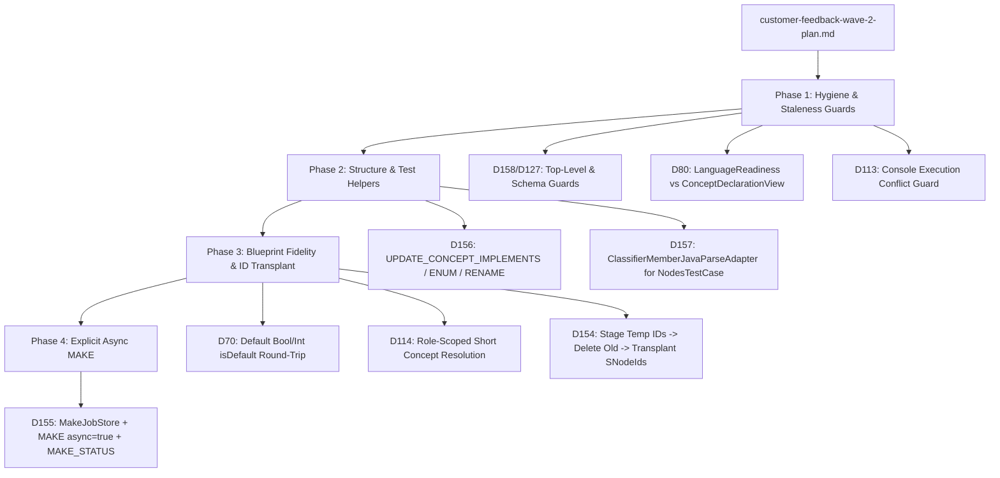

# Requirements

### Overview & Goals

Wave 1 of `plugins/mcp-tools/docs/customer-feedback-triage.md` remediated all confirmed live `mcp-tools` bugs (`CF-001`–`CF-005`, `CF-012`, `CF-013`) and documented core-MPS/MCP workarounds across all three skill trees (`CF-018`, `CF-021`–`CF-034`). Wave 2 addresses the remaining server-side feature candidates and open server defects identified in the triage ledger.

Because Wave 2 spans 10 distinct server enhancements and defects across multiple toolsets and core helpers, it will be executed across multiple independent sessions rather than in a single run. The goal of this task is to author a **persistent, self-contained, checkbox-driven Wave 2 execution plan** at `plugins/mcp-tools/docs/customer-feedback-wave-2-plan.md` (modelled on `plugins/mcp-tools/docs/d130-plan.md`) and cross-link it from `customer-feedback-triage.md` and `plugins/mcp-tools/study/instructions/defects.md`.

### Scope

#### In Scope
- Authoring `plugins/mcp-tools/docs/customer-feedback-wave-2-plan.md` with `- [ ]` checkboxes, concrete technical contracts, code locations, test gates, skill-update steps, defect-archival steps, and commit boundaries.
- Covering all **10 open Wave 2 items** agreed for remediation:
  - **5 Section 4.2 Feature Candidates (`NEW_TOOL_FEATURE`)**: `D154` (`CF-006`), `D155` (`CF-007`), `D156` (`CF-008`), `D157` (`CF-009`), `D158` (`CF-010`).
  - **3 Section 1 / 2.3 Server Defects Marked `TRACKED_FOR_WAVE_2`**: `D70` (`CF-014`), `D80` (`CF-015`), `D114` (`CF-011`).
  - **2 Section 2.3 Optional Server Polish Items**: `D113` (`CF-016`), `D127` (`CF-017`).
- Organizing those 10 items into **4 risk-graduated phases** (low-risk guards & polish -> additive authoring helpers -> blueprint fidelity & ID-preserving rewrites -> explicit async `MAKE`).
- Cross-linking the new roadmap file from `plugins/mcp-tools/docs/customer-feedback-triage.md` and `plugins/mcp-tools/study/instructions/defects.md`.

#### Out of Scope
- Executing any Wave 2 Kotlin, test, or skill-catalog changes during this run (**plan-file-only deliverable**).
- Wave 1 items already fixed and archived (`D138`, `D140`, `D141`, `D149`–`D153`, `D159`–`D163`), pre-existing fixed items (`CF-035`–`CF-052`), dropped customer-domain / third-party items (`CF-053`–`CF-057`), and upstream JBR / MPS Core / IDEA MCP escalations (`CF-058`–`CF-062`).

### User Stories

- **As a developer or coding agent picking up a Wave 2 session**, I want a standalone phased document with granular `- [ ]` checkboxes and settled architectural decisions so that I can execute one phase (or single defect) cleanly without re-triaging `customer-feedback-triage.md` or guessing cross-cutting invariants.
- **As a maintainer reviewing multi-run progress**, I want each item and phase to gate checkbox completion on specific tests, 3-tree skill catalog parity, IDE log checks, and `defects-archive.md` updates so partially verified work is never marked complete.

### Functional Requirements

1. **Persistent Plan Location & Convention**:
   - Write the plan to `plugins/mcp-tools/docs/customer-feedback-wave-2-plan.md`.
   - Follow `d130-plan.md` checkbox rules: *"Tick a box (`[x]`) only when the item is implemented **and** verified as stated; record commit hashes in the top status banner after each phase commits."*
2. **4-Phase Risk-Graduated Grouping**:
   - **Phase 1 — Input Hygiene, Staleness & Console/Parser Polish** (`D158`, `D127`, `D113`, `D80`): Low-risk request guards, targeted error hints, console conflict check, and runtime-vs-declaration staleness reporting (`~2–2.5 days` total).
   - **Phase 2 — Structure & Test Authoring Helpers** (`D156`, `D157`): Additive, self-contained operations in `alter_structure` and `NodesTestCase` support in `parse_java_and_insert` (`~2–3 days` total).
   - **Phase 3 — Blueprint Round-Trip Fidelity & ID-Preserving Rewrites** (`D70`, `D114`, `D154`): Cohesive pass over `AbstractOps` / `AbstractNodeOps` JSON serialization, short-name disambiguation, and child `SNodeId` preservation (`~4.5–6.5 days` total).
   - **Phase 4 — Explicit Async `MAKE` & Status Polling** (`D155`): Opt-in `async: true` mode on `mps_mcp_alter_nodes` `MAKE` and `MAKE_STATUS` polling backed by a project-scoped job store (`~2–3 days` total).
3. **Self-Contained Per-Phase Checklists**:
   - Every item and phase in `customer-feedback-wave-2-plan.md` must include explicit `- [ ]` checkboxes for:
     - Server code changes (with exact file paths, classes, and invariants).
     - Unit and/or integration tests (naming the target test class and `Mcp*TestSuite` sub-suite per `.agents/quality-gates.md`).
     - Skill blueprint updates (replacing Wave 1 workaround prose in `plugins/mcp-tools/resources/jetbrains/mps/agents/mcp/skills/`, propagating verbatim to `.agents/skills/` and `.claude/skills/`, and running `validate_skill_catalog.py`).
     - Moving closed `D*` entries from `study/instructions/defects.md` to `study/instructions/defects-archive.md` and updating `customer-feedback-triage.md` status tags.
     - Live MPS verification + `mps_mcp_read_ide_log` (`minLevel="WARN"`) check + commit gate per `.agents/git.md`.
4. **Tracker Cross-Links**:
   - Link `customer-feedback-wave-2-plan.md` from `customer-feedback-triage.md` (§4.2 and §2.3 notes) and from the 10 corresponding rows in `study/instructions/defects.md`.

# Technical Design

### Current Implementation

Investigation of `plugins/mcp-tools/` established the exact starting baseline for all 10 items:
- **Top-level `@McpTool` parameter checking (`D158`)**: `AbstractOps.rejectUnknownTopLevelParameters(tool, allowed)` (`AbstractOps.kt:447-480`) already inspects `McpCallAdditionalDataElement` `rawArguments`, ignores `TOLERATED_PARAMETER_KEYS` (`projectPath`) and `JsonNull`, and suggests near-misses via `RequiredParameterNearMisses` + `suggestParameterName`. Currently only `mps_mcp_run_migrations` invokes it (`McpToolParameterOptionalityTest.kt:169-176` already reflects over `plugin.xml` toolsets to verify allowed sets).
- **Java parser `"imports"` rejection (`D127`)**: `parseJavaParseInsertRequest` (`McpToolInputSchemas.kt:545`) calls `obj.rejectUnknownParameterKeys("mps_mcp_parse_java_and_insert", JAVA_INSERT_PARAMETER_KEYS)` without mentioning that Java classes resolve through the target model's `@java_stub` imports (`mps_mcp_model_dependency`).
- **Console run/insert race (`D113`)**: `MPSConsoleMcpToolset.mps_mcp_run_console_command` (`MPSConsoleMcpToolset.kt:364-366`) invokes `executeCurrentCommand` on the EDT and returns immediately while execution proceeds asynchronously; a concurrent/batched `mps_mcp_insert_console_command_from_json` or `mps_mcp_recall_console_command` overwrites the input holder before history recording finishes.
- **Concept runtime staleness (`D80`)**: `LanguageReadiness.classify` (`LanguageReadiness.kt:88-93`) relies solely on `ModelGenerationStatusManager.generationRequired(structureModel)`, missing a leftover `LanguageRegistry` runtime from a closed project with the same module ID. Furthermore, `MPSLanguageMcpToolset.mps_mcp_get_concept_details` (`MPSLanguageMcpToolset.kt:214-226`) sets `unserved = false` for `ConceptReadiness.NotBuilt.Stale` and filters `Stale` out of `buildWarnings`, returning stale runtime features without per-record markers after `UPDATE_CONCEPT_*` before `MAKE`.
- **Structure alter operations (`D156`)**: `MPSStructureAlterOperation` (`MPSLanguageStructureMcpToolset.kt:49-58`) has `CREATE_CONCEPTS`, `CREATE_ENUM`, `UPDATE_CONCEPT_{PROPERTY,CHILD,REFERENCE}`, and `RENAME_CONCEPT_{PROPERTY,CHILD,REFERENCE}`, but lacks incremental helpers for `ConceptDeclaration.implements`, `EnumerationDeclaration.members`, and renaming a concept declaration itself.
- **Java member parsing on `NodesTestCase` (`D157`)**: `MPSJavaMcpToolset.prepareJavaParseResult` (`MPSJavaMcpToolset.kt:117-169`) and `ConceptBehaviorJavaParseAdapter.kt` accept `Classifier` and `ConceptBehavior`, rejecting `NodesTestCase` (`IClassifier`, whose helper methods are `DefaultClassifierMethodDeclaration` in role `methods`).
- **Default boolean/integer omission in JSON (`D70`)**: In MPS, `SPrimitiveTypes.BOOLEAN.toString(false)` and `SPrimitiveTypes.INTEGER.toString(0)` return `null`, so `AbstractOps.addNodeFeatures` (`AbstractOps.kt:1898-1910`) omits `false`/`0` properties (`defaultEnumLiteralName` handles enums only), and `AbstractNodeOps.isUnsetDefaultProperty` (`AbstractNodeOps.kt:624-630`) checks enum defaults only.
- **Short concept names in blueprints (`D114`)**: `AbstractNodeOps.createNode` (`AbstractNodeOps.kt:434-481`) resolves bare names globally via `resolveConceptPreferringProject` and then calls `model.addLanguage(language)`, silently picking an arbitrary language on short-name collisions (`"NodeParameter"`, `"IsNotEmptyOperation"`) and importing it.
- **Full-root child replacement (`D154`)**: `AbstractNodeOps.updateNodeFromBlueprint` (`AbstractNodeOps.kt:1251-1375`) stages new children attached alongside `originalChildren` so `NodeFactoryManager.setupNode` sees live ancestors (`MPS-40226`), then deletes `originalChildren`. Because two attached nodes in one `SModel` cannot share an `SNodeId` simultaneously, every child gets a fresh `SNodeId`.
- **Large-language `MAKE` cancellation (`D155`)**: `AbstractOps.performMake` (`AbstractOps.kt:4832-4845`) runs `future.get()` inside `runInterruptible`; on MCP transport timeout (`CancellationException`), it cancels `makeMonitor` and `future.cancel(true)`, aborting mid-build after `TextGen` wrote `source_gen/`.

### Key Decisions

1. **All 10 Open Triage Items Grouped into 4 Risk-Graduated Phases**: Covers `D154`–`D158`, `D70`, `D80`, `D114`, and optional server polish `D113` and `D127`. Ordering phases from low-blast-radius validation/staleness guards (Phase 1) and isolated toolset extensions (Phase 2) to shared `AbstractNodeOps` blueprint mechanics (Phase 3) and stateful `performMake` job management (Phase 4) delivers early value while isolating complex core changes into dedicated runs.
2. **Plan-File-Only Deliverable**: Implementing this plan writes `plugins/mcp-tools/docs/customer-feedback-wave-2-plan.md` and updates tracker links in `customer-feedback-triage.md` and `study/instructions/defects.md`; code phases execute in subsequent runs.
3. **`D155` — Explicit Async `MAKE` Mode (`async: true` + `MAKE_STATUS`)**: Synchronous `MAKE` (`async = false`, default) keeps its deterministic cancellation behavior unchanged. Passing `async: true` starts the build inside an application/project-scoped coroutine managed by `MakeJobStore`, returns `jobId` immediately, and exposes a read-only `MAKE_STATUS` operation on `mps_mcp_alter_nodes` to poll phase progress and final `MakeResult`.
4. **`D154` — Stage-Then-Transplant `SNodeId` Preservation**: Keep `updateNodeFromBlueprint`'s `MPS-40226` attached staging with temporary `SNodeId`s so node factories and rollback-on-throw remain untouched. Record unique `(stagedNode -> preservedSNodeId)` pairs for blueprint descendants whose `"reference"` matches an existing same-concept descendant of the target root; once `originalChildren` are deleted in the apply phase (freeing those IDs in `SModel`), detach the staged subtrees, assign preserved IDs via `jetbrains.mps.smodel.SNode.setId`, re-attach in role order, and mature intra-root `StaticReference`s so no immature object pointer points to a deleted original node.
5. **`D114` — Role-Scoped Short Concept Disambiguation**: Allow an unqualified `concept` name in JSON blueprints only when it matches **exactly one** concrete concept in the target model's already-used languages/devkits (narrowed by `link.targetConcept` assignability when `link != null`), emitting a `warnings` entry naming the resolved FQN and **never** auto-importing an unused language from a bare name. Reject 0 or 2+ matches (or unimported-only matches) with ranked FQN candidates from `ConceptSuggestions`.

### Proposed Phase Designs & Contracts

`plugins/mcp-tools/docs/customer-feedback-wave-2-plan.md` will specify the following 4 phases:

#### Phase 1 — Input Hygiene, Staleness & Console/Parser Polish (`D158`, `D127`, `D113`, `D80`)
- **`D158` (`CF-010`) — Universal `rejectUnknownTopLevelParameters` Guard**:
  - Centralize reflected/declared parameter-name sets per `@McpTool` method (or invoke `rejectUnknownTopLevelParameters` at the top of every `@McpTool` function across all 18 `*McpToolset` classes, including endpoints that return before `withMpsProject` such as `mps_mcp_list_open_projects`, `mps_mcp_run_console_command`, and `mps_mcp_search_concepts`).
  - Extend `McpToolParameterOptionalityTest` (`McpContractAndSkillsTestSuite`) to assert every `@McpTool` registered in `plugins/mcp-tools/META-INF/plugin.xml` has a verified parameter allow-list matching `tool.valueParameters` and add wire-level rejection tests (e.g., `depth`/`outputFile` on `print_node`, `index` on `update_node`, `name` on `create_run_configuration`).
- **`D127` (`CF-017`) — `"imports"` Unknown-Key Hint in `parse_java_and_insert`**:
  - In `parseJavaParseInsertRequest` (`McpToolInputSchemas.kt:545`), when the unknown key is `"imports"`, append a one-line actionable note explaining that parsed Java resolves external classes through the target model's imports (`mps_mcp_model_dependency` `ADD` with `...@java_stub`). Test in `McpToolInputSchemasTest`.
- **`D113` (`CF-016`) — Console In-Flight Execution Guard**:
  - Track per-project console execution state in `MPSConsoleMcpToolset` (or inspect `BaseConsoleTab` / pending input-to-history transition) so `mps_mcp_insert_console_command_from_json`, `mps_mcp_recall_console_command`, and `mps_mcp_run_console_command` (when `dryRun = false`) return `McpErrorCode.CONFLICT` if a prior `run_console_command` is still moving/executing, advising `mps_mcp_get_console_history(includeResponses=true)`. Test in `MPSConsoleMcpToolsetIntegrationTest` (`McpWorkspaceToolsTestSuite`).
- **`D80` (`CF-015`) — Runtime-vs-Declaration Feature Divergence in `LanguageReadiness` & `get_concept_details`**:
  - Extend `LanguageReadiness.classify` (`LanguageReadiness.kt:74-93`) with a lightweight structural signature check comparing the runtime `SAbstractConcept`'s own declared property/link IDs and names against `ConceptDeclarationView.of(declaration)` when `declaration != null`, catching both unbuilt `UPDATE_CONCEPT_*` edits (`CF-015`) and leftover closed-project runtimes (`D80`) as `ConceptReadiness.NotBuilt.Stale` (or `RuntimeMismatch`).
  - Update `MPSLanguageMcpToolset.mps_mcp_get_concept_details` (`MPSLanguageMcpToolset.kt:212-227`) so `Stale` concepts either serve fresh declaration features via `ConceptDeclarationView` with `runtimeStatus: "stale"` / `runtimeStale: true` markers and a `warnings` entry naming the `MAKE` recovery, rather than silently returning outdated runtime descriptors. Test in `LanguageReadinessTest` (`McpLanguageToolsTestSuite`).

#### Phase 2 — Structure & Test Authoring Helpers (`D156`, `D157`)
- **`D156` (`CF-008`) — `alter_structure` Incremental Operations**:
  - Extend `MPSStructureAlterOperation` and `alterStructureParameterKeys` in `MPSLanguageStructureMcpToolset.kt` with:
    - `UPDATE_CONCEPT_IMPLEMENTS`: parameters `conceptRef`, `interfaceRef` (or `interfaceRefs`), `action` (`"ADD"` | `"REMOVE"`). Supports adding/removing `InterfaceConceptReference` entries on `ConceptDeclaration.implements` (and `InterfaceConceptDeclaration.extends`), resolving target `InterfaceConceptDeclaration` *before* mutating (`D153` atomicity rule), deduplicating on `ADD`.
    - `UPDATE_ENUM_MEMBER`: parameters `enumerationRef`, `memberName`, `action` (`"ADD"` | `"UPDATE"` | `"REMOVE"`), optional `newName`, `presentation`, `isDefault: Boolean`. Mutates `EnumerationDeclaration.members` (`EnumerationMemberDeclaration`) in place preserving `memberId` on `UPDATE`.
    - `RENAME_CONCEPT`: parameters `conceptRef`, `newName`. Validates identifier & same-model name uniqueness, sets `INamedConcept.name` on the `ConceptDeclaration` / `InterfaceConceptDeclaration` / `EnumerationDeclaration` (preserving numeric `conceptId`), calls `saveModelAndModule` (`FORCE_SAVE_WITH_RESOLVE_INFO`), and reports `makeStatus: "runtime_stale"` plus any non-auto-named aspect roots (`InferenceRule` `typeof_*`, etc.) in `details`.
  - Test in `MPSLanguageStructureMcpToolsetIntegrationTest` (`McpLanguageToolsTestSuite`); update `mps-aspect-structure-concepts` (`tool-conventions.md`) across all 3 skill trees.
- **`D157` (`CF-009`) — `parse_java_and_insert` Support for `NodesTestCase` (`IClassifier`)**:
  - Add `ClassifierMemberJavaParseAdapter` alongside `ConceptBehaviorJavaParseAdapter.kt` converting parsed `InstanceMethodDeclaration` / `StaticMethodDeclaration` nodes into `jetbrains.mps.baseLanguage.classifiers.structure.DefaultClassifierMethodDeclaration` (copying name, visibility, parameters, returnType, body, throwsItems, typeVariables, javadoc; rejecting `StaticMethodDeclaration` or fields/constructors with a clear `INVALID_REQUEST` message since `NodesTestCase.methods` holds instance `DefaultClassifierMethodDeclaration`s, and rewriting `this.<helper>()` `InstanceMethodCallOperation` -> `DefaultClassifierMethodCallOperation` where resolvable).
  - Wire `IClassifier` (`NodesTestCase`) into `MPSJavaMcpToolset.prepareJavaParseResult` (`inferredContextNodeRef` at lines 124–135 and `parseContext` at lines 145–169) and `McpToolInputSchemas.kt:602`.
  - Test in `MPSJavaMcpToolsetIntegrationTest` (`McpJavaToolsTestSuite`); update `mps-tests/references/common-failures.md` across all 3 skill trees.

#### Phase 3 — Blueprint Round-Trip Fidelity & ID-Preserving Rewrites (`D70`, `D114`, `D154`)
- **`D70` (`CF-014`) — Default Boolean & Integer Emission in `print_node` JSON**:
  - In `AbstractOps.addNodeFeatures` (`AbstractOps.kt:1898-1910`), generalize `defaultEnumLiteralName(prop)` to `defaultPropertyDisplayValue(prop)` returning `"false"` for `SPrimitiveTypes.BOOLEAN`, `"0"` for `SPrimitiveTypes.INTEGER`, and `defaultEnumLiteralName(prop)` for `SEnumeration` when `!stored` (`!SNodeAccessUtil.hasProperty(node, prop)`), emitting `"isDefault": true`.
  - In `AbstractNodeOps.isUnsetDefaultProperty` (`AbstractNodeOps.kt:624-630`), match `"false"` on `BOOLEAN` and `"0"` on `INTEGER` alongside enum defaults: in `createNode` (`line 566`), `newNode.setProperty(sProperty, null)` clears any factory-set `"true"` (fixing `PunctuationLeftStyleClassItem.flag = false` clone flip!), while an edited `"isDefault": true, "value": "true"` has `propValue != default` and applies `"true"`.
  - Audit `McpNodeToolsTestSuite` + `SkillBlueprintShapesTest` for assertions expecting `"properties": []` on boolean/int nodes; update `mps-dsl-memory`, `mps-language-analysis`, and `mps-mcp-workflow/references/analysis-tools/print-node-output.md`.
- **`D114` (`CF-011`) — Role-Scoped Short Concept Name Disambiguation**:
  - In `AbstractNodeOps.createNode` (`AbstractNodeOps.kt:434-481`) and `typeOperandNode`: detect unqualified `concept` names (`!conceptName.contains('.')` and `conceptRef.isNullOrEmpty()`).
  - Restrict candidate lookup for unqualified names to concrete concepts in `UsedLanguages` of `model` (direct used languages + used devkits), further filtered to subconcepts of `link.targetConcept` when `link != null` (or rootable concepts when `enclosingNode == null` and Inserting Root).
  - Exact 1 match -> resolve without calling `model.addLanguage` and append a `warnings` entry naming the chosen FQN; 0 matches or 2+ matches -> throw `McpInvalidRequestException` / `McpNotFoundException` with ranked FQN candidates from `ConceptSuggestions`.
  - Update `mps-aspect-dataflow` (`SKILL.md`, `json-patterns.md`) and `mps-node-editing` (`json-format.md`); test in `MPSNodeMcpToolsetIntegrationTest` / `MPSRootNodeMcpToolsetIntegrationTest`.
- **`D154` (`CF-006`) — Stage-Then-Transplant ID Preservation in `update_root_node_from_json`**:
  - Before staging in `AbstractNodeOps.updateNodeFromBlueprint` (`AbstractNodeOps.kt:1200`), index existing descendants of `node` (excluding `node` itself) as `Map<SNodeId, SConcept>`.
  - During `createNode` / `fillChildren` under `updateNodeFromBlueprint`, parse optional `"reference"` on each child blueprint: if its `SNodeId` is in `existingDescendants` with the **exact same `SConcept`** and has not already been claimed by an earlier blueprint node, record `stagedNode -> targetSNodeId` (on duplicate claim, keep first and emit a warning; on concept mismatch or foreign root ID, mint a fresh ID as today).
  - Also allow intra-root references staged during `createNode` / `updateNodeFromBlueprint` to target preserved IDs safely: in the apply phase, after `originalChildren` are deleted from `node`, detach each staged top-level child subtree, apply `(stagedDescendant as jetbrains.mps.smodel.SNode).setId(preservedId)` for all recorded descendants, re-attach to `node` in role order, and convert/re-resolve intra-root `StaticReference`s by `(model.reference, targetNodeId)` so no immature direct `SNode` reference dangles onto a deleted original node. Report `preservedNodeIds: Int` in `details`.
  - Test intra-root (`ApplicableNodeReference`, `LocalVariableReference`, `StaticMethodCall`) and cross-root (`has error` `TestNodeAnnotation`, behavior callers) preservation plus rollback-on-invalid-blueprint in `MPSRootNodeMcpToolsetIntegrationTest` (`McpNodeToolsTestSuite`).

#### Phase 4 — Explicit Async `MAKE` & Status Polling (`D155`)
- **`D155` (`CF-007`) — Opt-In `async: true` `MAKE` + `MAKE_STATUS`**:
  - Add `"async"` (`Boolean`, default `false`) to `MAKE` parameter keys and add `MAKE_STATUS` (`jobId` optional `String`, `waitMs` optional `Int` bounded e.g. `0..25_000`) to `MPSNodeAlterOperation` (`MPSNodeMcpToolset.kt`).
  - Introduce a project-scoped `MakeJobStore` (disposed with `Project` so background coroutines cancel cleanly on project close) holding at most one active async job and a small ring buffer of recent completed jobs:
    - Tracks lifecycle state: `PREPARING` -> `GENERATING` -> `COMPILING` -> `RELOADING` -> `COMPLETED` / `FAILED` / `CANCELLED` (hooked via custom `ProgressMonitorBase` / `IMakeNotificationListener` task names and `messages` accumulator), start/end timestamps, target modules/models, and final `MakeResult`.
    - When `async = true`, `performMake` validates inputs and session availability synchronously, launches the build on an independent project coroutine scope (so MCP call transport return/cancellation does **not** cancel `makeMonitor`), and returns `{jobId, status: "RUNNING", phase, pollWith: {tool: "mps_mcp_alter_nodes", operation: "MAKE_STATUS", parameters: {jobId}}}`.
    - Synchronous `MAKE` (`async = false`) keeps its existing `runInterruptible` cancellation behavior (`makeMonitor.cancel()`), and if an async `MAKE` is already active, reports `"Another make session is already active"` alongside `details.activeMakeJobId` so the caller can poll `MAKE_STATUS` instead of failing blindly.
  - Test async launch, phase transitions, completion reload, concurrent `MAKE` hint, and project-close cancellation in `AbstractOpsMakeTest` (`McpNodeToolsTestSuite`); update `mps-mcp-workflow` (`node-editing-rules.md`, `mcp-tools-index.md`) across all 3 skill trees.

### File Structure

Files modified/added **when implementing this plan** (authoring the roadmap):
- `plugins/mcp-tools/docs/customer-feedback-wave-2-plan.md` *(new — phased checkbox roadmap)*
- `plugins/mcp-tools/docs/customer-feedback-triage.md` *(modified — cross-link §4.2 & §2.3 to `customer-feedback-wave-2-plan.md`)*
- `plugins/mcp-tools/study/instructions/defects.md` *(modified — annotate `D70`, `D80`, `D113`, `D114`, `D127`, `D154`–`D158` status cells with Wave 2 phase links)*

Target codebase files **catalogued inside `customer-feedback-wave-2-plan.md` for Wave 2 runs**:
- Phase 1: `common/AbstractOps.kt`, `common/McpToolInputSchemas.kt`, `common/LanguageReadiness.kt`, `MPSLanguageMcpToolset.kt`, `MPSConsoleMcpToolset.kt`, all `*McpToolset.kt` top-level entry points, `unit/McpToolParameterOptionalityTest.kt`, `unit/McpToolInputSchemasTest.kt`, `integration/LanguageReadinessTest.kt`, `integration/MPSConsoleMcpToolsetIntegrationTest.kt`.
- Phase 2: `MPSLanguageStructureMcpToolset.kt`, `MPSJavaMcpToolset.kt`, `common/McpToolInputSchemas.kt`, `java/ClassifierMemberJavaParseAdapter.kt` *(new in Phase 2)*, `integration/MPSLanguageStructureMcpToolsetIntegrationTest.kt`, `integration/MPSJavaMcpToolsetIntegrationTest.kt`.
- Phase 3: `common/AbstractOps.kt`, `common/AbstractNodeOps.kt`, `MPSRootNodeMcpToolset.kt`, `integration/MPSRootNodeMcpToolsetIntegrationTest.kt`, `integration/MPSNodeMcpToolsetIntegrationTest.kt`.
- Phase 4: `common/AbstractOps.kt`, `common/MakeJobStore.kt` *(new in Phase 4)*, `MPSNodeMcpToolset.kt`, `common/McpToolInputSchemas.kt`, `integration/AbstractOpsMakeTest.kt`.
- All phases: `plugins/mcp-tools/resources/jetbrains/mps/agents/mcp/skills/**` mirrored to `.agents/skills/**` and `.claude/skills/**`, plus `study/instructions/defects.md` and `study/instructions/defects-archive.md`.

### Architecture Diagram

### Risks

- **Immature `StaticReference` & Attached-Model `SNodeId` Invariants (`D154`)**: `jetbrains.mps.smodel.SNode.setId` asserts `myModel == null`, and `StaticReference.create` to an in-memory node creates an immature direct object pointer until matured. The Phase 3 spec in the plan file will explicitly require detaching staged subtrees after `originalChildren` deletion, calling `setId` while detached, re-attaching, and rebinding/maturing intra-root `StaticReference`s by `(modelReference, targetNodeId)`.
- **Existing Test Snapshot Sensitivity (`D70` & `D114`)**: Emitting `"isDefault": true` on unset booleans/integers (`D70`) and rejecting unimported/ambiguous bare concept names (`D114`) will surface existing tests or skill examples that relied on `"properties": []` or bare `"NodeParameter"`. Phase 3 checkboxes will explicitly sequence skill-blueprint and test updates alongside full `McpToolsIntegrationTestSuite` runs (required by `.agents/quality-gates.md` whenever `common/` changes).
- **Orphaned Background Coroutines or Locked `MakeSession` (`D155`)**: An `async: true` make outlives the initiating MCP request. Phase 4 will require tying `MakeJobStore`'s `CoroutineScope` to IntelliJ `Project` disposal and ensuring `MigrationAssistantGuard` + `sessionClosedLatch` cleanup run inside `finally` blocks.
- **3-Tree Skill Drift & Suite Registration (`All Phases`)**: Editing `.agents/skills/` directly or registering a new test in `McpToolsIntegrationTestSuite` breaks CI (`SkillCatalogReplicationTest` and `SuiteRegistrationGuardTest`). Section 0 of the plan file will bake both invariants into every phase's checklist.

# Testing

### Validation Approach

Per `.agents/quality-gates.md` (*"Documentation, comment, and other prose-only changes have no build or test gate. Say that explicitly instead of running a suite to have something to report"*), authoring `customer-feedback-wave-2-plan.md` and updating links in `customer-feedback-triage.md` and `study/instructions/defects.md` is a **prose-only change** and will **not** invoke a JVM build or JUnit suite during this run.

Instead, the agent will validate the generated plan file and tracker cross-links directly against the codebase and repository rules, and ensure every Wave 2 phase embeds the mandatory `.agents/quality-gates.md` test commands for the future code runs.

### Key Scenarios

1. **Completeness Against Triage Ledger & Defect Tracker**:
   - Verify all 10 items (`D154`–`D158`, `D70`, `D80`, `D114`, `D113`, `D127`) appear in both the summary matrix and their assigned Phase 1–4 sections with matching `CF-*` and `D*` IDs.
2. **Actionable Multi-Run Checkbox Structure**:
   - Verify every phase in `plugins/mcp-tools/docs/customer-feedback-wave-2-plan.md` uses standard Markdown `- [ ]` checkboxes covering implementation, tests (`MCP_TESTS=...` and full umbrella where `common/` is touched), 3-tree skill sync + `validate_skill_catalog.py`, `mps_mcp_read_ide_log` check, `defects.md` -> `defects-archive.md` move, and `.agents/git.md` commit.
3. **Cross-Reference & Path Integrity**:
   - Verify every relative link between `customer-feedback-wave-2-plan.md`, `customer-feedback-triage.md`, and `study/instructions/defects.md` resolves cleanly, and every Kotlin source path, test class, sub-suite name, and skill file path named in the roadmap exists (or is explicitly marked *(new)*).

### Edge Cases

- **Skill Tree Untouched Guard**: Confirm `git status --short` shows modifications **only** to `plugins/mcp-tools/docs/customer-feedback-wave-2-plan.md`, `plugins/mcp-tools/docs/customer-feedback-triage.md`, and `plugins/mcp-tools/study/instructions/defects.md` (zero accidental edits under `plugins/mcp-tools/resources/.../skills/`, `.agents/skills/`, `.claude/skills/`, or `src/`).
- **`common/` Umbrella Gate Coverage**: Confirm Phases 1, 3, and 4 (which modify `common/`) explicitly require a full unfiltered `McpToolsIntegrationTestSuite` run in addition to targeted `MCP_TESTS` runs, matching `.agents/quality-gates.md`.

# Delivery Steps

###   Step 1: Author Wave 2 plan header, multi-run ground rules, and Phases 1–2 in customer-feedback-wave-2-plan.md
`plugins/mcp-tools/docs/customer-feedback-wave-2-plan.md` exists with multi-run execution rules, the 4-phase overview table, and detailed checkbox lists for Phases 1 and 2.

- Create `plugins/mcp-tools/docs/customer-feedback-wave-2-plan.md` modelled on `plugins/mcp-tools/docs/d130-plan.md` ("Tick a box only when implemented *and* verified as stated").
- Write Section 0 (Multi-Run Execution Ground Rules): JDK 25 check, `McpToolsIntegrationTestSuite` / `MCP_TESTS` selection table from `.agents/quality-gates.md`, `SuiteRegistrationGuardTest` single-sub-suite rule, 3-tree skill blueprint propagation (`plugins/mcp-tools/resources/.../skills` -> `.agents/skills` & `.claude/skills`) + `validate_skill_catalog.py`, `mps_mcp_read_ide_log` live check, `defects.md` -> `defects-archive.md` archival, and `.agents/git.md` commit format.
- Write Section 1 (Phase & Item Matrix): map all 10 Wave 2 items (`D158`, `D127`, `D113`, `D80`, `D156`, `D157`, `D70`, `D114`, `D154`, `D155`) to `CF-*` IDs, phases, owning source files, test suites, and status checkboxes.
- Author **Phase 1 — Input Hygiene, Staleness & Console/Parser Polish** (`D158`, `D127`, `D113`, `D80`) with concrete implementation, test, skill-doc, and verification checkboxes.
- Author **Phase 2 — Structure & Test Authoring Helpers** (`D156`, `D157`) with operation schemas (`UPDATE_CONCEPT_IMPLEMENTS`, `UPDATE_ENUM_MEMBER`, `RENAME_CONCEPT`), `IClassifier` / `DefaultClassifierMethodDeclaration` adapter rules, and verification checkboxes.

###   Step 2: Author Phases 3–4 architectural specs and verification checklists in customer-feedback-wave-2-plan.md
`customer-feedback-wave-2-plan.md` contains full architectural designs, edge-case guards, and verification checkboxes for Phase 3 (`D70`, `D114`, `D154`) and Phase 4 (`D155`).

- Author **Phase 3 — Blueprint Round-Trip Fidelity & ID-Preserving Rewrites** (`D70`, `D114`, `D154`) in `plugins/mcp-tools/docs/customer-feedback-wave-2-plan.md`:
  - `D70` (`CF-014`): unset boolean (`"false"`) and integer (`"0"`) emission with `"isDefault": true` in `AbstractOps.addNodeFeatures` and `AbstractNodeOps.isUnsetDefaultProperty` handling so factory-initialized `true` flags (`PunctuationLeftStyleClassItem.flag`) clear on replay while explicitly stored values apply.
  - `D114` (`CF-011`): role-scoped unqualified concept name disambiguation in `AbstractNodeOps.createNode` (used languages + devkits narrowed by `link.targetConcept`, warning with resolved FQN on unique hit, no auto-import from bare names, ranked `ConceptSuggestions` on 0 or 2+ matches).
  - `D154` (`CF-006`): stage-then-transplant `SNodeId` preservation in `AbstractNodeOps.updateNodeFromBlueprint` (temporary IDs during staging to preserve `MPS-40226` factory context and rollback, post-delete detachment + `jetbrains.mps.smodel.SNode.setId` transplant for unique same-concept descendant matches, and intra-root `StaticReference` maturation).
- Author **Phase 4 — Explicit Async `MAKE` & Status Polling** (`D155` / `CF-007`):
  - Opt-in `async: true` parameter on `mps_mcp_alter_nodes` `MAKE`, project-scoped `MakeJobStore` tracking phase transitions (`Preparing` -> `Generating` -> `Compiling` -> `Reloading` -> `Completed` / `Failed` / `Cancelled`) and project-close cleanup, and read-only `MAKE_STATUS` operation (`jobId` optional), leaving synchronous `MAKE` cancellation behavior unchanged.
- Include explicit skill-catalog cleanup checkboxes in each phase to replace Wave 1 workaround notes (`mps-node-editing`, `mps-mcp-workflow`, `mps-aspect-structure-concepts`, `mps-tests`, `mps-aspect-dataflow`, `mps-dsl-memory`, `mps-language-analysis`) once server support lands.

###   Step 3: Cross-link triage ledger and defect tracker and validate all roadmap references
`customer-feedback-triage.md` and `study/instructions/defects.md` cross-link to `customer-feedback-wave-2-plan.md`, and all links, file paths, and defect mappings are verified.

- Update Section 4.2 (and Section 2.3 `TRACKED_FOR_WAVE_2` references) in `plugins/mcp-tools/docs/customer-feedback-triage.md` to link to `customer-feedback-wave-2-plan.md` and note the 4-phase grouping across all 10 items.
- Update the status column of `D70`, `D80`, `D113`, `D114`, `D127`, and `D154`–`D158` in `plugins/mcp-tools/study/instructions/defects.md` to reference their assigned phase in `../../docs/customer-feedback-wave-2-plan.md`.
- Verify all relative Markdown links, section anchors, Kotlin class/file paths, test suite names, and `- [ ]` checkboxes across the three Markdown files; explicitly report per `.agents/quality-gates.md` that prose-only documentation edits require no JVM test suite run.