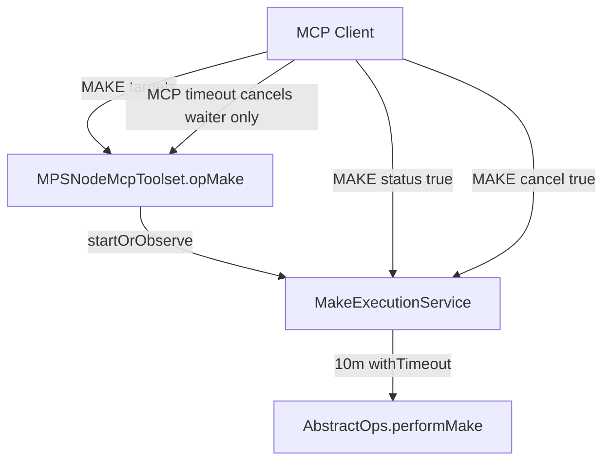

# D155 Follow-Up — Detach-on-Timeout Background `MAKE` Plan

**Status (2026-11-27):** Drafted and hardened through adversarial codebase review as a minimal post-Wave-2 (post-Phase-4 / post-Phase-5) follow-up to [`customer-feedback-wave-2-plan.md`](customer-feedback-wave-2-plan.md) (§1.5, §4) — **design & implementation plan only; no code changes implemented yet**.
- Wave 2 Phase 4 (`D155` / `CF-007`, Option 1) makes default `mps_mcp_alter_nodes` `MAKE` (`rebuild = false`) incremental via `ModelGenerationStatusManager.generationRequired` and recovers interrupted post-`TextGen` builds via `ModuleMaker`, eliminating everyday full-regeneration timeouts without changing the MCP schema.
- However, under Phase 4 alone, `MAKE` remains strictly bound to the MCP `tools/call` coroutine: if an irreducible build unit (a clean `rebuild = true` on a large language, an initial multi-module build, or a single huge model affected by `CF-059` `O(N²)` `TextGen`) exceeds the MCP client's transport timeout, Kotlin cancels `performMake` (`future.cancel(true)`), aborting in-flight work.
- This plan specifies the **minimal server + description change (~180–220 LOC)** that prevents MCP transport timeouts from implicitly cancelling an active `MAKE`, lets the `MAKE` continue in the background up to a **10-minute hard-stop timeout** (or explicit client cancellation / project disposal), and gives MCP clients lightweight polling (`{"status": true}`) and cancellation (`{"cancel": true}`) inside existing `mps_mcp_alter_nodes` `MAKE`.
- **Checkbox rule:** Tick a box (`[x]`) only when the item is implemented **and** verified against the test gates in §6.

---

## 0. Execution Ground Rules

Every session implementing this plan must follow [`.agents/quality-gates.md`](../../../.agents/quality-gates.md), [`.agents/conventions.md`](../../../.agents/conventions.md), [`.agents/git.md`](../../../.agents/git.md), and [`AGENTS.md`](../../../AGENTS.md):

1. **JDK 25 & Single-JVM Test Execution**:
   - Builds and tests run on **JDK 25**.
   - Never run multiple JUnit suites concurrently; verify `ps aux | grep JUnitStarter` shows no active runner before launching tests.
   - Run integration suites via `execute_run_configuration(configurationName="McpToolsIntegrationTestSuite", envs={"MCP_TESTS": "..."})`.
   - Every test that starts a background/detached `MAKE` **must** cancel and await `MakeExecutionService.awaitQuiescentForTests()` (parameterless JVM-wide companion helper) inside `try / finally` — including *before* any `mcpEnvironment.closeProject(secondaryProject)` call in multi-project tests — and `McpIntegrationTestBase.cleanUpGeneratedTempFiles()` (`integration/McpIntegrationTestBase.kt:508-518`, `@After` executed by JUnit 4 *before* superclass `ModuleInProjectTest.after()` closes `myProject` on the EDT) must also invoke `MakeExecutionService.awaitQuiescentForTests()` in `try / finally` so the JVM-wide `MakeServiceComponent` and `GenerationSettingsProvider` singletons are clean across consecutive test methods.
2. **Required Test Gates**:
   - Because `common/` (`AbstractOps.kt`, `TransientModelsOps.kt`, new `MakeExecutionService.kt`), `migration/HeadlessMigrations.kt`, `META-INF/plugin.xml` (`<ide.dynamicPluginVetoer>`), `MPSNodeMcpToolset.kt` (`@McpDescription` + `MAKE_PARAMETER_SCHEMA`), `McpIntegrationTestBase.kt`, and skill docs are touched, verification requires:
     1. Targeted tests (`AbstractOpsMakeTest`, `MPSNodeMcpToolsetExtendedIntegrationTest`, `MakeExecutionServiceTest` if split out),
     2. `McpNodeToolsTestSuite` + `McpContractAndSkillsTestSuite`,
     3. Full unfiltered `McpToolsIntegrationTestSuite` (no `MCP_TESTS`),
     4. `python3 plugins/mcp-tools/scripts/validate_skill_catalog.py --self-test plugins/mcp-tools/resources/jetbrains/mps/agents/mcp/skills`.
3. **3-Tree Skill Blueprint Sync & Byte Budgets**:
   - Edit only `plugins/mcp-tools/resources/jetbrains/mps/agents/mcp/skills/`; copy modified `<skill-name>/` directories verbatim over `.agents/skills/<skill-name>/` and `.claude/skills/<skill-name>/`.
   - Respect `SkillReferenceLayoutTest` budgets (`node-editing-rules.md` <= 12,288 B; `mcp-tools-index.md` is at 19,251 B / 19,456 B and needs **zero** edits under this design).
4. **Live MPS & IDE Log Gate**:
   - Exercise detach-on-timeout / `waitSeconds`, `{"status": true}`, and `{"cancel": true}` against a live MPS instance if available, and inspect `mps_mcp_read_ide_log(minLevel="WARN")` to confirm zero uncaught background exceptions or `MODAL_BLOCKED` regressions.

---

## 1. Problem Statement & Design Principles

### 1.1 Why Transport Cancellation Hurts Long `MAKE` Sessions

In `MPSNodeMcpToolset.opMake` (`MPSNodeMcpToolset.kt:757-763`), `performMake(...)` executes directly on the `mcpserver` `tools/call` request coroutine:
- `com.intellij.mcpserver` (`McpSessionHandler`) does not emit wire-level `notifications/progress` frames when `reportToolActivity` is called, so MCP clients enforce fixed per-call timeouts (commonly 60–120 s).
- When the client times out, `mcpserver` cancels the request coroutine. `AbstractOps.performMake` (`AbstractOps.kt:5021-5030`) catches `CancellationException` and immediately calls `makeMonitor.cancel()` and `future.cancel(true)`, aborting `WorkbenchMakeTask` (or Phase 4's `ModuleMaker`).
- If a single cluster's `Generate + TextGen` or a clean `rebuild = true` exceeds that client timeout, every retry restarts from zero and hits the exact same timeout in an unbreakable loop.

### 1.2 Why Full `MakeJobStore` (`D155` Option 2) Is Unnecessary

`WorkbenchMakeService` (`WorkbenchMakeService.java:73-79`, registered into the application-wide `MakeServiceComponent` `CoreComponent` at `MakeServiceComponent.java:19`) and `GenerationSettingsProvider` (`GenerationSettingsProvider.java:22`) are **IDE-wide singletons** sharing a single `MPSModuleRepository`: MPS permits **at most one active `MakeSession` across the entire IDE JVM** (not even one per open project). Consequently:
- Multi-job registries, `jobId` tokens, TTL eviction sweeps, new `@McpTool` endpoints, and new `MPSAlterOperation` enum entries (`MPSNodeMcpToolsetIntegrationTest.kt:2043`) add surface area without enabling any real build concurrency.
- Instead, a **`final` per-project `@Service(Service.Level.PROJECT)` (`MakeExecutionService`) coordinated through a single JVM-wide active-run slot (`MakeExecutionService.Companion`)**, plus two boolean control keys (`"status"`, `"cancel"`) and an optional `"waitSeconds"` bound inside `MAKE_PARAMETER_SCHEMA`, solve the problem completely while preserving:
  - Identical synchronous behavior and JSON payloads for every `MAKE` that finishes before the client times out,
  - Safe project-close and dynamic-plugin-reload lifecycle (`Disposer` cancels a closing project's active build and drops its `lastCompleted` record while preventing cross-project races on `MakeServiceComponent`, `MPSModuleRepository`, and `GenerationSettingsProvider`),
  - Existing `MPSAlterOperation.entries` and `mcp-tools-index.md` byte budgets,
  - `D29` / `D43` blank-`parameters` handling (`MPSNodeMcpToolset.kt:328`) and `MAKE("{}")` validation (`MPSNodeMcpToolsetExtendedIntegrationTest.kt:1615`),
  - Structured in-process cancellation for internal callers (`ensureLanguageRuntime`, `AbstractOpsMakeTest.kt:157`) that continue calling `performMake` directly.



---

## 2. MCP Tool Contract (`MPSNodeMcpToolset.kt`)

### 2.1 `MAKE_PARAMETER_SCHEMA` Additions

Extend `MAKE_PARAMETER_SCHEMA` (`MPSNodeMcpToolset.kt:109-115`) with three optional keys:

| Key | Type | Default | Contract |
|---|---|---|---|
| `status` | `boolean` | `false` | Poll the active or most recent MCP `MAKE` session without starting a new build. Cannot be combined with `cancel: true` or build keys (`models`, `modules`, `wholeProject`, `rebuild`, `saveTransientModels`). |
| `cancel` | `boolean` | `false` | Explicitly cancel the active MCP `MAKE` session owned by this project and wait up to `SESSION_CLOSE_TIMEOUT_SECONDS + 2` (`12 s`) for session wind-down. Cannot be combined with `status: true`, `waitSeconds`, or build keys. |
| `waitSeconds` | `integer` (`0..600`) | `0` for `status: true`; unbounded (up to MCP timeout / 10m hard-stop) for build calls | Maximum seconds this call waits for an active `MAKE` (or winding-down `CANCELLING` session) to settle before returning a non-terminal snapshot. Independent of `-Dmps.mcp.makeHardStopSeconds` test overrides. |

### 2.2 Input Validation & Lock-Free Pre-Flight Order

1. **Unknown-key check (`MPSNodeMcpToolset.kt:683-699`):** Keep existing `MAKE_INPUT_INVALID` + `expectedParameters` rejection, adding a small explicit near-miss fallback map (`"wait" | "waitSec" | "timeout" | "timeoutSeconds" -> "waitSeconds"`) alongside `suggestParameterName` (whose edit-distance threshold covers `"stat" -> "status"` and `"cancle" -> "cancel"`, but not `"wait" -> "waitSeconds"`).
2. **Type checks (using `McpToolInputSchemas` exact parsers, never raw Gson `asInt`):**
   - Parse `status = params.paramBoolean("status", default = false)` and `cancel = params.paramBoolean("cancel", default = false)` (`McpToolInputSchemas.kt:31-32, 763-782`, throwing `ToolInputSchemaException` -> `McpErrorCode.INVALID_REQUEST` via `AbstractOps.toolFailure` at `AbstractOps.kt:554`, matching `"saveTransientModels": "yes"` at `MPSNodeMcpToolsetExtendedIntegrationTest.kt:1783`).
   - Parse optional `waitSeconds` via `try { params.paramInt("waitSeconds") } catch (e: ToolInputSchemaException) { return makeInputInvalid("Parameter 'waitSeconds' must be an integer between 0 and 600") }` (`McpToolInputSchemas.kt:34, 784-805`, which accepts integer and quoted-integer scalars while rejecting floats like `3.5`, non-numbers, and 32-bit overflow), and check `if (waitSeconds != null && waitSeconds !in 0..MAX_WAIT_SECONDS) return makeInputInvalid("Parameter 'waitSeconds' must be an integer between 0 and 600")` where `MAX_WAIT_SECONDS = 600` is a constant independent of `-Dmps.mcp.makeHardStopSeconds`.
3. **Mode mutual exclusion (`MAKE_INPUT_INVALID`):**
   - If `status && cancel`: return `makeInputInvalid("Parameters 'status' and 'cancel' cannot both be true.")`.
   - Define `hasBuildKeys` as any non-`JsonNull` presence of `"models"`, `"modules"`, `"wholeProject"`, `"rebuild"`, or `"saveTransientModels"`.
   - If `(status || cancel) && hasBuildKeys`: return `makeInputInvalid("Control parameter '${if (status) "status" else "cancel"}' cannot be combined with build target or option parameters ('models', 'modules', 'wholeProject', 'rebuild', 'saveTransientModels').")`.
   - If `cancel && waitSeconds != null`: return `makeInputInvalid("Parameter 'waitSeconds' cannot be combined with 'cancel': true.")`.
   - If `!status && !cancel`: validate `models`/`modules` JSON array shapes, `wholeProject && (modelsArray != null || modulesArray != null)` (`errJson` preserving `MPSNodeMcpToolsetExtendedIntegrationTest.kt:1601`), and empty scope (`!wholeProject && requestedModels.isEmpty() && requestedModules.isEmpty()`) **before acquiring any model read lock** — extracting a shared `emptyMakeScopeInvalid()` helper carrying both the `"No model or module references were provided..."` message and `mapOf("expectedParameters" to MAKE_PARAMETER_SCHEMA)` so **both** the pre-lock check in `opMake` (`MPSNodeMcpToolsetExtendedIntegrationTest.kt:1615`) and `resolveMakeTargets` (`MPSNodeMcpToolset.kt:587`, unit-tested directly in `AbstractOpsPropertyProblemsTest.kt:2218`) preserve identical messages and `details.expectedParameters`.
4. **Critical lock-free pre-flight check BEFORE `executeBackgroundRead { resolveMakeTargets(...) }`:**
   - `executeBackgroundRead` enforces `withModalTimeout(MODEL_OPERATION_TIMEOUT_MS)` (`30 s`). If an agent retries `MAKE` after a transport timeout while the detached `MakeRun` holds the repository write lock for >30 s (e.g. `Make.reconcile` or `ClassLoaderManager.reload`), entering `executeBackgroundRead` first would stall 30 s and fail with `MODAL_BLOCKED` instead of returning the `"RUNNING"` status snapshot.
   - Therefore, immediately after pure-JSON validation in Mode A, call `MakeExecutionService.checkBusyBeforeTargetResolution(mpsProject)` (lock-free against `MPSModuleRepository`). If a build is already active (`RUNNING`, `CANCELLING`, `RUNNING_OTHER_PROJECT`, or `RUNNING_EXTERNAL`) or `HeadlessMigrations.applyRunning.get()` is `true`, return that response immediately without touching `executeBackgroundRead` or overwriting `lastCompleted`.

### 2.3 Response Shapes & State Machine Across All Call Modes

All valid `opMake` calls continue returning `finalizeResult(Gson().toJson(result))` (`{"ok": true, "data": {...}}`), matching existing `opMake` conventions.

**Canonical `state` values:**
- Non-terminal: `"RUNNING"`, `"CANCELLING"`, `"RUNNING_OTHER_PROJECT"`, `"RUNNING_EXTERNAL"` (all carry `"runtimeReady": false`).
- Terminal (for an MCP `MakeRun` in this project): `"COMPLETED"` (`MakeResult.success == true`, including `"Nothing to make..."` and `success == true, runtimeReady == false`), `"FAILED"` (`MakeResult.success == false` or unexpected interruption), `"CANCELLED"` (client/disposal cancelled and `MakeSession` closed), `"TIMED_OUT"` (10-minute hard-stop reached and `MakeSession` closed).
- Idle (no active session and no prior MCP `MakeRun` in this project): `"IDLE"`.

#### Mode A: Build Call (`models` / `modules` / `wholeProject`)
1. **Pre-flight busy / migration guard (lock-free, never clobbers `lastCompleted`):**
   - If an MCP `MakeRun` is already active in **this** project: returns `ok: true` with `"success": false, "runtimeReady": false, "state": "RUNNING" | "CANCELLING"`, live telemetry (`phase`, `elapsedMs`, `remainingHardStopMs`, `targetSummary`, `rebuild`, `errorsSoFar`, `warningsSoFar`), and a self-correcting `message` instructing the caller not to edit/check models and to poll with `MAKE {"status": true, "waitSeconds": 30}` or abort with `MAKE {"cancel": true}`.
   - If an MCP `MakeRun` is winding down from a **closing project** (`cancelReason == PROJECT_DISPOSED`): returns `ok: true` with `"success": false, "runtimeReady": false, "state": "CANCELLING", "sessionClosed": false` and a `message` explaining that a `MAKE` from closing project `<name>` is finishing wind-down (never pointing the caller at a closed `projectPath`).
   - If an MCP `MakeRun` is active in **another open project**: returns `ok: true` with `"success": false, "runtimeReady": false, "state": "RUNNING_OTHER_PROJECT"`, `containingProject: { name, mpsProjectBaseDirectory }` (pre-formatted via `internal` `AbstractOps.Companion.projectReferenceJsonObject` moved from `AbstractOps.kt:1165-1185`), and a `message` naming the owning project's `projectPath` (since `MakeServiceComponent` is IDE-wide).
   - If `MakeExecutionService.isDirectMakeRunning() || makeService.isSessionActive` is `true` with no active `globalActiveRun`: returns `"success": false, "runtimeReady": false, "state": "CANCELLING", "sessionClosed": false` (if a prior cancelled/timed-out MCP `MakeRun` in this project is still winding down its `MakeSession`) or `"success": false, "runtimeReady": false, "state": "RUNNING_EXTERNAL"` (if a direct internal `performMake` or an IDE UI / Console build is active, omitting any `"cancel": true` hint since MCP `cancel` does not abort it).
   - If `HeadlessMigrations.applyRunning.get()` is `true`: returns `{"success": false, "runtimeReady": false, "message": "a run_migrations APPLY is running"}`.
2. **Target resolution (`executeBackgroundRead`) & structured `MakeTargetSpec`:**
   - Runs `resolveMakeTargets(...)`; invalid or unresolved targets return `makeInputInvalid` immediately without touching `MakeExecutionService`.
   - Captures a structured `MakeTargetSpec` preserving Wave 2 Phase 4's explicit-model vs module/`wholeProject` distinction (`explicitModelRefs: List<SModelReference>`, `explicitModuleRefs: List<SModuleReference>`, `wholeProject: Boolean`, `hadResolvedInputs: Boolean`, plus `initialWarnings = resolvedTargets.warnings()` stored on `ActiveMakeRun`) rather than passing live `SModel`/`SModule` instances across coroutine boundaries or flattening explicit models into module-expanded models.
   - Atomically claims `globalActiveRun` in `MakeExecutionService.startOrObserve(...)` using Dekker publish-then-check ordering under `globalLock` (§3.1 #2).
3. **Completion while caller is still waiting (`waitSeconds` not exceeded and no MCP transport timeout):**
   - For `"COMPLETED"` / `"FAILED"` outcomes: returns the **exact existing `MAKE` response payload** (`success`, `message`, `runtimeReady`, optional `migrationsPending`, `migrationsHint`, `details`, `transientModels`, `warnings`) with 100% backwards compatibility.
   - For `"TIMED_OUT"` / `"CANCELLED"` outcomes witnessed directly by the waiting build call (e.g. `-Dmps.mcp.makeHardStopSeconds=1` in tests, or another client sending `{"cancel": true}`): returns the `MakeResult` payload (`success: false`, `runtimeReady: false`, `message`, `details`) augmented with `"state"` (`"CANCELLING"` if `hadUnclosedSession && makeService.isSessionActive`, else `"TIMED_OUT" | "CANCELLED"`) and `"sessionClosed": !makeService.isSessionActive`.
4. **MCP transport timeout expires while `MakeRun` is running:**
   - `mcpserver` cancels the `opMake` coroutine; `MakeExecutionService.awaitRun` detaches cleanly and rethrows `CancellationException` to `mcpserver` **without cancelling the background `MakeRun`**.
5. **Optional `waitSeconds` expires on a build call before `MakeRun` finishes:**
   - Checks `if (active.completion.isCompleted)` **before** handling `waitSeconds == 0` or `withTimeoutOrNull` so an already-finished fast build always returns its terminal result rather than `"RUNNING"`.
   - Otherwise detaches without cancelling `MakeRun` and returns `"success": false, "runtimeReady": false, "detached": true, "state": "RUNNING"` plus live telemetry (`phase`, `elapsedMs`, `remainingHardStopMs`, `targetSummary`, `rebuild`, `errorsSoFar`, `warningsSoFar`, `message`).

#### Mode B: Poll Call (`{"status": true}`, optional `"waitSeconds": N`, default `0`)
Evaluated in strict priority order so live IDE state is **never** masked by a stale `lastCompleted` record:
1. **Active MCP `MakeRun` in this project (`activeRun != null`):**
   - Awaits `active.completion` for up to `waitSeconds` (checking `isCompleted` first so `waitSeconds = 0` never misreports a finished run). Cancelling the `status` MCP call itself never cancels `MakeRun`.
   - If `active.completion` finishes during `waitSeconds`, **falls through to #3 with the remaining `waitSeconds` budget** (so `hadUnclosedSession == true` properly reports `"CANCELLING", "sessionClosed": false` until `makeService.isSessionActive` clears).
   - If still active after `waitSeconds`: returns `"state": "RUNNING"` (when `cancelReason == null`) or `"state": "CANCELLING", "sessionClosed": !makeService.isSessionActive` (when `cancelReason != null`), alongside `"success": false`, `"runtimeReady": false`, `"phase"`, `"elapsedMs"`, `"remainingHardStopMs"`, `"targetSummary"`, `"rebuild"`, `"errorsSoFar"`, `"warningsSoFar"`, and `"message"`.
2. **Active MCP `MakeRun` in another project (`globalActiveRun != null`):**
   - If `globalActiveRun.cancelReason == PROJECT_DISPOSED`: returns `"state": "CANCELLING", "success": false, "runtimeReady": false, "sessionClosed": false` noting the closing project's make is finishing wind-down.
   - Otherwise: returns `"state": "RUNNING_OTHER_PROJECT", "success": false, "runtimeReady": false, "containingProject": <pre-captured projectReferenceJsonObject>, "targetSummary": ..., "elapsedMs": ..., "message": ...`.
3. **Global `MakeExecutionService.isDirectMakeRunning() || makeService.isSessionActive` is `true` with `globalActiveRun == null`:**
   - **Slow wind-down of this project's cancelled/timed-out MCP `MakeRun` (`lastCompleted?.hadUnclosedSession == true && makeService.isSessionActive`):** If remaining `waitSeconds > 0`, polls/awaits `!makeService.isSessionActive` up to that budget. If still open, returns `"state": "CANCELLING", "success": false, "runtimeReady": false, "sessionClosed": false` with a message to keep polling `{"status": true, "waitSeconds": 10}`; once `isSessionActive` clears, flips `hadUnclosedSession = false` and falls through to #4.
   - **Direct internal `performMake` or external IDE UI / Console make:** Returns `"state": "RUNNING_EXTERNAL", "success": false, "runtimeReady": false, "message": "A non-background make session (IDE UI, Console, or internal auto-build) is currently active. Wait for it to finish before editing models or starting MAKE."` (even when `lastCompleted != null` from an earlier MCP build).
4. **Recorded terminal MCP `MakeRun` in this project (`lastCompleted != null`):**
   - Returns `"state": "COMPLETED" | "FAILED" | "CANCELLED" | "TIMED_OUT"` plus `"elapsedMs"`, `"targetSummary"`, `"rebuild"`, `"sessionClosed": true`, merged with **every field of the standard `MAKE` payload** (`success`, `message`, `runtimeReady`, `migrationsPending`, `migrationsHint`, `details`, `transientModels`, `warnings` — including `initialWarnings` from `resolveMakeTargets` and `TRANSIENT_MODELS_KEPT_WARNING`).
   - Repeated `{"status": true}` polls idempotently return this snapshot until the next MCP `MAKE` actually starts in this project.
5. **Otherwise (`lastCompleted == null`):**
   - Returns `{"state": "IDLE", "message": "No MAKE session is running and no prior MCP MAKE result is recorded for this project."}`.

#### Mode C: Cancel Call (`{"cancel": true}`)
1. **If an MCP `MakeRun` is active in THIS project:**
   - Sets `active.cancelReason.compareAndSet(null, CancelReason.CLIENT_CANCELLED)`, cancels `active.job` (triggering `makeMonitor.cancel()` + `future.cancel(true)` inside `performMake`), and awaits `active.completion` + `!makeService.isSessionActive` for up to `SESSION_CLOSE_TIMEOUT_SECONDS + 2` (`12 s`).
   - **Fully wound down (`active.completion.isCompleted && !makeService.isSessionActive`):** returns `{"cancelled": true, "state": "CANCELLED", "runtimeReady": false, "sessionClosed": true, "elapsedMs": ..., "targetSummary": ..., "message": "Cancelled the running MAKE session."}`.
   - **Still winding down after 12 s (`!active.completion.isCompleted || makeService.isSessionActive`, e.g. uninterruptible `ClassLoaderManager.reload` write action or long `TextGen`/`javac` step):** returns `{"cancelled": true, "state": "CANCELLING", "runtimeReady": false, "sessionClosed": false, "elapsedMs": ..., "targetSummary": ..., "message": "Cancellation requested; the make task is still winding down. Poll MAKE {\"status\": true, \"waitSeconds\": 10} until state becomes \"CANCELLED\" before starting a new MAKE."}` — matching Mode B #1/#3 with zero state contradiction.
2. **If no MCP `MakeRun` is active in this project:**
   - Never cancels a build owned by another open project (`RUNNING_OTHER_PROJECT`) or a user-initiated IDE UI make (`RUNNING_EXTERNAL`).
   - If `lastCompleted?.hadUnclosedSession == true && makeService.isSessionActive`, returns `{"cancelled": true, "state": "CANCELLING", "runtimeReady": false, "sessionClosed": false, ...}`.
   - Otherwise returns idempotent `{"cancelled": false, "state": "<IDLE | RUNNING_OTHER_PROJECT | RUNNING_EXTERNAL | COMPLETED | FAILED | CANCELLED | TIMED_OUT>", "message": "No active MCP MAKE session in this project to cancel."}`.

### 2.4 `@McpDescription` Update on `mps_mcp_alter_nodes`

Update the `MAKE parameters:` paragraph in `MPSNodeMcpToolset.kt:286` to explicitly document detach-on-timeout behavior, polling, and cancellation:

```text
MAKE parameters: {"modules":[<moduleRef>,...]} | {"models":[<modelRef>,...]} | {"wholeProject":true} (plus optional "rebuild":bool, "saveTransientModels":bool, "waitSeconds":int), OR {"status":true,"waitSeconds":30} to poll, OR {"cancel":true} to abort. node references are not accepted — resolve the node's module or model first. MAKE targets must belong to the project selected by projectPath, so a language of another open project is built with that project's `projectPath`.
MAKE TIMEOUT & BACKGROUND EXECUTION: If an MCP call to MAKE times out at the client/transport layer (or reaches `waitSeconds`), the MAKE session is NOT cancelled — it continues running in the background until completion (including synchronous class reload), explicit cancellation via `{"cancel":true}`, or the 10-minute server hard-stop timeout. After a MAKE timeout, do NOT edit or check models while the build holds repository locks and do NOT blindly re-run `rebuild:true`: poll `mps_mcp_alter_nodes` `MAKE` with `{"status":true,"waitSeconds":30}` (`{"status":true}` for an immediate snapshot) until `state` leaves `"RUNNING"` / `"CANCELLING"` to retrieve the full `MakeResult`, or call `{"cancel":true}` to stop it.
```
*(Keep the existing sentences on `saveTransientModels`, `transientModels`, and `migrationsPending` intact directly after.)*

---

## 3. Architecture & Concurrency Invariants (`MakeExecutionService` + `AbstractOps`)

### 3.1 `MakeExecutionService` (`common/MakeExecutionService.kt`)

Implement `MakeExecutionService` as a `final` IntelliJ project service (`@Service(Service.Level.PROJECT) class MakeExecutionService(private val ideaProject: Project) : Disposable` — never `open`, per IntelliJ light-service rules), coordinated via a JVM-wide companion slot:

1. **Dynamic Hard-Stop Property & Scope:**
   - `private val disposed = AtomicBoolean(false)`
   - `private val scope = CoroutineScope(SupervisorJob() + Dispatchers.IO)`
   - Read `mps.mcp.makeHardStopSeconds` dynamically per run via `hardStopMillis()` (mirroring `MigrationAssistantGuard.windowMillis()` at `MigrationAssistantGuard.kt:38-42`, defaulting to `DEFAULT_HARD_STOP_SECONDS = 600L` when missing/invalid/`<= 0`), so mid-test `System.setProperty` overrides work even after the project service has been instantiated.
2. **JVM-Wide Single-Flight, Leak-Free Ownership & Dekker Publication (`globalLock`):**
   - `Companion` holds `private val globalLock = Any()`, `@Volatile private var globalActiveRun: ActiveMakeRun? = null`, and `@Volatile private var directMakeActive: Boolean = false` (acquired via `tryAcquireDirectMake` / `releaseDirectMake` under `globalLock` for direct internal `performMake` calls such as `ensureLanguageRuntime`, so Phase 4's `MakeSession`-less `ModuleMaker` path is serialized and visible to `isMakeSessionActive` without self-blocking). Each project's `MakeExecutionService` holds `private var activeRun: ActiveMakeRun? = null` and `private var lastCompleted: CompletedMakeRun? = null` (all mutated strictly under `synchronized(globalLock)`).
   - **No strong `Project` / `MPSProject` retention on static `globalActiveRun` (`LeakHunter` safe):**
     - `ActiveMakeRun` pre-captures `ownerProjectName: String` and `ownerProjectJson: JsonObject` (moving `projectReferenceJsonObject` and `normalizedBasePath` at `AbstractOps.kt:1165-1185` into `AbstractOps.Companion` as `internal` helpers) plus `ownerServiceRef = WeakReference(this)` (cleared in `dispose()`), never holding a strong `Project` or `MPSProject` reference in `Companion.globalActiveRun`.
   - **Zero-allocation, disposal-safe queries:**
     - `MakeExecutionService.isAnyRunning(): Boolean = globalActiveRun != null || directMakeActive`
     - `MakeExecutionService.isDirectMakeRunning(): Boolean = directMakeActive`
     - `MakeExecutionService.isRunningInProject(mpsProject: MPSProject): Boolean = !mpsProject.isDisposed && !mpsProject.project.isDisposed && mpsProject.project.serviceIfCreated<MakeExecutionService>()?.let { it === globalActiveRun?.ownerServiceRef?.get() } == true`
     - Neither helper calls `.service<MakeExecutionService>()`, so `TransientModelsOps.isMakeSessionActive` and `HeadlessMigrations.isMakeSessionActive` never allocate unused `SupervisorJob` scopes and never throw `AlreadyDisposedException`.
   - **Race-free publication, `CoroutineStart.LAZY` start-under-lock & Dekker mutual exclusion:**
     - Inside `synchronized(globalLock)` in `startOrObserve`:
       1. Verify `!disposed.get()` and `globalActiveRun == null && !directMakeActive`.
       2. Construct `active = ActiveMakeRun(...)` and `active.job = scope.launch(MakeExecutionMarker, start = CoroutineStart.LAZY) { ... }`.
       3. **Publish `globalActiveRun = active` FIRST, then re-check `HeadlessMigrations.applyRunning.get() || makeService.isSessionActive`** (matching `MPSMigrationMcpToolset.apply`'s write-`applyRunning`-then-read-`isMakeSessionActive` Dekker ordering so a concurrent `APPLY` and `MAKE` never race or overwrite `lastCompleted`). If busy, immediately roll back `globalActiveRun = null` and cancel `active.job` before `.start()`, returning the pre-flight busy/migration response without touching `lastCompleted`.
       4. Otherwise set `this.activeRun = active`, register an idempotent `active.job.invokeOnCompletion` safety-net cleanup (guaranteeing `globalActiveRun` / `activeRun` / `active.completion` cleanup even if a job were ever cancelled prior to coroutine body entry), and call **`val started = active.job.start()` inside `synchronized(globalLock)`** (if `!started`, roll back immediately under the same lock).
     - Waiters (`opMake` and `status` with `waitSeconds`) await `active.completion` (`CompletableDeferred<CompletedMakeRun>`), checking `if (active.completion.isCompleted) return active.completion.getCompleted()` before `waitSeconds == 0` or `withTimeoutOrNull(waitSeconds * 1000L)`. Cancelling a waiter unregisters its `await()` continuation without cancelling `active.job`.
     - Inside `active.job`'s `finally` block (under `NonCancellable`), under `synchronized(globalLock)`: record `hadUnclosedSession = makeService.isSessionActive && (state == CANCELLED || state == TIMED_OUT)`, clear `globalActiveRun` (if `=== active`) and `this.activeRun`, write `lastCompleted = completedRun` **only if `!disposed.get()`** (never resurrecting `lastCompleted` on a disposed service), and **only then** call `active.completion.complete(completedRun)`.
3. **Structured Target Re-Resolution, `tryAcquireDirectMake` & Coroutine Context Ownership Marker (`MakeExecutionMarker`):**
   - `opMake` passes `runner: suspend (MakeRunObserver) -> AbstractOps.MakeResult` into `MakeExecutionService.startOrObserve(...)` (keeping `AbstractOps.performMake` `protected`). Inside `runner`, `opMake` re-resolves `MakeTargetSpec` (`explicitModelRefs`, `explicitModuleRefs`, `wholeProject`, `hadResolvedInputs`) inside `executeBackgroundRead(mpsProject)` (filtering `model.repository != null && model.module?.repository != null` and `module.repository != null`):
     - If `!wholeProject && hadResolvedInputs` and re-resolution yields zero valid models and zero valid modules (all targets were deleted/unloaded before execution), `runner` immediately returns `MakeResult(false, "None of the requested models or modules could be resolved when make started", runtimeReady = false)` (`state = "FAILED"`) rather than passing empty lists into `performMake` (which would falsely return `success = true, "Nothing to make"`).
     - Preserves explicit `models` vs `modules`/`wholeProject` separation so Wave 2 Phase 4's `generationRequired` filtering works without flattening.
   - `MakeExecutionService` launches `active.job` with `MakeExecutionMarker` (`AbstractCoroutineContextElement`).
   - For direct internal `performMake` calls (`currentCoroutineContext()[MakeExecutionMarker] == null`, e.g. `ensureLanguageRuntime` and `AbstractOpsMakeTest`), `performMake` calls `MakeExecutionService.tryAcquireDirectMake(mpsProject, makeService)` before entering its `try / finally { if (isDirectMake) MakeExecutionService.releaseDirectMake() }`:
     - Under `synchronized(globalLock)`, `tryAcquireDirectMake` first checks `if (globalActiveRun != null || directMakeActive)` (returning `"Another make session is already active.<project-aware hint>"` without self-blocking), **then sets `directMakeActive = true` before checking `makeService.isSessionActive` and `HeadlessMigrations.applyRunning.get()`** (rolling back `directMakeActive = false` and returning `"Another make session is already active"` or exact `"a run_migrations APPLY is running"` if either is active).
     - When `currentCoroutineContext()[MakeExecutionMarker] != null` (`MakeExecutionService`'s own background job), `performMake` skips `tryAcquireDirectMake` and checks only `makeService.isSessionActive` and `HeadlessMigrations.applyRunning.get()`.
   - This eliminates self-blocking while serializing `Direct + Direct`, `Direct + opMake` (`ensureLanguageRuntime` in `CREATE_CONCEPTS(make = true)` and `scaffold_editor`), and `Direct + run_migrations(APPLY)` across **every** phase — preparation, Phase 4 `ModuleMaker`, `MakeSession`, and post-session `ClassLoaderManager.reload` — without emitting misleading `"cancel": true` hints during external IDE UI builds.
4. **Exception & `ProcessCanceledException` Classification (IntelliJ 261.1):**
   - On IntelliJ Platform `261.1` (`META-INF/plugin.xml:13`), `ProcessCanceledException` extends `java.util.concurrent.CancellationException`.
   - Inside `active.job`, wrap `withTimeout(hardStopMs) { runner(observer) }` in `try / catch (t: Throwable)` (rethrowing `Error` only after completing `active.completion` so waiters never hang) and classify exceptions strictly by `cancelReason.get()`, `disposed.get()`, and `t is TimeoutCancellationException`:
     - `CancelReason.CLIENT_CANCELLED` -> `state = "CANCELLED"`, `MakeResult(false, "MAKE cancelled by client", active.messages.toList(), runtimeReady = false)`.
     - `CancelReason.PROJECT_DISPOSED` or `disposed.get()` -> `state = "CANCELLED"`, `MakeResult(false, "Project closed during make", active.messages.toList(), runtimeReady = false)`.
     - `CancelReason.HARD_STOP_TIMEOUT` or `t is TimeoutCancellationException` -> `state = "TIMED_OUT"`, `MakeResult(false, "MAKE exceeded the ${hardStopMs / 1000}s server hard-stop timeout and was cancelled.", active.messages.toList(), runtimeReady = false)`.
     - Any other `ProcessCanceledException` / `CancellationException` / `Exception` (`cancelReason == null && !disposed.get()`) -> `state = "FAILED"`, `MakeResult(false, "Make interrupted: ${t.message ?: t.javaClass.simpleName}", active.messages.toList(), runtimeReady = false)` — never misclassified as `"CANCELLED"` and never leaked to `SupervisorJob` (`idea.log` stays clean).

### 3.2 All Wave-2 §1.5 & Lifecycle Safety Invariants Satisfied

1. **Honest phase reporting (live IDE vs headless):** Reports only genuine observable transitions (`"PREPARING"` -> `"COMPILING_DIRTY_SOURCES"` [Phase 4 `ModuleMaker`] -> `"MAKING"` -> `"RELOADING"`).
2. **Leak-free `openNewSession` -> `makeService.make` handoff, `sessionClosed` filtering & `future.cancel(true)`:**
   - In `AbstractOps.performMake` (`AbstractOps.kt:4930-5013`), place `var sessionHandedToMake = false` and `try / finally { if (!sessionHandedToMake) runCatching { makeService.closeSession(session) } }` **around `runInterruptible(Dispatchers.Default) { makeService.openNewSession(session) }` itself** (not after it returns!), spanning `HeadlessMigrations` re-check, `GenerationSettingsProvider` lookup, `MigrationAssistantGuard.holdingSuppression`, listener registration, and `val future = makeService.make(...); sessionHandedToMake = true; observer?.onFutureCreated(future)`. Even if cancellation strikes inside `SESSION_OPENED` listeners or dispatcher resumption (`WorkbenchMakeService.java:138-142`), `closeSession(session)` closes the sticky session (`WorkbenchMakeService.closeSession` throws harmless `IllegalStateException` caught by `runCatching` if `session` was never installed).
   - Filter `sessionListener.sessionClosed(notification)` (`AbstractOps.kt:4997`, `MakeNotification.java:27`) with `if (notification.project == null || notification.project == mpsProject || !makeService.isSessionActive) sessionClosedLatch.countDown()` so a late `SESSION_CLOSED` event from an earlier session cannot prematurely release the latch.
   - Once handed off, cancellation runs `makeMonitor.cancel()` + `future.cancel(true)` + `withContext(NonCancellable + Dispatchers.IO) { sessionClosedLatch.await(10, SECONDS) }` (verified compatible with outer `withTimeout(hardStopMs)` because `NonCancellable` replaces the `Job` key).
3. **Non-blocking `Project` disposal, LIFO `isDisposed` checks & Dynamic Plugin Unload Guard:**
   - `MPSProject.isDisposed()` (`Project.java:226`) turns `true` only at the **end** of `MPSProject.destroy()`, *after* IntelliJ `Disposer` has already disposed later-registered project services (`MakeExecutionService`) in LIFO order and torn down modules. Conversely, once `mpsProject.isDisposed` is `true`, `mpsProject.getComponent(...)` returns `null` (`MPSProject.java:170-171`).
   - Therefore:
     - `MakeExecutionService.dispose()` runs **inside `synchronized(globalLock)`** on the EDT: sets `disposed.set(true)`, clears `lastCompleted = null`, clears `ownerServiceRef.clear()` and `this.activeRun = null`, marks `active.cancelReason.compareAndSet(null, CancelReason.PROJECT_DISPOSED)` (leaving `globalActiveRun` until `active.job` finishes winding down), cancels `activeFuture.get()?.cancel(true)`, and cancels `scope` non-blockingly (never `runBlocking` / `job.join()`).
     - `performMake` checks `isProjectDisposed(mpsProject, observer)` (`mpsProject.isDisposed || mpsProject.project.isDisposed || observer?.isDisposed == true`) before `openNewSession`, `ClassLoaderManager.reload`, `transientModelsReport`, and `pendingMigrationCount`, and null-safes `mpsProject.getComponent(GenerationSettingsProvider::class.java)?.generationSettings ?: return MakeResult(false, "Project closed during make", runtimeReady = false)`.
     - Because `META-INF/plugin.xml:1` sets `allow-bundled-update="true"`, implement `com.intellij.ide.plugins.DynamicPluginVetoer` (`McpMakeUnloadGuard`, avoiding `@Deprecated` `DynamicPluginListener.checkUnloadPlugin` / `CannotUnloadPluginException` on IJ `261.1`) and register `<ide.dynamicPluginVetoer implementation="jetbrains.mps.agents.mcp.tools.common.McpMakeUnloadGuard" />` under `<extensions defaultExtensionNs="com.intellij">` in `META-INF/plugin.xml`, returning a non-null veto reason from `vetoPluginUnload` whenever `pluginDescriptor.pluginId.idString == "jetbrains.mps.agents.mcp.tools" && (MakeExecutionService.isAnyRunning() || HeadlessMigrations.applyRunning.get())`.
4. **`MigrationAssistantGuard` & `withSaveTransientModels` lifetime + zero hidden MCP context assumptions:**
   - Verified across `AbstractOps.kt`, `SaveTransientModelsToggle.kt`, and `MigrationAssistantGuard.kt`: `performMake` and its callees (`executeBackgroundRead`, `withModalTimeout`, `coroutineProgressMonitor`, `transientModelsReport`, `pendingMigrationCount`) do **not** read `McpCallAdditionalDataElement`, `currentCoroutineContext().project`, or `reportToolActivity`. Running `performMake` inside `MakeExecutionService` keeps `MigrationAssistantGuard.holdingSuppression` and `withSaveTransientModels` alive for the full background run.
5. **Cross-tool single-flight protection (`TransientModelsOps` & `HeadlessMigrations`) preserving test-pinned wording:**
   - Update `TransientModelsOps.isMakeSessionActive(mpsProject)` (`TransientModelsOps.kt:112`) and `HeadlessMigrations.isMakeSessionActive(mpsProject)` (`HeadlessMigrations.kt:165`) to:
     ```kotlin
     MakeExecutionService.isAnyRunning() ||
         mpsProject.getComponent(MakeServiceComponent::class.java)?.get()?.isSessionActive == true
     ```
   - Preserve test-pinned substrings (`error.contains("make session is active")` in `MPSGenerationTransientModelsIntegrationTest.kt:243`, and `startsWith("make session active")` in `MPSMigrationMcpToolsetIntegrationTest.kt:145, 205`): keep `HeadlessMigrations.MAKE_SESSION_ACTIVE_BLOCKER` starting with `"make session active: ..."` (appending `" (if started via MCP, poll mps_mcp_alter_nodes MAKE {\"status\": true})"` at the end is safe because existing tests check `startsWith("make session active")` and `contains("make session active")`).
6. **Zero regressions on `D29` / `D43` / `MAKE("{}")` & `mcp-tools-index.md` byte budget:**
   - `MPSAlterOperation.entries` and `mcp-tools-index.md` (19,251 B / 19,456 B) remain completely unchanged.

### 3.3 Minimal Hooks in `AbstractOps.performMake` (`common/AbstractOps.kt`)

Keep `performMake`'s default signature backwards-compatible for `ensureLanguageRuntime` and `AbstractOpsMakeTest`:

```kotlin
protected suspend fun performMake(
    mpsProject: MPSProject,
    models: List<SModel>,
    modules: List<SModule> = emptyList(),
    rebuild: Boolean,
    saveTransientModels: Boolean? = null,
    observer: MakeRunObserver? = null,
): MakeResult
```

Where `MakeRunObserver` (`common/MakeExecutionService.kt`) exposes:
- `val isDisposed: Boolean`
- `fun onPhase(phase: String)` — `"PREPARING"`, `"COMPILING_DIRTY_SOURCES"` (when Phase 4 `ModuleMaker` runs), `"MAKING"`, `"RELOADING"`.
- `fun onMessage(message: MakeMessage)` — called from `IMessageHandler` alongside `CopyOnWriteArrayList<MakeMessage>()` (`AbstractOps.kt:4840`, also fixing a pre-existing thread-safety hazard across pooled compiler/make threads) so live `status` polls report `errorsSoFar` / `warningsSoFar` and cancelled/timed-out builds retain diagnostics accumulated so far.
- `fun onFutureCreated(future: Future<*>)` — called immediately after `makeService.make(...)`.

### 3.4 Telemetry Note (`McpCallLogListener`)

In `McpCallLogListener.kt` (`-Dmps.mcp.calllog=...`):
- When an initial `MAKE` call times out at the MCP transport layer, `opMake` throws `CancellationException`, which `McpCallLogListener` records as `tool: "mps_mcp_alter_nodes", op: "MAKE", ok: false, threw: true, error: "JobCancellationException: ..."`.
- Subsequent `MAKE {"status": true}` and `MAKE {"cancel": true}` calls return normal envelopes through `withMpsProject` and log `ok: true, threw: false`. No changes to `McpCallLogListener` are required.

---

## 4. Compatibility with Wave 2 Phases 1 & 4

1. **Wave 2 Phase 1 (`D158` — `rejectUnknownTopLevelParameters`):**
   - `status`, `cancel`, and `waitSeconds` are keys inside `mps_mcp_alter_nodes`'s `parameters` JSON object, not top-level `@McpTool` parameters.
   - **Ordering note for Phase 1:** In `MPSNodeMcpToolset.mps_mcp_alter_nodes`, `rejectUnknownTopLevelParameters("mps_mcp_alter_nodes", setOf("operation", "parameters"))` must run *after* the blank-`parameters` guard (`MPSNodeMcpToolset.kt:328`) so a `D29` call that omits `parameters` and puts `MAKE` keys at the top level (`{"operation": "MAKE", "rebuild": true, "moduleName": "..."}` or `{"operation": "MAKE", "status": true}`) continues returning `MAKE_INPUT_INVALID` (`MPSNodeMcpToolsetIntegrationTest.kt:2089-2121`, `McpCallLogTest.kt:215`).
2. **Wave 2 Phase 4 (`D155` Option 1 — Incremental `MAKE` + `ModuleMaker`):**
   - Works cleanly both before and after Phase 4 lands:
     - Routine `rebuild = false` module/project `MAKE`s finish in seconds via `generationRequired` filtering without detaching.
     - Long `rebuild = true` or huge single-model `MAKE`s survive MCP transport timeouts in `MakeExecutionService`.
     - If a multi-cluster build hits the 10-minute hard-stop (or `{"cancel": true}`) after earlier clusters finished `TextGen`, Phase 4's `generationRequired` + `ModuleMaker` recovery salvages those completed clusters on a subsequent `rebuild = false` `MAKE`.
     - `MakeExecutionService.isAnyRunning()` covers Phase 4's `MakeSession`-less `ModuleMaker` pass across all open projects.

---

## 5. Skill Blueprint Updates

A full-catalog search across `plugins/mcp-tools/resources/jetbrains/mps/agents/mcp/skills/` confirmed that `mps-mcp-workflow/references/node-editing-rules.md:33` (`Rebuild after compiled-aspect changes`, currently 59 lines / ~7.1 KB vs 12,288 B budget in `SkillReferenceLayoutTest`) is the sole skill location documenting `MAKE` timeout handling (`mps-mcp-workflow/SKILL.md:33` and `mps-language-analysis/references/language-readiness.md:19-20` recommend `MAKE` with `rebuild=true` on the language module, which directly benefits from background execution).

Update `plugins/mcp-tools/resources/jetbrains/mps/agents/mcp/skills/mps-mcp-workflow/references/node-editing-rules.md:33`:
- State that if an `mps_mcp_alter_nodes` `MAKE` call times out at the MCP client layer, the build is **not** cancelled and continues running in the background (up to 10 minutes): **do not** edit/check models or immediately re-issue `MAKE` with `rebuild: true`; instead poll `mps_mcp_alter_nodes` `MAKE` with `{"status": true, "waitSeconds": 30}` until `state` leaves `"RUNNING"` / `"CANCELLING"` (or send `{"cancel": true}` to abort).
- Propagate `mps-mcp-workflow/` verbatim to `.agents/skills/mps-mcp-workflow/` and `.claude/skills/mps-mcp-workflow/`.

---

## 6. Implementation & Verification Checklist

### 6.1 Existing Test Contracts to Preserve Verbatim

| Test File & Lines | Pinned Contract / Exact Substring |
|---|---|
| `integration/AbstractOpsMakeTest.kt:35-47, 90-93` | Direct `performMake` with empty inputs returns `success = true`, `message = "Nothing to make (no inputs resolved)"`, `runtimeReady = true`, `migrationsPending = null`, `transientModels = null`, `!makeService.isSessionActive`. |
| `integration/AbstractOpsMakeTest.kt:157-188` | Direct `performMake` coroutine cancellation cancels the make, closes `makeService.isSessionActive`, and restores `settings.isSaveTransientModels`. |
| `integration/AbstractOpsMakeTest.kt:191-201` | Refusal during migration APPLY keeps exact `message = "a run_migrations APPLY is running"`. |
| `integration/MPSGenerationTransientModelsIntegrationTest.kt:238-245` | `TransientModelsOps.refuseWhileMakeActive` returns `code = "INVALID_REQUEST"`, `error.contains("make session is active")`, and logs zero `WARN`/`ERROR` records. |
| `integration/MPSMigrationMcpToolsetIntegrationTest.kt:138-153, 201-206` | `HeadlessMigrations.MAKE_SESSION_ACTIVE_BLOCKER` keeps `startsWith("make session active")` and `code = "INVALID_REQUEST"`. |
| `integration/MPSNodeMcpToolsetExtendedIntegrationTest.kt:1601-1789` | `wholeProject` + `models` -> `contains("must not be provided when 'wholeProject' is true")`; `"{}"` -> `contains("No model or module references were provided")` + `'models'`, `'modules'`, `'wholeProject'`; `"module"` -> `"did you mean 'modules'"`; `data.warnings` (inside `data`) starts with `"Transient models were kept"`; `"saveTransientModels": "yes"` rejected naming `saveTransientModels`. |
| `integration/MPSNodeMcpToolsetIntegrationTest.kt:2043, 2089-2121` & `McpCallLogTest.kt:215` | `MPSAlterOperation.entries` unchanged; blank `parameters` on `MAKE` returns `MAKE_INPUT_INVALID` before `withMpsProject` and logs `ok = false, errorCode = "MAKE_INPUT_INVALID"`. |
| `unit/AbstractOpsPropertyProblemsTest.kt:2218-2310` | `resolveMakeTargets` direct unit tests keep empty-scope `Invalid` message (`startsWith("No model or module references were provided")`) and `details["expectedParameters"]`. |

### 6.2 Server Implementation
- [ ] Create `plugins/mcp-tools/src/jetbrains/mps/agents/mcp/tools/common/MakeExecutionService.kt` (`final` `@Service(Service.Level.PROJECT)`, `Disposable`, `McpMakeUnloadGuard : DynamicPluginVetoer`, JVM-wide `Companion.globalLock` / `globalActiveRun` / `directMakeActive` + `tryAcquireDirectMake`/`releaseDirectMake`, `WeakReference`-based service ownership + pre-captured `ownerProjectJson`, Dekker publish-then-check + `CoroutineStart.LAZY` started inside `globalLock` + `invokeOnCompletion` fallback, `MakeTargetSpec`, `MakeExecutionMarker`, `MakeRunObserver`, dynamic `hardStopMillis()` via `mps.mcp.makeHardStopSeconds`, `CANCELLING` / `RUNNING_OTHER_PROJECT` / `RUNNING_EXTERNAL` state resolution, `ProcessCanceledException` classification, synchronized non-blocking `dispose()`, and parameterless `awaitQuiescentForTests()`).
- [ ] Register `<ide.dynamicPluginVetoer implementation="jetbrains.mps.agents.mcp.tools.common.McpMakeUnloadGuard" />` in `plugins/mcp-tools/META-INF/plugin.xml`, and call `MakeExecutionService.awaitQuiescentForTests()` inside `try / finally` in `McpIntegrationTestBase.cleanUpGeneratedTempFiles()` (`integration/McpIntegrationTestBase.kt:508-518`).
- [ ] Update `common/AbstractOps.kt`:
  - Move `projectReferenceJsonObject` and `normalizedBasePath` (`AbstractOps.kt:1165-1185`) into `AbstractOps.Companion` as `internal` helpers.
  - In `performMake`, acquire/release `MakeExecutionService.tryAcquireDirectMake(mpsProject, makeService)` / `releaseDirectMake()` when `currentCoroutineContext()[MakeExecutionMarker] == null` (preserving project-aware, closing-project-aware, external-make-aware, and `applyRunning` refusal messages without self-blocking).
  - Wrap `runInterruptible(Dispatchers.Default) { makeService.openNewSession(session) }` itself inside the `sessionHandedToMake` `try / finally { if (!sessionHandedToMake) runCatching { makeService.closeSession(session) } }` block, and filter `sessionClosed(notification)` by `notification.project == null || notification.project == mpsProject || !makeService.isSessionActive`.
  - Switch `messages` to `CopyOnWriteArrayList<MakeMessage>()` and wire optional `MakeRunObserver`.
  - Guard `openNewSession`, `ClassLoaderManager.reload`, `transientModelsReport`, and `pendingMigrationCount` with `isProjectDisposed(mpsProject, observer)` and null-safe `GenerationSettingsProvider`.
- [ ] Update `common/TransientModelsOps.kt` (`isMakeSessionActive`) and `migration/HeadlessMigrations.kt` (`isMakeSessionActive`, preserving `startsWith("make session active")`) to check `MakeExecutionService.isAnyRunning()`.
- [ ] Update `MPSNodeMcpToolset.kt`:
  - Add `"status"`, `"cancel"`, and `"waitSeconds"` to `MAKE_PARAMETER_SCHEMA` (plus `"wait"` / `"timeout"` near-miss hints).
  - Share `emptyMakeScopeInvalid()` (`expectedParameters` included) between pre-lock `opMake` validation and `resolveMakeTargets`; validate types (`paramBoolean`, `paramInt`, `waitSeconds in 0..600`) and mutual exclusion, run lock-free `checkBusyBeforeTargetResolution` **before** `executeBackgroundRead`, pass structured `MakeTargetSpec` into `MakeExecutionService.startOrObserve`, and preserve exact `MAKE` JSON output on synchronous completion and terminal `status` polls.
  - Update `@McpDescription` on `mps_mcp_alter_nodes` (§2.4).

### 6.3 Skill Docs
- [ ] Update `plugins/mcp-tools/resources/jetbrains/mps/agents/mcp/skills/mps-mcp-workflow/references/node-editing-rules.md:33` (§5) and propagate `mps-mcp-workflow` to `.agents/skills/` and `.claude/skills/`.

### 6.4 Automated Tests
- [ ] Add unit/integration tests (in `integration/AbstractOpsMakeTest.kt` and `integration/MPSNodeMcpToolsetExtendedIntegrationTest.kt`, or a dedicated test class registered in **exactly one** `Mcp*TestSuite` sub-suite per `SuiteRegistrationGuardTest`), always calling `MakeExecutionService.awaitQuiescentForTests` in `finally`:
  1. **Input validation:** mutual exclusion of `status` + `cancel`, `status`/`cancel` + build keys, `cancel` + `waitSeconds`, float/overflow/out-of-range `waitSeconds` (`3.5`, `-1`, `601`, `"x"`), quoted `"waitSeconds": "5"` accepted, near-miss `"wait"` -> `"waitSeconds"`, non-boolean `status`/`cancel`, while `"{}"`, `{"status": false}`, and blank `parameters` keep existing `MAKE_INPUT_INVALID` errors.
  2. **Synchronous completion & `waitSeconds: 0` parity:** normal `MAKE` (and fast no-op `MAKE` with `waitSeconds: 0`) returns identical fields (`success`, `runtimeReady`, `transientModels`, `warnings`), and subsequent `MAKE {"status": true}` returns `state = "COMPLETED"` with the exact same fields (unless an external `MakeSession` is opened, which reports `RUNNING_EXTERNAL` without clobbering `lastCompleted`).
  3. **Detach on caller cancellation (simulated MCP timeout):** launching `mps_mcp_alter_nodes(MAKE, ...)` in a child coroutine, cancelling that caller coroutine mid-build, verifying `state = "RUNNING"` on `{"status": true}` while `isSaveTransientModels` stays held, and polling `{"status": true, "waitSeconds": 60}` until `state = "COMPLETED"` with `runtimeReady = true` and `isSaveTransientModels` restored.
  4. **Lock-free duplicate `MAKE` while `RUNNING` & cross-project isolation:** calling `MAKE` while a build holds a write lock returns `success = false, runtimeReady = false, state = "RUNNING"` immediately without stalling in `executeBackgroundRead` (`MODAL_BLOCKED`); calling from a second open project (`mcpEnvironment.createEmptyProject()`) returns `state = "RUNNING_OTHER_PROJECT"` with `containingProject` and refuses cross-project `{"cancel": true}` (calling `MakeExecutionService.awaitQuiescentForTests()` before `mcpEnvironment.closeProject(secondProject)` in `finally`).
  5. **Explicit client cancellation (`{"cancel": true}`) & `CANCELLING` wind-down:** cancelling an in-flight `MakeRun` stops the build (`future.cancel(true)`), closes `MakeSession`, restores `isSaveTransientModels`, and transitions to `state = "CANCELLED"`; if `MakeSession` wind-down is artificially delayed, both `cancel` and `status` report `state = "CANCELLING", sessionClosed = false` until the session closes; idle `{"cancel": true}` returns `cancelled = false`.
  6. **Hard-stop timeout (`-Dmps.mcp.makeHardStopSeconds=1`):** dynamically setting the system property mid-test cancels a stalled build at the deadline, closes its session, restores settings, and reports `state = "TIMED_OUT"` while still allowing `{"status": true, "waitSeconds": 30}` (`0..600` constant bound).
  7. **Cross-tool guards & `openNewSession` cancellation safety:** while `MakeExecutionService` is `RUNNING` (even outside `MakeSession`), `TransientModelsOps.refuseWhileMakeActive`, `HeadlessMigrations.blockers`, and direct `performMake` (without `MakeExecutionMarker`) refuse cleanly with zero `WARN`/`ERROR` log entries; direct `performMake` cancellation (`AbstractOpsMakeTest.kt:157`) remains synchronous and unaffected.

### 6.5 Verification Gates
- [ ] Run IDEA `get_file_problems` on all modified Kotlin files.
- [ ] Run `MCP_TESTS=AbstractOpsMakeTest,MPSNodeMcpToolsetExtendedIntegrationTest`, then `McpNodeToolsTestSuite` and `McpContractAndSkillsTestSuite`.
- [ ] Run the full unfiltered `McpToolsIntegrationTestSuite` on JDK 25 with 0 failures.
- [ ] Run `python3 plugins/mcp-tools/scripts/validate_skill_catalog.py --self-test plugins/mcp-tools/resources/jetbrains/mps/agents/mcp/skills`.
- [ ] Perform live MPS verification + `mps_mcp_read_ide_log(minLevel="WARN")` check (or document skip if no live MPS instance is open).
